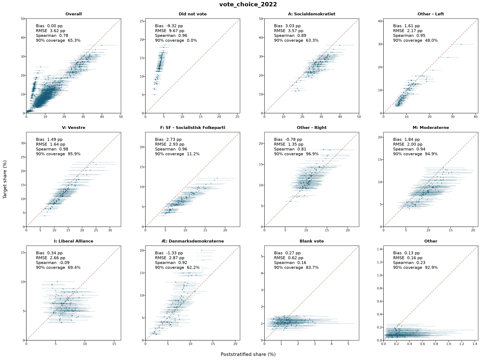
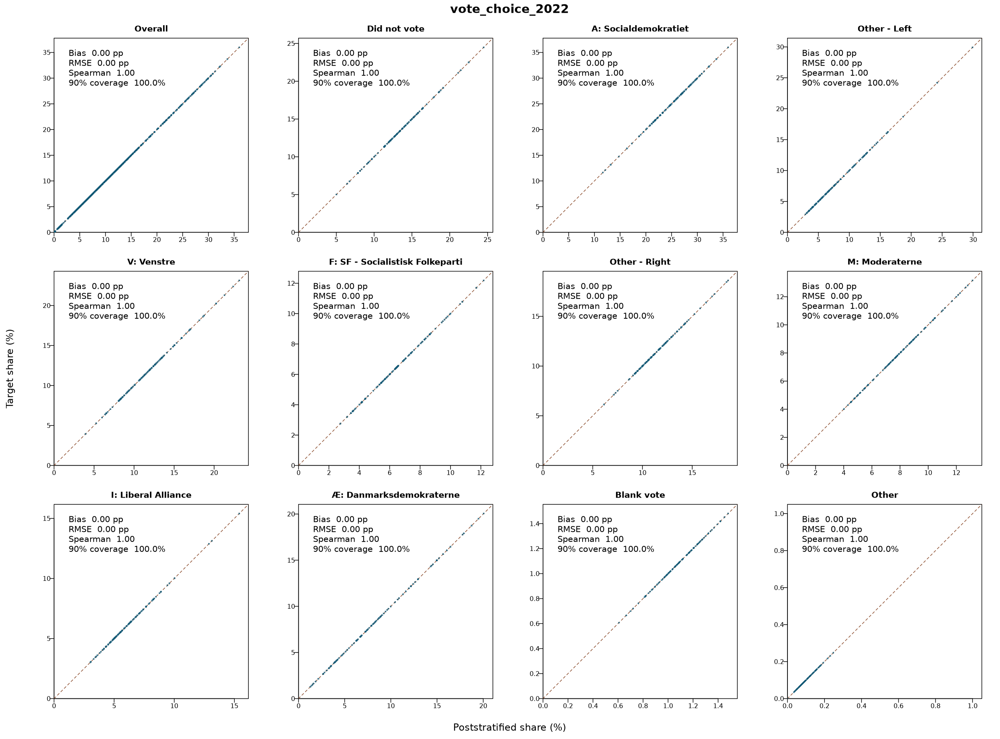
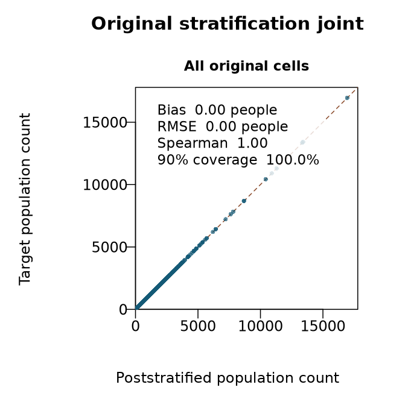
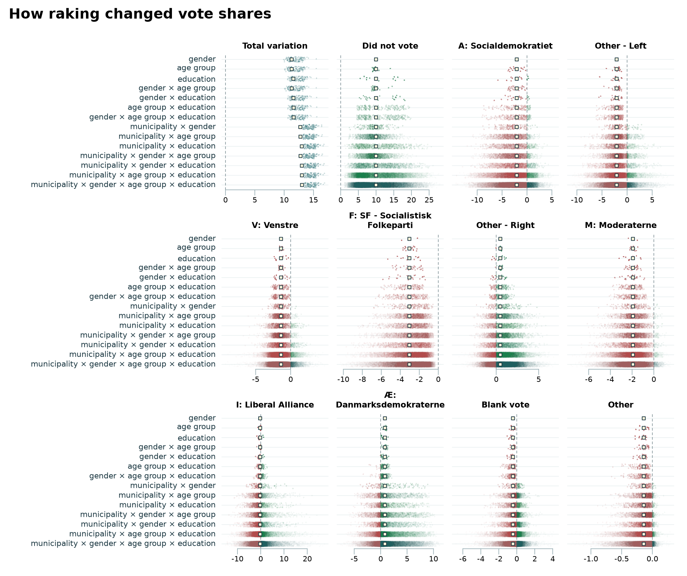

# Extending the Denmark 2026 population frame

This walkthrough fits a sequential logit model for reported 2022 parliamentary
vote choice using the Denmark 2026 case-study inputs. Run the R chunks in
order from the repository root to reproduce the analysis. The captured R
output below shows the results of the saved run. The [input documentation](data/input/denmark%202026/README.md)
describes the source files and recodes.

## Step 1. Load the three inputs

- The auxiliary survey has one row per respondent and records their
  municipality, gender, age group, education, and reported 2022 vote choice.
- The population frame has one row per demographic cell within a municipality.
  `N` is the cell population.
- The election results provide the 2022 share (`pop_pct`) for each recorded
  municipality and outcome pair. These shares will supply an area-level
  predictor.

```{r load-inputs, results="hide", warning=FALSE}
options(scipen = 999)

country <- file.path("data", "input", "denmark 2026")
survey <- read.csv(file.path(country, "auxiliary_survey.csv"), fileEncoding = "UTF-8")
frame <- read.csv(file.path(country, "frame.csv"), fileEncoding = "UTF-8")
election <- read.csv(file.path(country, "election_results.csv"), fileEncoding = "UTF-8")

inputs <- list(survey = survey, frame = frame, election = election)
data.frame(
  input = names(inputs),
  rows = vapply(inputs, nrow, integer(1)),
  municipalities = vapply(inputs, function(input) {
    municipality <- input$municipality
    length(unique(municipality[!is.na(municipality) & nzchar(municipality)]))
  }, integer(1)),
  row.names = NULL
)
lapply(inputs, names)
```

```text
     input  rows municipalities
1   survey  2823             94
2    frame 28980             98
3 election  1078             98
$survey
[1] "municipality"     "gender"           "age_group"        "education"
[5] "vote_choice_2022"

$frame
[1] "municipality" "gender"       "age_group"    "education"    "N"

$election
[1] "vote_choice_2022" "municipality"     "pop_pct"
```

### Auxiliary survey

```{r preview-survey, results="hide", warning=FALSE}
head(survey)
```

```text
  municipality gender age_group
1               Women     30-34
2   Copenhagen    Men     90-94
3   Copenhagen  Women     85-89
4   Copenhagen  Women     80-84
5   Copenhagen    Men     80-84
6   Copenhagen  Women     80-84
                                                            education
1
2 H2010 Upper secondary education, General (stx, hf, student courses)
3                         H30 Vocational Education and Training (VET)
4                         H30 Vocational Education and Training (VET)
5                                    H40 Short cycle higher education
6                                                H70 Masters programs
      vote_choice_2022
1         Did not vote
2         Other - Left
3 A: Socialdemokratiet
4 A: Socialdemokratiet
5       M: Moderaterne
6 A: Socialdemokratiet
```

### Population frame

```{r preview-frame, results="hide", warning=FALSE}
head(frame)
```

```text
  municipality gender age_group
1     Aabenraa    Men     20-24
2     Aabenraa    Men     20-24
3     Aabenraa    Men     20-24
4     Aabenraa    Men     20-24
5     Aabenraa    Men     20-24
6     Aabenraa    Men     20-24
                                                            education         N
1                                  H1020 Primary school 7th-9th grade 169.48616
2                                     H1030 Primary school 10th grade 289.06228
3 H2010 Upper secondary education, General (stx, hf, student courses) 177.80450
4                 H2020 Upper secondary education, General (hhx, htx) 162.20761
5                         H30 Vocational Education and Training (VET) 373.28547
6                                    H40 Short cycle higher education  17.67647
```

### 2022 election results

```{r preview-election, results="hide", warning=FALSE}
head(election)
```

```text
                 vote_choice_2022 municipality    pop_pct
1            A: Socialdemokratiet     Aabenraa 0.24700637
2                      Blank vote     Aabenraa 0.01250955
3                    Did not vote     Aabenraa 0.13123567
4 F: SF - Socialistisk Folkeparti     Aabenraa 0.03704459
5             I: Liberal Alliance     Aabenraa 0.05691720
6                  M: Moderaterne     Aabenraa 0.06970701
```

The survey has 2,823 respondents in 94 municipalities. The frame has 28,980
cells, and the election file has 1,078 municipality-outcome rows. Both cover
98 municipalities. These are raw input counts before applying the model's
complete-case rules.

## Step 2. Check missing values and survey-to-frame coverage

The four columns that define a cell are municipality, gender, age group,
and education. The fitter also needs a recorded outcome for each respondent
it uses. An empty string or `NA` in any of those five columns makes the
row incomplete.

```{r check-missing, results="hide", warning=FALSE}
predictors <- c("municipality", "gender", "age_group", "education")
outcome <- "vote_choice_2022"

missing <- function(x) is.na(x) | as.character(x) == ""
lapply(inputs, function(input) vapply(input, function(x) sum(missing(x)), integer(1)))

source(file.path("R", "prepare_sequential_data.R"))
survey_cells <- aggregate_extension_survey(
  survey, extension_variable = outcome, predictors = predictors,
  no_vote = "Did not vote"
)
c(
  complete_respondents = sum(survey_cells$counts),
  omitted_respondents = survey_cells$omitted,
  distinct_complete_cells = nrow(survey_cells$cells)
)
```

```text
$survey
    municipality           gender        age_group        education
              11               14               10              158
vote_choice_2022
              51

$frame
municipality       gender    age_group    education            N
           0            0            0            0            0

$election
vote_choice_2022     municipality          pop_pct
               0                0                0

Warning: Removed 221 incomplete survey rows before aggregation.
   complete_respondents     omitted_respondents distinct_complete_cells
                   2602                     221                    2088
```

The fitter's aggregation helper keeps 2,602 respondents in 2,088
distinct cells and reports 221 incomplete rows.

```{r check-coverage, results="hide", warning=FALSE}
survey_areas <- unique(survey$municipality[!missing(survey$municipality)])
setdiff(frame$municipality, survey_areas)
setdiff(survey_areas, frame$municipality)
setdiff(frame$municipality, election$municipality)

frame_cells <- frame[predictors]
stopifnot(!anyDuplicated(frame_cells))
frame_cells$in_frame <- TRUE

survey_with_cell <- survey[
  rowSums(sapply(survey[predictors], missing)) == 0, , drop = FALSE
]
survey_matches <- merge(
  survey_with_cell, frame_cells, by = predictors, all.x = TRUE, sort = FALSE
)
survey_only <- survey_matches[is.na(survey_matches$in_frame), , drop = FALSE]
c(
  survey_only_cells = nrow(unique(survey_only[predictors])),
  survey_only_respondents = nrow(survey_only),
  survey_only_with_outcome = sum(!missing(survey_only[[outcome]]))
)
```

```text
[1] "Fanø"  "Læsø"  "Samsø" "Ærø"
character(0)
character(0)
       survey_only_cells  survey_only_respondents survey_only_with_outcome
                      62                       67                       64
```

Fanø, Læsø, Samsø, and Ærø are in the frame and the election results,
and have no recorded survey respondents. There are also 62 demographic
combinations that appear only in the survey. They account for 67
respondents, 64 of whom recorded a vote choice. Those 64 meet the fitter's
complete-case rule. The population frame defines which cells will receive
predictions.

## Step 3. Build the stage-specific municipality predictors

Use the outcome order from Step 2 to make one matrix per fitted stage.
Each stage uses the original `pop_pct` for its outcome, with the same
municipality population denominator throughout. The last outcome receives
the remaining model probability, so it has no fitted stage. Each matrix
has one row per municipality and one column named `vote_share_2022`.
Additional area covariates can have their own columns and retain their
original units.

```{r build-area-predictors, results="hide"}
source(file.path("R", "process_area_covariates.R"))
historical_shares <- process_area_covariates(
  election,
  area_variable = "municipality",
  outcome_variable = outcome,
  value_variable = "pop_pct"
)

stage_outcomes <- head(survey_cells$outcome_order, -1L)
area_covariates <- setNames(lapply(stage_outcomes, function(stage_outcome) {
  shares <- historical_shares[, stage_outcome, drop = FALSE]
  colnames(shares) <- "vote_share_2022"
  shares
}), stage_outcomes)

stopifnot(all(vapply(area_covariates, function(stage) {
  setequal(rownames(stage), frame$municipality) &&
    all(is.finite(stage) & stage >= 0 & stage <= 1)
}, logical(1))))

data.frame(
  stage = seq_along(area_covariates),
  outcome = names(area_covariates),
  row.names = NULL
)
```

```text
stage                         outcome
1      1                    Did not vote
2      2            A: Socialdemokratiet
3      3                    Other - Left
4      4                      V: Venstre
5      5 F: SF - Socialistisk Folkeparti
6      6                   Other - Right
7      7                  M: Moderaterne
8      8             I: Liberal Alliance
9      9         Æ: Danmarksdemokraterne
10    10                      Blank vote
```

## Step 4. Inspect the candidate formulas and selected depths

At each stage, only respondents who did not choose an earlier outcome are eligible.
The fitter starts at the requested depth of 2 and tries shallower formulas
until the candidate has at most one coefficient per eligible respondent.
If every candidate exceeds that limit, the fitter warns and attempts depth 0.
The count uses the stage's survey data. The formula builder excludes terms
that let a municipality-level predictor's slope or smooth vary within
municipality, where the predictor is constant. The final outcome,
`Other`, receives the probability left after the ten fitted stages.

The raw counts use all recorded vote choices, including responses with
missing demographics. At each stage, “for” counts the current outcome and
“against” counts the later outcomes. Both percentages use their sum as the
denominator. The `respondents` column gives the eligible complete-case
count used to select the depth.

```{r inspect-stage-designs, results="hide"}
source(file.path("R", "build_sequential_formula.R"))
source(file.path("R", "fit_sequential_logit.R"))

requested_depth <- 2
stage_designs <- lapply(seq_along(stage_outcomes), function(i) {
  remaining <- seq.int(i, length(survey_cells$outcome_order))
  trials <- rowSums(survey_cells$counts[, remaining, drop = FALSE])
  stage <- join_stage_covariates(
    survey_cells$cells[trials > 0, , drop = FALSE],
    "municipality", area_covariates[[i]]
  )
  area_predictors <- setdiff(names(stage), predictors)
  selected <- select_sequential_stage_design(
    stage, "municipality", requested_depth, splines = TRUE,
    area_predictors = area_predictors, observations = sum(trials)
  )

  summary <- data.frame(
    outcome = stage_outcomes[i],
    respondents = sum(trials),
    selected_depth = selected$design$depth,
    selected_coefficients = selected$design$parameter_count,
    tried_depth_and_count = paste(selected$attempted, collapse = ", ")
  )
  list(summary = summary, formula = selected$design$formula)
})
stage_summary <- lapply(stage_designs, function(stage) stage$summary)
last_outcome <- tail(survey_cells$outcome_order, 1L)
remaining_outcome <- data.frame(
  outcome = last_outcome,
  respondents = sum(survey_cells$counts[, last_outcome]),
  selected_depth = NA_real_,
  selected_coefficients = NA_real_,
  tried_depth_and_count = "No separate model"
)
stage_table <- rbind(do.call(rbind, stage_summary), remaining_outcome)
recorded_votes <- survey[[outcome]][!missing(survey[[outcome]])]
raw_for <- as.integer(table(factor(recorded_votes, levels = stage_table$outcome)))
raw_eligible <- rev(cumsum(rev(raw_for)))
raw_against <- raw_eligible - raw_for
stage_table$raw_for <- raw_for
stage_table$raw_for_pct <- round(100 * raw_for / raw_eligible, 1)
stage_table$raw_against <- raw_against
stage_table$raw_against_pct <- round(100 * raw_against / raw_eligible, 1)
stage_table[c("outcome", "raw_for", "raw_for_pct", "raw_against",
              "raw_against_pct", "respondents", "selected_depth",
              "selected_coefficients", "tried_depth_and_count")]
```

```text
                           outcome raw_for raw_for_pct raw_against
1                     Did not vote     123         4.4        2649
2             A: Socialdemokratiet     709        26.8        1940
3                     Other - Left     405        20.9        1535
4                       V: Venstre     346        22.5        1189
5  F: SF - Socialistisk Folkeparti     287        24.1         902
6                    Other - Right     274        30.4         628
7                   M: Moderaterne     259        41.2         369
8              I: Liberal Alliance     168        45.5         201
9          Æ: Danmarksdemokraterne     157        78.1          44
10                      Blank vote      37        84.1           7
11                           Other       7       100.0           0
   raw_against_pct respondents selected_depth selected_coefficients
1             95.6        2602              1                   147
2             73.2        2503              1                   147
3             79.1        1840              1                   147
4             77.5        1456              1                   147
5             75.9        1129              1                   147
6             69.6         855              1                   147
7             58.8         599              1                   145
8             54.5         349              1                   137
9             21.9         190              1                   120
10            15.9          39              0                    30
11             0.0           5             NA                    NA
                tried_depth_and_count
1                       2=2878, 1=147
2                       2=2847, 1=147
3                       2=2606, 1=147
4                       2=2497, 1=147
5                       2=2317, 1=147
6                       2=2151, 1=147
7                       2=1928, 1=145
8                       2=1590, 1=137
9                       2=1222, 1=120
10 2=439, 1=62, 0.75=55, 0.5=54, 0=30
11                  No separate model
```

### Selected formulas

Stages can share a formula structure while using different eligible
respondents, area predictor values, and fitted coefficients. Each distinct
selected formula appears once below.

```{r selected-formulas, results="hide"}
formula_text <- vapply(stage_designs, function(stage) {
  paste(deparse(stage$formula), collapse = "\n")
}, character(1))
for (formula in unique(formula_text)) {
  stages <- which(formula_text == formula)
  cat("Depth", stage_table$selected_depth[stages[1L]], "\n")
  cat("Outcomes:", paste(stage_outcomes[stages], collapse = "; "), "\n")
  cat(formula, "\n\n")
}
```

```text
Depth 1
Outcomes: Did not vote; A: Socialdemokratiet; Other - Left; V: Venstre; F: SF - Socialistisk Folkeparti; Other - Right; M: Moderaterne; I: Liberal Alliance; Æ: Danmarksdemokraterne
cbind(.success, .failure) ~ 1 + vote_share_2022 + (1 | municipality) +
    (1 | gender) + (1 | age_group) + (1 | education) + v_s(vote_share_2022)

Depth 0
Outcomes: Blank vote
cbind(.success, .failure) ~ 1 + (1 | municipality)
```

## Step 5. Fit the ten outcome models

Run the fit at requested depth 2 using the stage matrices from Step 3 and
the population frame from Step 1. The fitter reports when it starts
preparing each outcome, which depth it selects, and when the model returns.
The engine prints optimization progress, and R prints warnings as they
occur. A fitting error stops the run and preserves the failure in the stage
log.

```{r fit-denmark, results="hide", warning=FALSE, message=FALSE}
for (file in list.files("R", pattern = "[.]R$", full.names = TRUE)) source(file)

options(warn = 1)
set.seed(2026)
control <- vglmer::vglmer_control(quiet = FALSE, print_prog = 100)
fit_dir <- file.path("data", "output", "denmark-2026-fit")
dir.create(fit_dir, recursive = TRUE, showWarnings = FALSE)

message("Fitting the Denmark outcome models with vglmer ",
        packageVersion("vglmer"), " on R ", getRversion(), ".")
fit <- fit_sequential_logit(
  auxiliary_survey = survey,
  extension_variable = outcome,
  area_variable = "municipality",
  area_covariates = area_covariates,
  no_vote = "Did not vote",
  depth = requested_depth,
  predictors = predictors,
  control = control,
  frame = frame,
  log_file = file.path(fit_dir, "fit_log.csv")
)

saveRDS(fit, file.path(fit_dir, "fit.rds"))
saveRDS(list(seed = 2026, control = control, session = sessionInfo()),
        file.path(fit_dir, "run_settings.rds"))
message("Saved the fit, stage log, and run settings in ", fit_dir, ".")

iterations <- vapply(fit$stages, function(stage) {
  as.integer(stage$fit$internal_parameters$it_used)
}, integer(1))
iteration_limit <- vapply(fit$stages, function(stage) {
  as.integer(stage$fit$internal_parameters$it_max)
}, integer(1))
data.frame(
  outcome = fit$outcome_order[seq_along(iterations)],
  depth = fit$fit_log$fitted_depth,
  iterations = unname(iterations),
  reached_iteration_limit = unname(iterations >= iteration_limit)
)
```

<details>
<summary>Model fitting log</summary>

```text
Fitting the Denmark outcome models with vglmer 1.0.8 on R 4.5.3.
Warning: Removed 221 incomplete survey rows before aggregation.
Stage 1/10 ‘Did not vote’ — preparing data and selecting depth.
Stage 1/10 ‘Did not vote’ — fitting at depth 1 (requested 2) with 2602 eligible respondents and 147 estimated coefficients.
Begin Regression
Converged after 43 iterations with ELBO change of 0.000000006
The largest change in any variational parameter was 0.000022
Stage 1/10 ‘Did not vote’ — registering frame levels.
Stage 1/10 ‘Did not vote’ — model returned (1 of 10 completed).
Stage 2/10 ‘A: Socialdemokratiet’ — preparing data and selecting depth.
Stage 2/10 ‘A: Socialdemokratiet’ — fitting at depth 1 (requested 2) with 2503 eligible respondents and 147 estimated coefficients.
Begin Regression
Converged after 13 iterations with ELBO change of 0
The largest change in any variational parameter was 0.000001
Stage 2/10 ‘A: Socialdemokratiet’ — registering frame levels.
Stage 2/10 ‘A: Socialdemokratiet’ — model returned (2 of 10 completed).
Stage 3/10 ‘Other - Left’ — preparing data and selecting depth.
Stage 3/10 ‘Other - Left’ — fitting at depth 1 (requested 2) with 1840 eligible respondents and 147 estimated coefficients.
Begin Regression
Converged after 22 iterations with ELBO change of 0.000000009
The largest change in any variational parameter was 0.000161
Stage 3/10 ‘Other - Left’ — registering frame levels.
Stage 3/10 ‘Other - Left’ — model returned (3 of 10 completed).
Stage 4/10 ‘V: Venstre’ — preparing data and selecting depth.
Stage 4/10 ‘V: Venstre’ — fitting at depth 1 (requested 2) with 1456 eligible respondents and 147 estimated coefficients.
Begin Regression
Converged after 14 iterations with ELBO change of 0.000000008
The largest change in any variational parameter was 0.00002
Stage 4/10 ‘V: Venstre’ — registering frame levels.
Stage 4/10 ‘V: Venstre’ — model returned (4 of 10 completed).
Stage 5/10 ‘F: SF - Socialistisk Folkeparti’ — preparing data and selecting depth.
Stage 5/10 ‘F: SF - Socialistisk Folkeparti’ — fitting at depth 1 (requested 2) with 1129 eligible respondents and 147 estimated coefficients.
Begin Regression
Converged after 10 iterations with ELBO change of 0.000000009
The largest change in any variational parameter was 0.000025
Stage 5/10 ‘F: SF - Socialistisk Folkeparti’ — registering frame levels.
Stage 5/10 ‘F: SF - Socialistisk Folkeparti’ — model returned (5 of 10 completed).
Stage 6/10 ‘Other - Right’ — preparing data and selecting depth.
Stage 6/10 ‘Other - Right’ — fitting at depth 1 (requested 2) with 855 eligible respondents and 147 estimated coefficients.
Begin Regression
Converged after 15 iterations with ELBO change of 0.000000003
The largest change in any variational parameter was 0.000013
Stage 6/10 ‘Other - Right’ — registering frame levels.
Stage 6/10 ‘Other - Right’ — model returned (6 of 10 completed).
Stage 7/10 ‘M: Moderaterne’ — preparing data and selecting depth.
Stage 7/10 ‘M: Moderaterne’ — fitting at depth 1 (requested 2) with 599 eligible respondents and 145 estimated coefficients.
Begin Regression
Converged after 13 iterations with ELBO change of 0.000000003
The largest change in any variational parameter was 0.000065
Stage 7/10 ‘M: Moderaterne’ — registering frame levels.
Stage 7/10 ‘M: Moderaterne’ — model returned (7 of 10 completed).
Stage 8/10 ‘I: Liberal Alliance’ — preparing data and selecting depth.
Stage 8/10 ‘I: Liberal Alliance’ — fitting at depth 1 (requested 2) with 349 eligible respondents and 137 estimated coefficients.
Begin Regression
Converged after 13 iterations with ELBO change of 0.000000006
The largest change in any variational parameter was 0.000195
Stage 8/10 ‘I: Liberal Alliance’ — registering frame levels.
Stage 8/10 ‘I: Liberal Alliance’ — model returned (8 of 10 completed).
Stage 9/10 ‘Æ: Danmarksdemokraterne’ — preparing data and selecting depth.
Stage 9/10 ‘Æ: Danmarksdemokraterne’ — fitting at depth 1 (requested 2) with 190 eligible respondents and 120 estimated coefficients.
Begin Regression
Converged after 20 iterations with ELBO change of 0.000000001
The largest change in any variational parameter was 0.000232
Stage 9/10 ‘Æ: Danmarksdemokraterne’ — registering frame levels.
Stage 9/10 ‘Æ: Danmarksdemokraterne’ — model returned (9 of 10 completed).
Stage 10/10 ‘Blank vote’ — preparing data and selecting depth.
Stage 10/10 ‘Blank vote’ — fitting at depth 0 (requested 2) with 39 eligible respondents and 30 estimated coefficients.
Begin Regression
Converged after 11 iterations with ELBO change of 0.000000002
The largest change in any variational parameter was 0.00001
Stage 10/10 ‘Blank vote’ — registering frame levels.
Stage 10/10 ‘Blank vote’ — model returned (10 of 10 completed).
Saved the fit, stage log, and run settings in data/output/denmark-2026-fit.
```

</details>

```text
                           outcome depth iterations reached_iteration_limit
1                     Did not vote     1         43                   FALSE
2             A: Socialdemokratiet     1         13                   FALSE
3                     Other - Left     1         22                   FALSE
4                       V: Venstre     1         14                   FALSE
5  F: SF - Socialistisk Folkeparti     1         10                   FALSE
6                    Other - Right     1         15                   FALSE
7                   M: Moderaterne     1         13                   FALSE
8              I: Liberal Alliance     1         13                   FALSE
9          Æ: Danmarksdemokraterne     1         20                   FALSE
10                      Blank vote     0         11                   FALSE
```

## Step 6. Predict vote probabilities and extend the frame

Generate 125 posterior draws from the saved fit. Step 5 stored the frame
in `fit$frame`, which `predict_sequential_logit()` uses by default.
The prediction function combines the conditional stage probabilities into one probability per
outcome, cell, and draw. It writes the probability array and a CSV with
one row per cell and outcome. The original frame has 28,980 demographic
cells. Extending each cell across 11 outcomes gives 318,780 cell–outcome
rows. In the extended frame, `N` is the arithmetic mean of the 125 expected
counts in `N_draw_1` through `N_draw_125` for that row.

```{r predict-denmark, results="hide", message=FALSE, warning=FALSE}
for (file in list.files("R", pattern = "[.]R$", full.names = TRUE)) source(file)
fit_dir <- file.path("data", "output", "denmark-2026-fit")
fit <- readRDS(file.path(fit_dir, "fit.rds"))
set.seed(2026)
message("Drawing 125 posterior predictions per frame cell and outcome.")
posterior <- predict_sequential_logit(fit, n_draws = 125, output_dir = fit_dir)
dimensions <- dim(posterior$draws)
print(setNames(dimensions, c("frame_cells", "outcomes", "draws")))
print(basename(c(posterior$posterior_file, posterior$extended_frame_file)))
```

```text
Drawing 125 posterior predictions per frame cell and outcome.
frame_cells    outcomes       draws
      28980          11         125
[1] "posterior_probabilities.rds" "extended_frame.csv"
```

### Preview the extended frame

The first six rows show different outcomes for the same demographic
cell. The preview displays three of the 125 draw columns.

```{r preview-extended-frame, results="hide"}
extended_preview <- read.csv(posterior$extended_frame_file, nrows = 6)
preview_columns <- c(names(posterior$cells), posterior$extension_variable,
                     posterior$count_variable,
                     head(dimnames(posterior$draws)[[3L]], 3L))
print(extended_preview[preview_columns], row.names = FALSE)
```

```text
 municipality gender age_group                          education
     Aabenraa    Men     20-24 H1020 Primary school 7th-9th grade
     Aabenraa    Men     20-24 H1020 Primary school 7th-9th grade
     Aabenraa    Men     20-24 H1020 Primary school 7th-9th grade
     Aabenraa    Men     20-24 H1020 Primary school 7th-9th grade
     Aabenraa    Men     20-24 H1020 Primary school 7th-9th grade
     Aabenraa    Men     20-24 H1020 Primary school 7th-9th grade
                vote_choice_2022         N  N_draw_1  N_draw_2  N_draw_3
                    Did not vote  5.242101  3.668051  5.137503  7.465239
            A: Socialdemokratiet 29.949444 22.093253 31.060676 37.621455
                    Other - Left  9.833688 10.489422 25.230359  8.916253
                      V: Venstre 23.332528 21.778710 22.743809 20.232992
 F: SF - Socialistisk Folkeparti  6.721910  8.810337  4.448490  6.349729
                   Other - Right 28.867785 33.540976 24.131427 31.381665
```

Check that the outcome probabilities sum to one for each cell and draw,
and that the expected counts in the exported CSV sum back to the original
cell populations. Read the CSV in blocks of complete cells.

```{r check-prediction-totals, results="hide"}
frame <- fit$frame
outcomes <- fit$outcome_order
n_outcomes <- length(outcomes)
draw_columns <- dimnames(posterior$draws)[[3L]]
probability_error <- max(vapply(seq_along(draw_columns), function(i) {
  probabilities <- posterior$draws[, , i]
  stopifnot(all(is.finite(probabilities) & probabilities >= 0 & probabilities <= 1))
  max(abs(rowSums(probabilities) - 1))
}, numeric(1)))

check_export <- function(path, frame) {
  input <- file(path, open = "rt")
  on.exit(close(input))
  columns <- names(read.csv(text = readLines(input, n = 1L), nrows = 0))
  count_columns <- c(posterior$count_variable, draw_columns)
  stopifnot(identical(columns, c(names(posterior$cells),
                                 posterior$extension_variable, count_columns)))
  column_types <- ifelse(columns %in% count_columns, "numeric", "character")
  max_error <- 0
  exported_rows <- 0L
  for (start in seq.int(1L, nrow(frame), by = 1000L)) {
    cells <- start:min(start + 999L, nrow(frame))
    lines <- readLines(input, n = length(cells) * n_outcomes)
    block <- read.csv(text = lines, header = FALSE, col.names = columns,
                      colClasses = column_types)
    cell_rows <- rep(cells, each = n_outcomes)
    stopifnot(
      nrow(block) == length(cell_rows),
      identical(block[[fit$extension_variable]], rep(outcomes, length(cells))),
      all(vapply(names(posterior$cells), function(key) {
        identical(block[[key]], frame[[key]][cell_rows])
      }, logical(1)))
    )
    counts <- as.matrix(block[count_columns])
    stopifnot(all(is.finite(counts) & counts >= 0))
    totals <- rowsum(counts, rep(seq_along(cells), each = n_outcomes))
    max_error <- max(max_error, abs(totals - frame$N[cells]))
    exported_rows <- exported_rows + nrow(block)
  }
  stopifnot(length(readLines(input, n = 1L)) == 0L)
  c(exported_rows = exported_rows, max_count_error = max_error)
}

export_check <- check_export(posterior$extended_frame_file, frame)
stopifnot(probability_error < 0.000000000001,
          export_check[["max_count_error"]] < 0.00000001)
cat("Extended frame rows:", export_check[["exported_rows"]], "\n")
cat("Maximum probability sum error:",
    formatC(probability_error, format = "f", digits = 16), "\n")
cat("Maximum population count error:",
    formatC(export_check[["max_count_error"]], format = "f", digits = 12), "\n")
```

```text
Extended frame rows: 318780
Maximum probability sum error: 0.0000000000000004
Maximum population count error: 0.000000000018
```

## Step 7. Compare poststratified estimates with a target

Pass the extended frame and target shares to `check_extended_frame()`.
Set `by` to the columns that identify the target groups. Here we use
municipality. An education-level target would use `by = "education"`
and contain one row per education level and outcome.

The check sums expected counts across the other frame dimensions and
divides by the total population of each target group. It does this for
the posterior mean counts and for each draw. For Denmark, the target is
the original 2022 `pop_pct`, which also supplies the area predictor.
This is an agreement check against that target. Other applications can
supply target data from a separate source.

```{r check-denmark-target, results="hide"}
extended_path <- posterior$extended_frame_file
header <- names(read.csv(text = readLines(extended_path, n = 1L), nrows = 0))
count_columns <- c(posterior$count_variable, dimnames(posterior$draws)[[3L]])
column_types <- ifelse(header %in% count_columns, "numeric", "character")
extended <- read.csv(extended_path, colClasses = column_types)

target_check <- check_extended_frame(
  extended, election,
  by = "municipality",
  extension_variable = "vote_choice_2022",
  target_variable = "pop_pct",
  plot_file = file.path(fit_dir, "municipality_target_check.png"),
  outcome_order = fit$outcome_order
)
cat("Matched municipality–outcome pairs:", nrow(target_check$comparison), "\n")
print(round(target_check$metrics, 2))
```

```text
Matched municipality–outcome pairs: 1078
                                bias_pp RMSE_pp spearman coverage_90_pct
Overall                            0.00    3.62     0.78           65.31
Did not vote                      -9.32    9.67     0.96            0.00
A: Socialdemokratiet               3.03    3.57     0.89           63.27
Other - Left                       1.61    2.17     0.95           47.96
V: Venstre                         1.49    1.64     0.98           95.92
F: SF - Socialistisk Folkeparti    2.73    2.93     0.96           11.22
Other - Right                     -0.78    1.35     0.81           96.94
M: Moderaterne                     1.84    2.00     0.94           94.90
I: Liberal Alliance                0.34    2.66    -0.09           69.39
Æ: Danmarksdemokraterne           -1.33    2.87     0.92           62.24
Blank vote                         0.27    0.62     0.16           83.67
Other                              0.13    0.16     0.23           92.86
```

Each dot is a municipality–outcome pair. The overall panel pools all
pairs and comes first, followed by the outcomes in fitted order. The x-axis
shows the poststratified estimate, and the y-axis shows
the target. The dashed line marks equality, and the horizontal bars give
the 5th to 95th percentiles of the posterior draws. The upper-left corner
of each panel shows its error metrics.
Bias and RMSE are in percentage points. Bias is estimate minus target.
Spearman correlation compares the rankings, and coverage is the
percentage of targets inside their 90% interval. Each municipality has
equal weight within an outcome. A frame with only posterior means produces
the same point comparison and a warning that intervals and coverage
are unavailable.



## Step 8. Rake the extended frame

`rake_with_diagnostics()` runs the rake and generates the outcome, joint-cell,
and change plots. Steps 9 and 10 show the diagnostics it returns.

Use the original stratification frame as the target for every full
demographic cell, and use the 2022 `pop_pct` shares as the outcome
targets within each municipality. The rake uses `SQUAREM::squarem()`
to accelerate iterative proportional fitting. It solves for outcome
scaling factors with demographic-cell shares enforced directly, then
rescales by the original municipality population.

The grouping columns in `by` define the scope of the outcome targets.
For example, `by = "age_group"` targets age groups across municipalities.
Use `by = c("municipality", "age_group")` for joint municipality-by-age
targets. Every original cell total, and therefore every municipality
total, is preserved in either case.

Raking adjusts `N` and every draw independently. In the raked frame,
`N` is the raked posterior mean from the original extended frame.
Because raking is nonlinear, independently raking that column can give
a different result from averaging the raked draws.

```{r rake-denmark, results="hide"}
raking <- rake_with_diagnostics(
  extended, fit$frame, election,
  by = "municipality", extension_variable = fit$extension_variable,
  target_variable = "pop_pct", output_dir = fit_dir,
  outcome_order = fit$outcome_order
)
raked <- raking$frame

cell_columns <- names(posterior$cells)
cell_index <- match(
  frame_cell_keys(raked[cell_columns], fit$frame[cell_columns]),
  frame_cell_keys(fit$frame[cell_columns], fit$frame[cell_columns])
)
cell_totals <- rowsum(raked[count_columns], cell_index)
area_totals <- rowsum(cell_totals, fit$frame$municipality, reorder = FALSE)
target_keys <- c("municipality", fit$extension_variable)
target_reference <- election[target_keys]
area_outcome <- frame_cell_keys(raked[target_keys], target_reference)
raked_outcomes <- rowsum(raked[count_columns], area_outcome, reorder = FALSE)
target_order <- match(frame_cell_keys(target_reference, target_reference),
                      rownames(raked_outcomes))
raked_shares <- as.matrix(raked_outcomes)[target_order, , drop = FALSE] /
  as.matrix(area_totals)[match(election$municipality, rownames(area_totals)), , drop = FALSE]

population_total <- sum(fit$frame$N)
stopifnot(
  nrow(raked) == nrow(extended),
  max(abs(as.matrix(cell_totals) - fit$frame$N)) < 0.00000001,
  max(abs(raked_shares - election$pop_pct)) < 0.000000000002,
  max(abs(colSums(cell_totals) - population_total)) < 0.000001
)
cat("Raked rows:", nrow(raked), "\n")
cat("Raked count columns:", length(count_columns), "\n")
cat("Original population:", population_total, "\n")
cat("Raked population (range across count columns):",
    format(range(colSums(cell_totals)), trim = TRUE), "\n")
cat("Maximum absolute target share error:",
    formatC(max(abs(raked_shares - election$pop_pct)), format = "f", digits = 14), "\n")
```

```text
Raked rows: 318780
Raked count columns: 126
Original population: 4163940
Raked population (range across count columns): 4163940 4163940
Maximum absolute target share error: 0.00000000000001
```

```{r save-raked-frame, results="hide"}
raked_path <- file.path(fit_dir, "raked_extended_frame.csv")
temporary <- tempfile(tmpdir = fit_dir, fileext = ".csv")
for (start in seq.int(1L, nrow(raked), by = 11000L)) {
  rows <- start:min(start + 10999L, nrow(raked))
  write.table(raked[rows, , drop = FALSE], temporary, sep = ",",
              row.names = FALSE, col.names = start == 1L, append = start != 1L)
}
stopifnot(file.rename(temporary, raked_path))
cat("Saved:", basename(raked_path), "\n")
```

```text
Saved: raked_extended_frame.csv
```

## Step 9. Check both margins after raking

The raking engine is `SQUAREM::squarem()`. The VoteFrame wrapper supplies the
matrix-scaling problem and checks both margins after the solver returns.

The raking run calls `check_post_rake()` to draw both target checks. The first repeats the
municipality vote-share comparison. The second sums across vote outcomes
within each original municipality × gender × age × education cell and
compares that total to the original cell population. The municipality
panels use shares, and the original-joint plot uses population counts.

```{r check-denmark-post-rake, results="hide"}
post_rake <- raking$target_check
cat("Outcome targets checked:", nrow(post_rake$outcome$comparison), "\n")
print(round(post_rake$outcome$metrics, 2))
cat("Original joint cells checked:", nrow(post_rake$joint$comparison), "\n")
print(round(post_rake$joint$metrics, 2))
```

```text
Outcome targets checked: 1078
                                bias_pp RMSE_pp spearman coverage_90_pct
Overall                               0       0        1             100
Did not vote                          0       0        1             100
A: Socialdemokratiet                  0       0        1             100
Other - Left                          0       0        1             100
V: Venstre                            0       0        1             100
F: SF - Socialistisk Folkeparti       0       0        1             100
Other - Right                         0       0        1             100
M: Moderaterne                        0       0        1             100
I: Liberal Alliance                   0       0        1             100
Æ: Danmarksdemokraterne               0       0        1             100
Blank vote                            0       0        1             100
Other                                 0       0        1             100
Original joint cells checked: 28980
                   bias_count RMSE_count spearman coverage_90_pct
All original cells          0          0        1             100
```

Coverage here checks whether the raked draws respect the targets used to
constrain them. The comparisons allow for numerical precision when an
interval collapses onto its target.





## Step 10. Visualize changes on margins left unconstrained

The rake preserves the population of every original demographic cell and
the vote-choice totals within each municipality. Within those constraints,
the shares allocated to individual outcomes can move across demographic
groups. The figure covers all 14 groupings of gender, age, and education,
both nationally and within municipality.

For a group $g$, let $p_{gj}$ and $q_{gj}$ be the shares for outcome $j$
before and after raking. **Total variation** here is half the sum of the
absolute changes across outcomes:

$$
\mathrm{TV}_g = \frac{1}{2} \sum_j |q_{gj} - p_{gj}|.
$$

It is the minimum fraction of the group's population that would need to
be reassigned among outcomes to turn one distribution into the other.
For example, if one outcome goes from 25% to 30% and one other outcome
loses five points, total variation is five percentage points. The **Total variation**
panel averages these distances using the groups' original populations
as weights. Its dots show total variation for each paired draw, and its
square shows total variation calculated from the two mean-count columns.

Each outcome panel shows signed changes, raked share minus original
share. On its x-axis, zero means no change and a value of +5 means a
five-point increase, such as a move from 25% to 30%. Negative values
indicate decreases. Red marks decreases and green marks increases. Each
dot is one demographic group, using the
mean-count columns. The square is the population-weighted mean of those
changes. For a given outcome, it stays at the same value as the grouping
changes because each grouping covers the same population. The **Total variation**
x-axis measures how much share moved in total, so
its values are nonnegative. All axes use percentage points, with ranges
that vary by panel. An independent target is needed to evaluate accuracy
on these margins.

```{r visualize-raking-changes, results="hide"}
change_plot <- raking$change_plot
print(basename(change_plot))
```

```text
[1] "raking_changes_diagnostic.png"
```



## Final output. Preview the raked extended frame

The final export is [raked_extended_frame.csv](data/output/denmark-2026-fit/raked_extended_frame.csv),
a Git LFS file. This extract shows all
11 vote outcomes for four original demographic cells spread across the
frame. It displays `N`, the raked mean-count column, and three of the 125
raked draws. Step 8 checks the original joint cell totals and the national
population for all 126 count columns. The original cells also sum to the
original municipality populations. Step 9 shows the municipality outcome
checks.

```{r preview-final-raked-frame, results="hide"}
preview_cells <- round(seq(1L, nrow(fit$frame), length.out = 4L))
draws_to_show <- paste0("N_draw_", c(1, 2, 125))
preview_columns <- c(names(posterior$cells), fit$extension_variable,
                     "N", draws_to_show)
final_preview <- raked[cell_index %in% preview_cells, preview_columns]
final_preview[c("N", draws_to_show)] <- round(final_preview[c("N", draws_to_show)], 3)
preview_width <- options(width = 170)
print(final_preview, row.names = FALSE)
options(preview_width)
```

```text
 municipality gender age_group                                   education                vote_choice_2022       N N_draw_1 N_draw_2 N_draw_125
     Aabenraa    Men     20-24          H1020 Primary school 7th-9th grade                    Did not vote  17.809   13.542   16.233     20.933
     Aabenraa    Men     20-24          H1020 Primary school 7th-9th grade            A: Socialdemokratiet  26.576   19.606   32.306     20.556
     Aabenraa    Men     20-24          H1020 Primary school 7th-9th grade                    Other - Left   6.364    7.436   13.716      4.064
     Aabenraa    Men     20-24          H1020 Primary school 7th-9th grade                      V: Venstre  22.460   22.295   21.328     21.005
     Aabenraa    Men     20-24          H1020 Primary school 7th-9th grade F: SF - Socialistisk Folkeparti   4.184    4.724    2.245      3.265
     Aabenraa    Men     20-24          H1020 Primary school 7th-9th grade                   Other - Right  32.413   34.592   26.736     26.980
     Aabenraa    Men     20-24          H1020 Primary school 7th-9th grade                  M: Moderaterne  13.651   12.796   15.400      8.169
     Aabenraa    Men     20-24          H1020 Primary school 7th-9th grade             I: Liberal Alliance  37.576   47.552   34.549     52.715
     Aabenraa    Men     20-24          H1020 Primary school 7th-9th grade         Æ: Danmarksdemokraterne   7.509    6.369    6.831     10.837
     Aabenraa    Men     20-24          H1020 Primary school 7th-9th grade                      Blank vote   0.875    0.535    0.132      0.897
     Aabenraa    Men     20-24          H1020 Primary school 7th-9th grade                           Other   0.067    0.039    0.010      0.066
      Halsnæs  Women     25-29            H40 Short cycle higher education                    Did not vote   2.244    2.594    2.285      2.569
      Halsnæs  Women     25-29            H40 Short cycle higher education            A: Socialdemokratiet   2.753    1.904    2.594      2.418
      Halsnæs  Women     25-29            H40 Short cycle higher education                    Other - Left   1.992    1.583    1.841      2.179
      Halsnæs  Women     25-29            H40 Short cycle higher education                      V: Venstre   2.558    2.411    2.592      2.288
      Halsnæs  Women     25-29            H40 Short cycle higher education F: SF - Socialistisk Folkeparti   1.759    1.709    2.234      1.880
      Halsnæs  Women     25-29            H40 Short cycle higher education                   Other - Right   2.957    3.715    2.934      2.854
      Halsnæs  Women     25-29            H40 Short cycle higher education                  M: Moderaterne   2.767    2.423    2.055      3.454
      Halsnæs  Women     25-29            H40 Short cycle higher education             I: Liberal Alliance   1.950    2.442    2.229      1.637
      Halsnæs  Women     25-29            H40 Short cycle higher education         Æ: Danmarksdemokraterne   0.538    0.411    0.402      0.486
      Halsnæs  Women     25-29            H40 Short cycle higher education                      Blank vote   0.646    0.945    0.968      0.419
      Halsnæs  Women     25-29            H40 Short cycle higher education                           Other   0.060    0.086    0.088      0.038
        Odder    Men     65-69 H30 Vocational Education and Training (VET)                    Did not vote  44.463   43.870   40.705     36.143
        Odder    Men     65-69 H30 Vocational Education and Training (VET)            A: Socialdemokratiet 113.583  115.215  122.697    119.274
        Odder    Men     65-69 H30 Vocational Education and Training (VET)                    Other - Left  16.751   18.371   16.230     18.916
        Odder    Men     65-69 H30 Vocational Education and Training (VET)                      V: Venstre  32.828   30.712   31.292     27.191
        Odder    Men     65-69 H30 Vocational Education and Training (VET) F: SF - Socialistisk Folkeparti  11.053   12.584   11.871     18.889
        Odder    Men     65-69 H30 Vocational Education and Training (VET)                   Other - Right  32.630   33.400   36.212     28.111
        Odder    Men     65-69 H30 Vocational Education and Training (VET)                  M: Moderaterne  28.646   27.304   22.388     25.946
        Odder    Men     65-69 H30 Vocational Education and Training (VET)             I: Liberal Alliance  10.103    5.659    9.297     13.449
        Odder    Men     65-69 H30 Vocational Education and Training (VET)         Æ: Danmarksdemokraterne  38.172   41.276   36.825     40.400
        Odder    Men     65-69 H30 Vocational Education and Training (VET)                      Blank vote   0.624    0.484    1.263      0.548
        Odder    Men     65-69 H30 Vocational Education and Training (VET)                           Other   0.081    0.058    0.152      0.066
          Ærø  Women     90-94                              H90 Not stated                    Did not vote   0.121    0.158    0.160      0.115
          Ærø  Women     90-94                              H90 Not stated            A: Socialdemokratiet   0.227    0.246    0.195      0.335
          Ærø  Women     90-94                              H90 Not stated                    Other - Left   0.130    0.112    0.123      0.083
          Ærø  Women     90-94                              H90 Not stated                      V: Venstre   0.081    0.085    0.080      0.068
          Ærø  Women     90-94                              H90 Not stated F: SF - Socialistisk Folkeparti   0.064    0.061    0.051      0.065
          Ærø  Women     90-94                              H90 Not stated                   Other - Right   0.076    0.045    0.121      0.052
          Ærø  Women     90-94                              H90 Not stated                  M: Moderaterne   0.055    0.052    0.044      0.068
          Ærø  Women     90-94                              H90 Not stated             I: Liberal Alliance   0.014    0.017    0.006      0.014
          Ærø  Women     90-94                              H90 Not stated         Æ: Danmarksdemokraterne   0.107    0.108    0.100      0.089
          Ærø  Women     90-94                              H90 Not stated                      Blank vote   0.013    0.005    0.009      0.002
          Ærø  Women     90-94                              H90 Not stated                           Other   0.002    0.001    0.001      0.000
```
