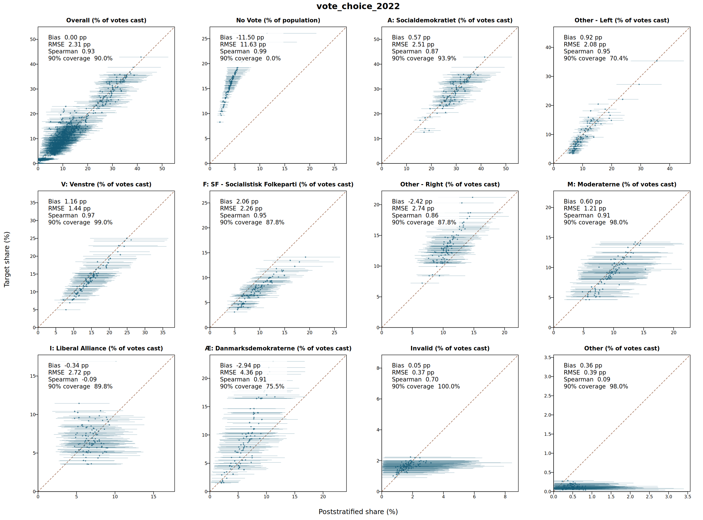
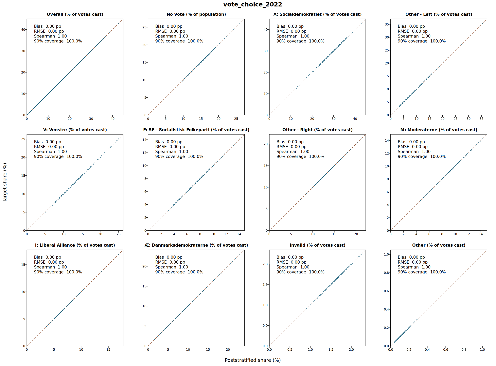
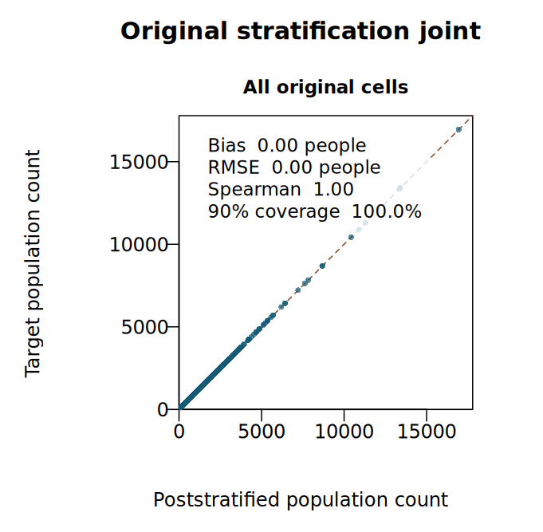
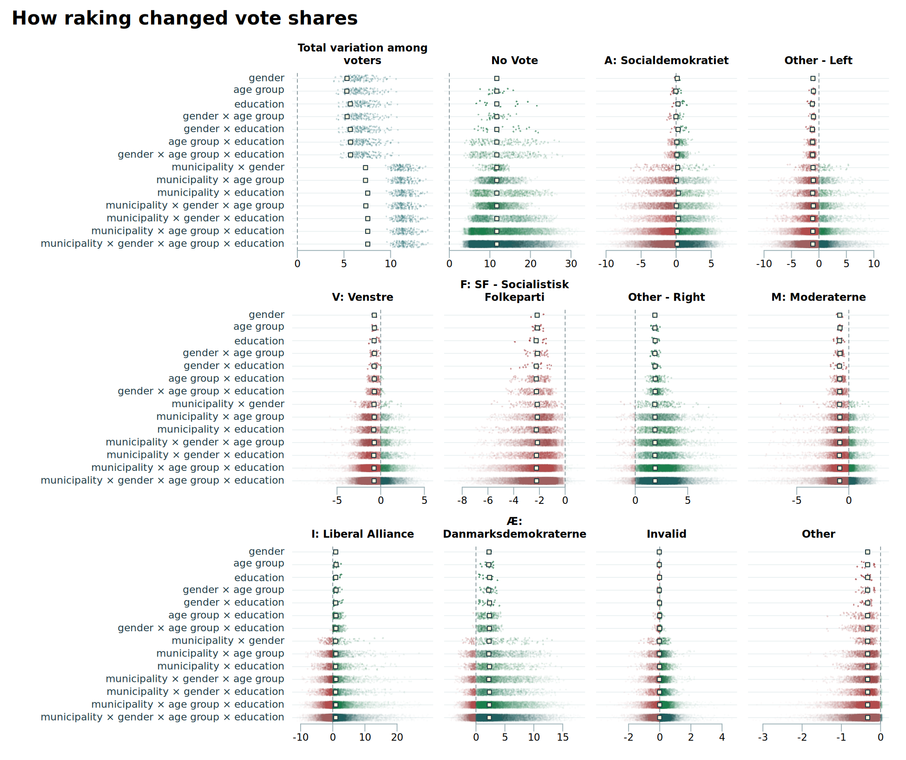

# Extending the Denmark 2026 population frame

This example extends the Denmark population frame with reported 2022
parliamentary vote choice. It fits one model per sequential stage,
predicts into the population frame, and calibrates the resulting counts
to municipal election shares. The
[input guide](../data/input/denmark%202026/README.md) documents the
source data and outcome recodes.

## Read and inspect the inputs

*Snippet 1. Read the population frame, survey, and election results and check their keys.*

```{r inputs}
knitr::opts_chunk$set(error = FALSE)
for (file in list.files("R", pattern = "[.]R$", full.names = TRUE)) source(file)

country <- file.path("data", "input", "denmark 2026")
survey <- read.csv(file.path(country, "auxiliary_survey.csv"), fileEncoding = "UTF-8")
frame <- read.csv(file.path(country, "frame.csv"), fileEncoding = "UTF-8")
election <- read.csv(file.path(country, "election_results.csv"), fileEncoding = "UTF-8")
area <- "municipality"
parent_area <- Sys.getenv("VOTEFRAME_PARENT_AREA", "constituency")
areas_per_batch <- vignette_areas_per_batch()
outcome <- "vote_choice_2022"
no_vote <- "No Vote"
predictors <- c(area, "gender", "age_group", "education")
out <- Sys.getenv("VOTEFRAME_DENMARK_OUTPUT_DIR",
                  unset = file.path("data", "output", basename(country)))
outputs <- case_study_outputs(out)
figure_dir <- file.path("vignettes", "assets", "denmark-2026")
dir.create(figure_dir, recursive = TRUE, showWarnings = FALSE)

stopifnot(!anyDuplicated(frame[predictors]),
          setequal(frame[[area]], election[[area]]))
cells <- aggregate_extension_survey(
  survey, extension_variable = outcome, predictors = predictors, no_vote = no_vote
)
```

*Snippet 2. Report how many respondents and population cells enter the example.*

```{r input-counts}
c(survey_rows = nrow(survey), complete_respondents = sum(cells$counts),
  omitted_respondents = cells$omitted, population_cells = nrow(frame),
  municipalities = length(unique(frame[[area]])))
```

## Prepare the municipality predictors

`process_area_covariates()` makes a matrix of historical shares with one
row per municipality. Each fitted stage uses the historical population
share for its own outcome. The first stage models nonvoting. Later
stages use respondents whose choices remain after removing the earlier
outcomes. The final choice receives the remaining probability.

*Snippet 3. Build municipality-level predictors from the earlier election.*

```{r area-predictors}
historical <- process_area_covariates(election, area, outcome, "share_eligible")
stage_outcomes <- head(cells$outcome_order, -1L)
area_covariates <- setNames(lapply(stage_outcomes, function(choice) {
  share <- historical[, choice, drop = FALSE]
  colnames(share) <- "vote_share_2022"
  share
}), stage_outcomes)
cells$outcome_order
```

## Select and fit the sequential models

`fit_sequential_logit()` starts each stage's search at **depth 4**.
It screens support, prunes collinear fixed columns while preserving
hierarchy, and reduces depth if the retained design exceeds the
respondent budget. The fit log records the selected designs, the
columns removed, and the solver diagnostics. In Table 1, `returned` means
the solver produced a model. With the settings below, convergence requires
`max_parameter_change` to fall below 0.01. If a stage reaches 100
iterations at or above that threshold, its predictions use the last iterate.

*Snippet 4. Fit and save the sequential vote-choice stages.*

```{r fit, message=FALSE, warning=FALSE, results="hide"}
requested_depth <- 4L
minimum_support <- 10L
set.seed(2026)
control <- vglmer::vglmer_control(quiet = FALSE, print_prog = 1L)
fit <- withCallingHandlers(
  fit_sequential_logit(
    survey, outcome, area, area_covariates,
    no_vote = no_vote, outcome_order = cells$outcome_order,
    predictors = predictors, frame = frame, depth = requested_depth,
    splines = TRUE, control = control, minimum_support = minimum_support,
    tolerance_parameters = 0.01, tolerance_elbo = 0, max_iterations = 100L,
    interaction_support_log = file.path(outputs$diagnostics, "interaction_support.csv"),
    log_file = file.path(outputs$diagnostics, "fit_log.csv")
  ),
  message = function(m) cat(conditionMessage(m), file = stderr())
)
save_case_study_rds(fit, file.path(outputs$models, "fit.rds"))
```

*Snippet 5. Display the selected designs and convergence results for each fitted stage.*

```{r design-and-fit-log}
fields <- c("outcome", "observations", "fitted_depth", "retained_order",
            "estimated_retained_parameters",
            "dropped_fixed", "dropped_scalar_random", "dropped_correlated_random",
            "dropped_smooth", "fixed_condition_after", "iterations_used",
            "max_parameter_change", "status")
knitr::kable(fit$fit_log[fields])
```

*Table 1. Fitted stages, with sample sizes, retained design, screened coefficients, and convergence diagnostics.*

The `fitted_depth` column gives the selected candidate depth. The
`retained_order` column counts the predictors in the largest surviving term.
For example, `fit$stages[["Invalid"]]$formula` shows the terms fitted for
invalid ballots.

## Predict and check municipal vote shares before raking

`predict_sequential_logit()` draws the outcomes' cell probabilities.
`aggregate_extended_frame()` multiplies probabilities by population
counts and keeps a row for every original cell and vote choice. The
municipal comparison uses shares **among voters** for party choices and
shares **of the full population** for nonvoting. The among-voters
denominator includes invalid ballots. Posterior intervals
use each draw's own turnout denominator.

The 2022 municipal results also enter as predictors. This comparison
measures agreement with the calibration targets. Prediction and raking
batch by constituency by default, keeping each municipality intact.

*Snippet 6. Predict vote choice in geographic batches and expand population counts into choice categories.*

```{r predict}
n_draws <- 125L
frame_rows <- geographic_batches(frame, area, parent_area, areas_per_batch)
part_bytes <- pre_rake_frame_bytes(lengths(frame_rows) * length(fit$outcome_order),
                                   n_draws, ncol(frame))
storage <- vignette_pre_rake_storage(
  out, sum(part_bytes), largest_part_bytes = max(part_bytes),
  final_directory = out, final_bytes = sum(part_bytes)
)
set.seed(2027)
draw_state <- new.env(parent = emptyenv())
extended_parts <- lapply(seq_along(frame_rows), function(i) {
  cells <- frame[frame_rows[[i]], , drop = FALSE]
  posterior <- predict_sequential_logit(
    fit, frame = cells, n_draws = n_draws, draw_state = draw_state, write_files = FALSE
  )
  extended <- aggregate_extended_frame(cells, posterior, by = setdiff(names(cells), "N"))
  stopifnot(nrow(extended) == nrow(cells) * length(fit$outcome_order))
  storage$put(extended, sprintf("part-%02d", i))
})
rm(draw_state)
```

*Snippet 7. Pool the predicted counts by municipality and compare their shares with the targets.*

```{r before-rake}
figure <- function(name) file.path(figure_dir, paste0(name, ".png"))
municipal_counts <- municipal_partition_counts(extended_parts, storage$get, area, outcome)
before <- check_extended_frame(
  municipal_counts, election, by = area, extension_variable = outcome, target_variable = "share_eligible",
  no_vote = no_vote, outcome_order = fit$outcome_order,
  plot_file = figure("municipal-before")
)
utils::write.csv(before$metrics, file.path(outputs$diagnostics, "before_rake_metrics.csv"))
knitr::kable(before$metrics, digits = 4)
```

*Table 2. Before-rake municipal vote-share errors and 90% interval coverage against the election benchmarks.*



*Figure 1. Before raking, predicted municipal shares and 90% draw intervals against the election benchmarks.*

## Rake to the municipal targets

`rake_extended_frame()` takes shares on the population scale. It
reallocates counts across vote choices within each demographic cell,
preserving that cell's total. The same constraints apply to the mean
counts and each posterior draw.

*Snippet 8. Calibrate each municipality’s vote totals while preserving the original population cells.*

```{r rake}
rake_tolerance <- 1e-8
raked_parts <- lapply(seq_along(frame_rows), function(i) {
  cells <- frame[frame_rows[[i]], , drop = FALSE]
  targets <- election[election[[area]] %in% cells[[area]], , drop = FALSE]
  rake_extended_frame(
    storage$get(extended_parts[[i]]), cells, targets, by = area, extension_variable = outcome,
    target_variable = "share_eligible", tolerance = rake_tolerance
  )
})
raked <- do.call(rbind, raked_parts)
row_order <- order(rep(unlist(frame_rows, use.names = FALSE), each = length(fit$outcome_order)))
raked <- raked[row_order, , drop = FALSE]
rownames(raked) <- NULL
dir.create(outputs$raked_frame, showWarnings = FALSE)
raked_path <- file.path(outputs$raked_frame, "part-01.rds")
save_case_study_rds(raked, raked_path)
```

The final raked frame is saved to
`data/output/denmark 2026/raked_frame/part-01.rds`. The pre-rake frame uses memory or temporary
disk according to available memory. Set `VOTEFRAME_PRE_RAKE_STORAGE=keep`
to save it. Use the saved `models/fit.rds` and the prediction chunk to recreate it.

## Check both margins after raking

`check_post_rake()` repeats the municipal comparisons using the same
denominators and checks every original joint demographic cell's total.

*Snippet 9. Check the calibrated election margins and compare counts with the original stratification joint.*

```{r after-rake}
after <- check_post_rake(
  raked, frame, election, by = area, extension_variable = outcome, target_variable = "share_eligible",
  no_vote = no_vote, outcome_order = fit$outcome_order,
  share_tolerance = 2 * rake_tolerance,
  outcome_plot_file = figure("municipal-after"),
  joint_plot_file = figure("original-cell-totals")
)
utils::write.csv(after$outcome$metrics, file.path(outputs$diagnostics, "after_rake_metrics.csv"))
utils::write.csv(after$joint$metrics, file.path(outputs$diagnostics, "original_cell_totals_metrics.csv"))
knitr::kable(after$outcome$metrics, digits = 4)
```

*Table 3. After-rake municipal vote-share errors and 90% interval coverage against the same benchmarks.*



*Figure 2. After raking, calibrated municipal shares and 90% draw intervals against the election benchmarks.*



*Figure 3. Raked counts and 90% draw intervals versus the mother-frame population in each original cell.*

## Measure how raking changes the estimates

`plot_partitioned_raking_changes()` shows how calibration changed vote shares on
demographic margins. Each row shows a grouping, such as age group or
municipality × education. In the outcome panels, dots are subgroup
changes in percentage points and squares are population-weighted
averages. Green marks increases and red marks decreases. Every outcome, including No Vote, is expressed as a share of the
eligible population in that group. Total variation is half the sum of
the absolute changes in these shares, population-weighted across groups.
Its dots show paired draws and its square uses the mean counts.

*Snippet 10. Compare pre-rake and post-rake vote shares across demographic groupings.*

```{r raking-changes}
plot_partitioned_raking_changes(
  extended_parts, raked_parts, frame[c(predictors, "N")], frame_rows,
  area = area, outcome = outcome, no_vote = no_vote, plot_file = figure("raking-changes"),
  read_extended = storage$get, read_raked = identity
)
```



*Figure 4. Changes in vote shares after raking across demographic and municipal groupings.*

## Inspect the extended frame

The table shows 100 randomly selected rows from the raked frame.

*Snippet 11. Sample 100 rows from the raked stratification frame.*

```{r preview}
set.seed(2029)
columns <- c(predictors, outcome, "N", "N_draw_1", "N_draw_2")
knitr::kable(sample_extended_frame(raked, columns), digits = 2, row.names = FALSE)
```

*Table 4. Sample of 100 raked joint rows with their calibrated mean and two posterior draws.*

*Snippet 12. Keep the requested output partitions and release the remaining pre-rake storage.*

```{r cleanup-pre-rake}
if (storage$mode == "keep") {
  paths <- unlist(extended_parts, use.names = FALSE)
  prune_geographic_partitions(dirname(paths[1L]), paths, "^part-[0-9]+[.]rds$")
}
storage$cleanup()
rm(extended_parts, raked_parts)
```
