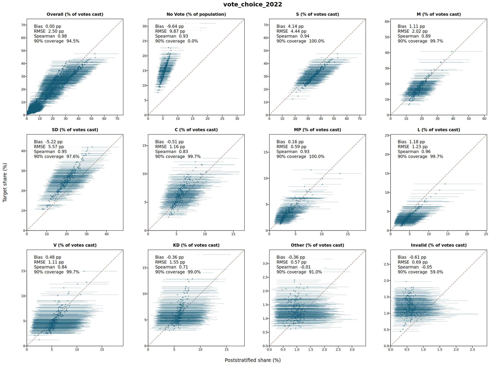
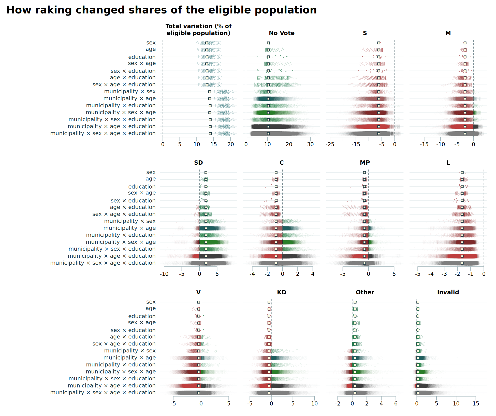

# Extending the Sweden 2026 population frame

This example extends the Sweden population frame with reported 2022
Riksdag vote choice. It fits one model per sequential stage,
predicts into the population frame, and calibrates the resulting counts
to municipal election shares. The
[input guide](../data/input/sweden%202026/README.md) documents the
source data and outcome recodes. The auxiliary survey comes from the
[Swedish National Election Study 2022 – CSES Edition](https://doi.org/10.5878/2ty4-tk98)
(Oscarsson, Karlsson, Lindskog, and Oleskog Tryggvason, 2024).

## Read and inspect the inputs

*Snippet 1. Read the population frame, survey, and election results and check their keys.*


``` r
knitr::opts_chunk$set(error = FALSE)
for (file in list.files("R", pattern = "[.]R$", full.names = TRUE)) source(file)

country <- file.path("data", "input", "sweden 2026")
survey <- read.csv(file.path(country, "auxiliary_survey.csv"), fileEncoding = "UTF-8")
frame <- read.csv(file.path(country, "frame.csv"), fileEncoding = "UTF-8")
election <- read.csv(file.path(country, "election_results.csv"), fileEncoding = "UTF-8")
area <- "municipality"
parent_area <- Sys.getenv("VOTEFRAME_PARENT_AREA", "constituency")
areas_per_batch <- vignette_areas_per_batch()
outcome <- "vote_choice_2022"
no_vote <- "No Vote"
predictors <- c(area, "sex", "age", "education")
out <- Sys.getenv("VOTEFRAME_SWEDEN_OUTPUT_DIR",
                  unset = file.path("data", "output", basename(country)))
outputs <- case_study_outputs(out)
figure_dir <- file.path("vignettes", "assets", "sweden-2026")
dir.create(figure_dir, recursive = TRUE, showWarnings = FALSE)

# Keep the municipality's constituency as a frame key. The model uses
# municipality as its area, since the constituency is determined by it.
stopifnot(is.numeric(survey$age), is.numeric(frame$age),
          !anyDuplicated(frame[predictors]),
          setequal(frame[[area]], election[[area]]))
cells <- aggregate_extension_survey(
  survey, extension_variable = outcome, predictors = predictors, no_vote = no_vote
)
```

```
## Warning: Removed 476 incomplete survey rows before aggregation.
```

*Snippet 2. Report how many respondents and population cells enter the example.*


``` r
c(survey_rows = nrow(survey), complete_respondents = sum(cells$counts),
  omitted_respondents = cells$omitted, population_cells = nrow(frame),
  municipalities = length(unique(frame[[area]])))
```

```
##          survey_rows complete_respondents  omitted_respondents
##                 2845                 2369                  476
##     population_cells       municipalities
##               361920                  290
```

## Prepare the municipality predictors

`process_area_covariates()` makes a matrix of historical shares with one
row per municipality. Each fitted stage uses the historical population
share for its own outcome. The first stage models nonvoting. Later
stages use respondents whose choices remain after removing the earlier
outcomes. The final choice receives the remaining probability.

*Snippet 3. Build municipality-level predictors from the earlier election.*


``` r
historical <- process_area_covariates(election, area, outcome, "share_eligible")
stage_outcomes <- head(cells$outcome_order, -1L)
area_covariates <- setNames(lapply(stage_outcomes, function(choice) {
  share <- historical[, choice, drop = FALSE]
  colnames(share) <- "vote_share_2022"
  share
}), stage_outcomes)
cells$outcome_order
```

```
##  [1] "No Vote" "S"       "M"       "SD"      "C"       "MP"      "L"
##  [8] "V"       "KD"      "Other"   "Invalid"
```

## Select and fit the sequential models

`fit_sequential_logit()` starts each stage's search at **depth 4**.
It screens support, prunes collinear fixed columns while preserving
hierarchy, and reduces depth if the retained design exceeds the
respondent budget. The fit log records the selected designs, the
columns removed, and the solver diagnostics. In Table 1, `returned` means
the solver produced a model. With the settings below, convergence requires
`max_parameter_change` to fall below 0.01. If a stage reaches 100
iterations at or above that threshold, its predictions use the last iterate.

Age enters the model in years, with 95 representing ages 95 and older.
With splines enabled, the fitter considers a smooth age effect and
interactions involving that smooth. The same screening and coefficient
budget apply to these terms.

*Snippet 4. Fit and save the sequential vote-choice stages.*


``` r
requested_depth <- 4L
minimum_support <- 10L
set.seed(2026)
control <- vglmer::vglmer_control(quiet = FALSE, print_prog = 1L)
fit <- withCallingHandlers(
  fit_sequential_logit(
    survey, outcome, area, area_covariates,
    no_vote = no_vote, outcome_order = cells$outcome_order,
    predictors = predictors, frame = frame, depth = requested_depth,
    splines = TRUE, control = control, minimum_support = minimum_support,
    tolerance_parameters = 0.01, tolerance_elbo = 0, max_iterations = 100L,
    interaction_support_log = file.path(outputs$diagnostics, "interaction_support.csv"),
    log_file = file.path(outputs$diagnostics, "fit_log.csv")
  ),
  message = function(m) cat(conditionMessage(m), file = stderr())
)
save_case_study_rds(fit, file.path(outputs$models, "fit.rds"))
```

*Snippet 5. Display the selected designs and convergence results for each fitted stage.*


``` r
fields <- c("outcome", "observations", "fitted_depth", "retained_order",
            "estimated_retained_parameters",
            "dropped_fixed", "dropped_scalar_random", "dropped_correlated_random",
            "dropped_smooth", "fixed_condition_after", "iterations_used",
            "max_parameter_change", "status")
knitr::kable(fit$fit_log[fields])
```


|outcome | observations| fitted_depth| retained_order| estimated_retained_parameters| dropped_fixed| dropped_scalar_random| dropped_correlated_random| dropped_smooth| fixed_condition_after| iterations_used| max_parameter_change|status   |
|:-------|------------:|------------:|--------------:|-----------------------------:|-------------:|---------------------:|-------------------------:|--------------:|---------------------:|---------------:|--------------------:|:--------|
|No Vote |         2369|            2|              2|                          2214|             0|                  1271|                       670|          13355|             12.388868|             100|            0.0359261|returned |
|S       |         2262|            2|              2|                          2187|             0|                  1252|                       669|          13315|             15.560200|             100|            0.0336359|returned |
|M       |         1476|            2|              2|                          1450|             0|                  1019|                       666|          12695|             11.037620|             100|            0.0779111|returned |
|SD      |         1063|            2|              2|                          1045|             0|                   865|                       637|          11673|              8.666298|             100|            0.0774935|returned |
|C       |          745|            1|              1|                            75|             0|                   180|                         0|              0|             10.793597|              14|            0.0004620|returned |
|MP      |          577|            1|              1|                            71|             0|                   167|                         0|              0|              8.396833|              26|            0.0012906|returned |
|L       |          431|            1|              1|                            67|             0|                   152|                         0|              0|              8.191447|              13|            0.0042818|returned |
|V       |          289|            1|              1|                            63|             0|                   131|                         0|              0|              8.034208|              11|            0.0048167|returned |
|KD      |          158|            1|              1|                            49|             0|                    97|                         0|              0|              8.021605|              20|            0.0079681|returned |
|Other   |           31|            1|              1|                            17|             0|                    29|                         0|              0|              9.159624|              22|            0.0067292|returned |

*Table 1. Fitted stages, with sample sizes, retained design, screened coefficients, and convergence diagnostics.*

The published fit predates the rule requiring two supported levels for
a random effect. In that fit, the No Vote, S, M, and SD stages kept age
curves by sex, education, and supported municipalities. Each reached the
100-iteration cap above the 0.01 threshold. The other six stages met the
threshold and kept a global age curve. The joint smooth of age and
municipal vote share did not survive screening in any stage.

## Predict and check municipal vote shares before raking

`predict_sequential_logit()` draws the outcomes' cell probabilities.
`aggregate_extended_frame()` multiplies probabilities by population
counts and keeps a row for every original cell and vote choice. The
municipal comparison uses shares **among voters** for party choices and
shares **of the full population** for nonvoting. The among-voters
denominator includes invalid ballots. Posterior intervals
use each draw's own turnout denominator.

The 2022 municipal results also enter as predictors. This comparison
measures agreement with the calibration targets. Sweden uses 125
posterior draws per cell. Batches use constituencies by default and keep
each municipality intact. Without a usable parent geography, the default
is ten municipalities per batch. A shared draw state keeps fitted
coefficients and effects for previously seen levels aligned across
batches.

*Snippet 6. Predict vote choice in geographic batches and expand population counts into choice categories.*


``` r
n_draws <- 125L
frame_rows <- geographic_batches(frame, area, parent_area, areas_per_batch)
part_paths <- function(directory) {
  dir.create(directory, showWarnings = FALSE)
  file.path(directory, sprintf("part-%02d.rds", seq_along(frame_rows)))
}
part_bytes <- pre_rake_frame_bytes(lengths(frame_rows) * length(fit$outcome_order),
                                   n_draws, length(predictors) + 2L)
storage <- vignette_pre_rake_storage(
  out, sum(part_bytes), largest_part_bytes = max(part_bytes),
  final_directory = out, final_bytes = sum(part_bytes)
)
extended_parts <- vector("list", length(frame_rows))
set.seed(2027)
draw_state <- new.env(parent = emptyenv())
for (i in seq_along(frame_rows)) {
  cells <- frame[frame_rows[[i]], , drop = FALSE]
  posterior <- predict_sequential_logit(
    fit, frame = cells, n_draws = n_draws, draw_state = draw_state, write_files = FALSE
  )
  extended <- aggregate_extended_frame(cells, posterior, by = setdiff(names(cells), "N"))
  rm(posterior)
  stopifnot(nrow(extended) == nrow(cells) * length(fit$outcome_order))
  extended_parts[[i]] <- storage$put(extended, sprintf("part-%02d", i))
  rm(extended)
}
rm(draw_state)
```

*Snippet 7. Pool the predicted counts by municipality and compare their shares with the targets.*


``` r
figure <- function(name) file.path(figure_dir, paste0(name, ".png"))
municipal_counts <- municipal_partition_counts(extended_parts, storage$get, area, outcome)
before <- check_extended_frame(
  municipal_counts, election, by = area, extension_variable = outcome,
  target_variable = "share_eligible", no_vote = no_vote, outcome_order = fit$outcome_order,
  plot_file = figure("municipal-before")
)
utils::write.csv(before$metrics, file.path(outputs$diagnostics, "before_rake_metrics.csv"))
knitr::kable(before$metrics, digits = 4)
```


|        | bias_pp| RMSE_pp| spearman| coverage_90_pct|
|:-------|-------:|-------:|--------:|---------------:|
|Overall |  0.0000|  2.5092|   0.9719|         99.4483|
|No Vote | -9.6354|  9.8640|   0.9294|          0.0000|
|S       |  4.1614|  4.4728|   0.9421|        100.0000|
|M       |  1.0779|  1.9764|   0.9003|        100.0000|
|SD      | -5.1936|  5.5445|   0.9537|         97.5862|
|C       | -0.5103|  1.1522|   0.8290|        100.0000|
|MP      |  0.1507|  0.5842|   0.9268|        100.0000|
|L       |  1.1738|  1.2251|   0.9620|         99.3103|
|V       |  0.4695|  1.1389|   0.8142|         98.9655|
|KD      | -1.0412|  1.8459|   0.6893|         98.9655|
|Other   |  0.0614|  0.4589|   0.0789|         99.6552|
|Invalid | -0.3497|  0.4732|   0.0714|        100.0000|

*Table 2. Before-rake municipal vote-share errors and 90% interval coverage against the election benchmarks.*



*Figure 1. Before raking, predicted municipal shares and 90% draw intervals against the election benchmarks.*

## Rake to the municipal targets

`rake_extended_frame()` takes shares on the population scale. It
reallocates counts across vote choices within each demographic cell,
preserving that cell's total. Raking uses the same constraints for the
mean counts and all 125 draws. Each municipality is constrained
independently, so batches can be raked separately.

*Snippet 8. Calibrate each municipality’s vote totals while preserving the original population cells.*


``` r
rake_tolerance <- 1e-8
raked_paths <- part_paths(outputs$raked_frame)
for (i in seq_along(frame_rows)) {
  cells <- frame[frame_rows[[i]], , drop = FALSE]
  targets <- election[election[[area]] %in% cells[[area]], , drop = FALSE]
  raked <- rake_extended_frame(
    storage$get(extended_parts[[i]]), cells, targets, by = area, extension_variable = outcome,
    target_variable = "share_eligible", tolerance = rake_tolerance
  )
  save_case_study_rds(raked, raked_paths[i])
  rm(raked)
}
```

The final raked frame is stored as RDS partitions under
`data/output/sweden 2026/raked_frame/`. The pre-rake partitions use memory or temporary disk storage according to
available memory. Temporary partitions are removed after the raked output
and diagnostics finish. Set `VOTEFRAME_PRE_RAKE_STORAGE=keep` to save all
pre-rake partitions. Use the saved
`models/fit.rds` and the prediction chunk to recreate them.

## Check both margins after raking

The post-rake diagnostics repeat the municipality comparisons using
the same denominators and check the total of each original joint
demographic cell.

*Snippet 9. Check the calibrated election margins and compare counts with the original stratification joint.*


``` r
after <- check_extended_frame(
  municipal_partition_counts(raked_paths, readRDS, area, outcome),
  election, by = area, extension_variable = outcome,
  target_variable = "share_eligible", no_vote = no_vote, outcome_order = fit$outcome_order,
  coverage_tolerance = 2 * rake_tolerance, plot_file = figure("municipal-after")
)
joint <- do.call(rbind, lapply(seq_along(frame_rows), function(i) {
  post_rake_cell_comparison(readRDS(raked_paths[i]), frame[frame_rows[[i]], , drop = FALSE], outcome)
}))
joint_metrics <- plot_post_rake_cells(joint, figure("original-cell-totals"))
utils::write.csv(after$metrics, file.path(outputs$diagnostics, "after_rake_metrics.csv"))
utils::write.csv(joint_metrics, file.path(outputs$diagnostics, "original_cell_totals_metrics.csv"))
knitr::kable(after$metrics, digits = 4)
```


|        | bias_pp| RMSE_pp| spearman| coverage_90_pct|
|:-------|-------:|-------:|--------:|---------------:|
|Overall |       0|       0|        1|             100|
|No Vote |       0|       0|        1|             100|
|S       |       0|       0|        1|             100|
|M       |       0|       0|        1|             100|
|SD      |       0|       0|        1|             100|
|C       |       0|       0|        1|             100|
|MP      |       0|       0|        1|             100|
|L       |       0|       0|        1|             100|
|V       |       0|       0|        1|             100|
|KD      |       0|       0|        1|             100|
|Other   |       0|       0|        1|             100|
|Invalid |       0|       0|        1|             100|

*Table 3. After-rake municipal vote-share errors and 90% interval coverage against the same benchmarks.*


*Figure 2. After raking, calibrated municipal shares and 90% draw intervals against the election benchmarks.*


*Figure 3. Raked counts and 90% draw intervals versus the mother-frame population in each original cell.*

## Measure how raking changes the estimates

`plot_partitioned_raking_changes()` shows how calibration changed vote shares on
demographic margins. Each row shows a grouping, such as age or
municipality × education. In the outcome panels, dots are subgroup
changes in percentage points and squares are population-weighted
averages. Green marks increases and red marks decreases. Every outcome, including No Vote, is expressed as a share of the
eligible population in that group. Total variation is half the sum of
the absolute changes in these shares, population-weighted across groups.
Its dots show paired draws and its square uses the mean counts.

The archived Figure 4 below uses the earlier voter denominator for party
shares and total variation. Running Snippet 10 with the current code produces
the eligible-population comparison described above.

*Snippet 10. Compare pre-rake and post-rake vote shares across demographic groupings.*


``` r
plot_partitioned_raking_changes(
  extended_parts, raked_paths, frame[c(predictors, "N")], frame_rows,
  area = area, outcome = outcome, no_vote = no_vote, plot_file = figure("raking-changes"),
  read_extended = storage$get
)
```



*Figure 4. Changes in vote shares after raking across demographic and municipal groupings.*

## Inspect the extended frame

The table shows 100 randomly selected rows across all raked partitions.

*Snippet 11. Sample 100 rows from the raked stratification frame.*


``` r
set.seed(2029)
columns <- c(predictors, outcome, "N", "N_draw_1", "N_draw_2")
partition_sizes <- lengths(frame_rows) * length(fit$outcome_order)
preview <- sample_extended_frame(raked_paths, columns, partition_sizes)
knitr::kable(preview, digits = 2, row.names = FALSE)
```


|municipality  |sex   | age|education                           |vote_choice_2022 |     N| N_draw_1| N_draw_2|
|:-------------|:-----|---:|:-----------------------------------|:----------------|-----:|--------:|--------:|
|Arvidsjaur    |Men   |  45|Compulsory education, under 9 years |MP               |  0.00|     0.00|     0.01|
|Hammarö       |Men   |  84|Post-secondary, 3 years or more     |Invalid          |  0.26|     0.31|     0.34|
|Karlshamn     |Men   |  26|Post-secondary, under 3 years       |C                |  1.15|     1.68|     0.94|
|Lilla Edet    |Women |  18|Unknown                             |SD               |  0.21|     0.37|     0.30|
|Eslöv         |Men   |  28|Compulsory education, under 9 years |Invalid          |  0.01|     0.00|     0.02|
|Stockholm     |Men   |  40|Post-secondary, under 3 years       |L                | 78.56|    73.99|    60.69|
|Dorotea       |Women |  37|Upper secondary, up to 2 years      |SD               |  0.00|     0.00|     0.00|
|Arvika        |Women |  26|Upper secondary, 3 years            |SD               |  7.61|     6.85|    11.02|
|Tjörn         |Men   |  23|Doctoral education                  |V                |  0.00|     0.00|     0.00|
|Vilhelmina    |Men   |  38|Post-secondary, 3 years or more     |No Vote          |  0.32|     0.30|     0.33|
|Ånge          |Women |  57|Upper secondary, 3 years            |Invalid          |  0.08|     0.16|     0.13|
|Rättvik       |Men   |  27|Compulsory education, 9 or 10 years |MP               |  0.11|     0.07|     0.19|
|Österåker     |Men   |  44|Unknown                             |M                |  3.51|     2.21|     2.13|
|Ängelholm     |Women |  57|Upper secondary, 3 years            |SD               | 14.98|    13.61|    12.54|
|Tranemo       |Women |  38|Post-secondary, 3 years or more     |KD               |  2.50|     2.29|     2.21|
|Ljungby       |Men   |  34|Post-secondary, under 3 years       |Invalid          |  0.62|     0.00|     0.07|
|Nynäshamn     |Women |  74|Post-secondary, 3 years or more     |SD               |  1.85|     1.31|     0.96|
|Söderköping   |Women |  61|Compulsory education, under 9 years |M                |  0.00|     0.00|     0.00|
|Älvdalen      |Men   |  48|Compulsory education, 9 or 10 years |V                |  0.05|     0.02|     0.02|
|Stockholm     |Women |  71|Compulsory education, under 9 years |Invalid          |  0.25|     0.10|     1.02|
|Karlskoga     |Women |  95|Post-secondary, 3 years or more     |No Vote          |  0.75|     1.06|     0.57|
|Flen          |Women |  41|Compulsory education, 9 or 10 years |Invalid          |  0.02|     0.01|     0.02|
|Forshaga      |Men   |  50|Post-secondary, under 3 years       |C                |  0.42|     0.37|     0.41|
|Hörby         |Women |  74|Post-secondary, under 3 years       |C                |  1.18|     0.40|     1.40|
|Sundsvall     |Men   |  50|Upper secondary, up to 2 years      |S                | 26.38|    20.69|    20.56|
|Laxå          |Women |  21|Post-secondary, under 3 years       |V                |  0.39|     0.35|     0.38|
|Karlsborg     |Men   |  89|Unknown                             |MP               |  0.00|     0.00|     0.00|
|Hylte         |Men   |  41|Upper secondary, 3 years            |Other            |  0.55|     0.46|     1.11|
|Smedjebacken  |Women |  48|Post-secondary, under 3 years       |Other            |  0.07|     0.01|     0.00|
|Köping        |Men   |  45|Compulsory education, under 9 years |KD               |  0.40|     0.43|     0.48|
|Kinda         |Men   |  39|Compulsory education, under 9 years |V                |  0.03|     0.04|     0.02|
|Östra Göinge  |Men   |  61|Compulsory education, 9 or 10 years |C                |  0.26|     0.29|     0.28|
|Gagnef        |Women |  35|Unknown                             |L                |  0.02|     0.01|     0.00|
|Söderköping   |Women |  65|Compulsory education, 9 or 10 years |M                |  1.84|     1.61|     2.07|
|Falkenberg    |Men   |  52|Doctoral education                  |Other            |  0.01|     0.01|     0.02|
|Falun         |Women |  65|Post-secondary, under 3 years       |S                | 20.18|    24.54|    15.75|
|Haninge       |Women |  20|Doctoral education                  |V                |  0.00|     0.00|     0.00|
|Skövde        |Men   |  34|Post-secondary, 3 years or more     |C                |  8.00|     7.35|     9.85|
|Varberg       |Women |  70|Upper secondary, up to 2 years      |S                | 44.93|    41.42|    54.84|
|Ale           |Men   |  75|Upper secondary, 3 years            |MP               |  0.35|     0.39|     0.64|
|Storuman      |Men   |  52|Doctoral education                  |No Vote          |  0.00|     0.00|     0.00|
|Klippan       |Men   |  32|Upper secondary, 3 years            |MP               |  0.38|     0.52|     0.26|
|Vårgårda      |Men   |  25|Compulsory education, 9 or 10 years |MP               |  0.10|     0.06|     0.15|
|Vårgårda      |Men   |  74|Unknown                             |Invalid          |  0.01|     0.00|     0.00|
|Surahammar    |Women |  48|Doctoral education                  |V                |  0.00|     0.00|     0.00|
|Varberg       |Women |  76|Compulsory education, under 9 years |L                |  1.28|     1.35|     1.97|
|Ale           |Men   |  53|Upper secondary, up to 2 years      |M                | 12.76|    14.42|     9.04|
|Norberg       |Men   |  65|Upper secondary, 3 years            |M                |  0.54|     0.49|     0.65|
|Sundsvall     |Women |  43|Compulsory education, under 9 years |KD               |  0.43|     0.62|     0.54|
|Vännäs        |Men   |  39|Post-secondary, under 3 years       |Invalid          |  0.14|     0.00|     0.01|
|Vindeln       |Men   |  75|Upper secondary, 3 years            |C                |  0.22|     0.13|     0.16|
|Lekeberg      |Women |  94|Doctoral education                  |MP               |  0.00|     0.00|     0.00|
|Mariestad     |Women |  52|Post-secondary, 3 years or more     |MP               |  3.29|     3.23|     3.40|
|Dals-Ed       |Men   |  85|Compulsory education, 9 or 10 years |S                |  0.00|     0.00|     0.00|
|Lysekil       |Men   |  75|Post-secondary, 3 years or more     |V                |  0.61|     0.62|     0.58|
|Ragunda       |Women |  18|Upper secondary, 3 years            |V                |  0.00|     0.00|     0.00|
|Emmaboda      |Women |  25|Upper secondary, up to 2 years      |C                |  0.04|     0.05|     0.02|
|Huddinge      |Men   |  45|Upper secondary, up to 2 years      |C                |  3.32|     3.39|     2.76|
|Lysekil       |Women |  36|Post-secondary, under 3 years       |Invalid          |  0.20|     0.05|     0.16|
|Bjuv          |Women |  87|Compulsory education, 9 or 10 years |L                |  0.02|     0.01|     0.04|
|Varberg       |Men   |  28|Compulsory education, 9 or 10 years |KD               |  0.81|     0.76|     0.67|
|Tjörn         |Women |  87|Compulsory education, 9 or 10 years |V                |  0.03|     0.01|     0.03|
|Flen          |Women |  34|Upper secondary, up to 2 years      |Invalid          |  0.03|     0.02|     0.01|
|Härnösand     |Men   |  89|Compulsory education, 9 or 10 years |No Vote          |  0.14|     0.13|     0.11|
|Essunga       |Men   |  21|Unknown                             |S                |  0.11|     0.08|     0.10|
|Nykvarn       |Men   |  68|Post-secondary, under 3 years       |Invalid          |  0.04|     0.00|     0.02|
|Åsele         |Women |  29|Post-secondary, 3 years or more     |S                |  0.00|     0.00|     0.00|
|Valdemarsvik  |Men   |  52|Upper secondary, up to 2 years      |SD               |  9.92|    11.94|    12.19|
|Krokom        |Women |  91|Unknown                             |L                |  0.00|     0.00|     0.00|
|Strängnäs     |Women |  49|Compulsory education, under 9 years |No Vote          |  1.14|     1.35|     1.22|
|Vellinge      |Women |  22|Compulsory education, 9 or 10 years |L                |  0.29|     0.15|     0.37|
|Österåker     |Women |  83|Compulsory education, 9 or 10 years |MP               |  0.15|     0.14|     0.35|
|Mark          |Men   |  28|Post-secondary, 3 years or more     |M                |  1.51|     2.18|     1.74|
|Hallstahammar |Women |  68|Compulsory education, under 9 years |KD               |  0.10|     0.07|     0.09|
|Karlsborg     |Men   |  37|Doctoral education                  |C                |  0.00|     0.00|     0.00|
|Lomma         |Women |  73|Post-secondary, 3 years or more     |C                |  2.68|     2.79|     2.44|
|Hörby         |Women |  39|Compulsory education, 9 or 10 years |S                |  1.23|     0.99|     0.84|
|Karlshamn     |Women |  72|Doctoral education                  |L                |  0.03|     0.02|     0.02|
|Håbo          |Women |  54|Compulsory education, under 9 years |S                |  0.48|     0.55|     0.39|
|Munkfors      |Women |  59|Upper secondary, up to 2 years      |SD               |  1.58|     1.41|     1.42|
|Kumla         |Women |  26|Unknown                             |MP               |  0.10|     0.05|     0.11|
|Sjöbo         |Women |  72|Post-secondary, under 3 years       |S                |  3.89|     5.44|     3.68|
|Malung-Sälen  |Women |  86|Unknown                             |No Vote          |  0.22|     0.27|     0.18|
|Norrköping    |Men   |  23|Compulsory education, under 9 years |L                |  0.05|     0.08|     0.04|
|Hedemora      |Men   |  32|Upper secondary, 3 years            |SD               | 11.18|    11.42|    12.22|
|Luleå         |Men   |  69|Unknown                             |L                |  0.06|     0.04|     0.02|
|Mark          |Men   |  59|Unknown                             |C                |  0.06|     0.03|     0.02|
|Mora          |Men   |  72|Upper secondary, 3 years            |V                |  0.26|     0.12|     0.37|
|Borgholm      |Men   |  94|Post-secondary, 3 years or more     |L                |  0.00|     0.00|     0.00|
|Laholm        |Women |  81|Upper secondary, up to 2 years      |L                |  1.18|     0.52|     1.51|
|Degerfors     |Women |  43|Compulsory education, 9 or 10 years |No Vote          |  0.14|     0.21|     0.13|
|Vindeln       |Women |  81|Compulsory education, 9 or 10 years |C                |  0.12|     0.07|     0.18|
|Pajala        |Women |  74|Post-secondary, under 3 years       |KD               |  0.38|     0.39|     0.73|
|Ale           |Men   |  93|Upper secondary, 3 years            |M                |  0.00|     0.00|     0.00|
|Skara         |Men   |  34|Upper secondary, 3 years            |KD               |  2.79|     5.69|     1.81|
|Årjäng        |Women |  20|Upper secondary, 3 years            |KD               |  4.69|     5.15|     5.97|
|Svenljunga    |Women |  49|Upper secondary, up to 2 years      |KD               |  0.40|     0.30|     0.60|
|Filipstad     |Women |  78|Doctoral education                  |SD               |  0.00|     0.00|     0.00|
|Gislaved      |Women |  94|Post-secondary, 3 years or more     |M                |  0.00|     0.00|     0.00|
|Hudiksvall    |Women |  64|Post-secondary, 3 years or more     |V                |  3.48|     3.29|     3.70|

*Table 4. Sample of 100 raked joint rows with their calibrated mean and two posterior draws.*

*Snippet 12. Keep the requested output partitions and release the remaining pre-rake storage.*


``` r
if (storage$mode == "keep") {
  paths <- unlist(extended_parts, use.names = FALSE)
  prune_geographic_partitions(dirname(paths[1L]), paths, "^part-[0-9]+[.]rds$")
}
prune_geographic_partitions(dirname(raked_paths[1L]), raked_paths, "^part-[0-9]+[.]rds$")
storage$cleanup()
rm(extended_parts)
```
