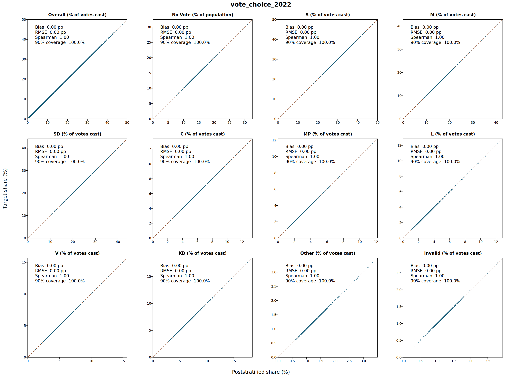
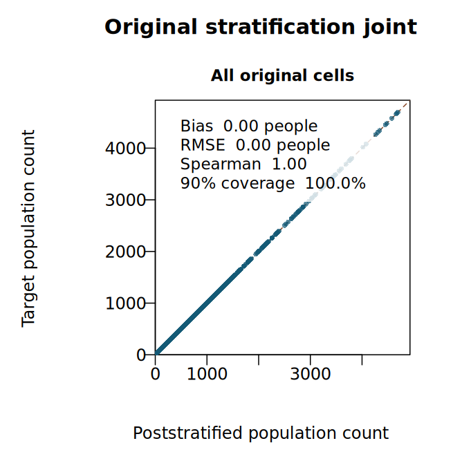

# Extending the Sweden 2026 population frame

This example extends the Sweden population frame with reported 2022
Riksdag vote choice. It fits one model per sequential stage,
predicts into the population frame, and calibrates the resulting counts
to municipal election shares. The
[input guide](../data/input/sweden%202026/README.md) documents the
source data and outcome recodes. The auxiliary survey comes from the
[Swedish National Election Study 2022 – CSES Edition](https://doi.org/10.5878/2ty4-tk98)
(Oscarsson, Karlsson, Lindskog, and Oleskog Tryggvason, 2024).

## Read and inspect the inputs


``` r
for (file in list.files("R", pattern = "[.]R$", full.names = TRUE)) source(file)

country <- file.path("data", "input", "sweden 2026")
survey <- read.csv(file.path(country, "auxiliary_survey.csv"), fileEncoding = "UTF-8")
frame <- read.csv(file.path(country, "frame.csv"), fileEncoding = "UTF-8")
election <- read.csv(file.path(country, "election_results.csv"), fileEncoding = "UTF-8")
area <- "municipality"
outcome <- "vote_choice_2022"
no_vote <- "No Vote"
predictors <- c(area, "sex", "age", "education")
out <- Sys.getenv("VOTEFRAME_SWEDEN_OUTPUT_DIR",
                  unset = file.path("data", "output", basename(country)))
dir.create(out, recursive = TRUE, showWarnings = FALSE)
figure_dir <- file.path("vignettes", "assets", "sweden-2026")
dir.create(figure_dir, recursive = TRUE, showWarnings = FALSE)

# Keep the municipality's constituency as a frame key. The model uses
# municipality as its area, since the constituency is determined by it.
stopifnot(is.numeric(survey$age), is.numeric(frame$age),
          !anyDuplicated(frame[predictors]),
          setequal(frame[[area]], election[[area]]))
cells <- aggregate_extension_survey(
  survey, extension_variable = outcome, predictors = predictors, no_vote = no_vote
)
```

```
## Warning: Removed 476 incomplete survey rows before aggregation.
```

``` r
c(survey_rows = nrow(survey), complete_respondents = sum(cells$counts),
  omitted_respondents = cells$omitted, population_cells = nrow(frame),
  municipalities = length(unique(frame[[area]])))
```

```
##          survey_rows complete_respondents  omitted_respondents
##                 2845                 2369                  476
##     population_cells       municipalities
##               361920                  290
```

## Prepare the municipality predictors

`process_area_covariates()` makes a matrix of historical shares with one
row per municipality. Each fitted stage uses the historical population
share for its own outcome. The first stage models nonvoting. Later
stages use respondents whose choices remain after removing the earlier
outcomes. The final choice receives the remaining probability.


``` r
historical <- process_area_covariates(election, area, outcome, "share_eligible")
stage_outcomes <- head(cells$outcome_order, -1L)
area_covariates <- setNames(lapply(stage_outcomes, function(choice) {
  share <- historical[, choice, drop = FALSE]
  colnames(share) <- "vote_share_2022"
  share
}), stage_outcomes)
cells$outcome_order
```

```
##  [1] "No Vote" "S"       "M"       "SD"      "C"       "MP"      "L"
##  [8] "V"       "KD"      "Other"   "Invalid"
```

## Select and fit the sequential models

`fit_sequential_logit()` starts each stage's search at **depth 4**.
It screens support, prunes collinear fixed columns while preserving
hierarchy, and reduces depth if the retained design exceeds the
respondent budget. The fit log records the selected designs, the
columns removed, and the solver diagnostics. A stage can return a fit
at the iteration cap, so inspect the solver status before interpreting
its results.

Age enters the model in years, with 95 representing ages 95 and older.
With splines enabled, the fitter considers a smooth age effect and
interactions involving that smooth. The same screening and coefficient
budget apply to these terms.


``` r
requested_depth <- 4L
minimum_support <- 10L
set.seed(2026)
control <- vglmer::vglmer_control(quiet = FALSE, print_prog = 1L)
fit <- withCallingHandlers(
  fit_sequential_logit(
    survey, outcome, area, area_covariates,
    no_vote = no_vote, outcome_order = cells$outcome_order,
    predictors = predictors, frame = frame, depth = requested_depth,
    splines = TRUE, control = control, minimum_support = minimum_support,
    tolerance_parameters = 0.01, tolerance_elbo = 0, max_iterations = 100L,
    interaction_support_log = file.path(out, "interaction_support.csv"),
    log_file = file.path(out, "fit_log.csv")
  ),
  message = function(m) cat(conditionMessage(m), file = stderr())
)
saveRDS(fit, file.path(out, "fit.rds"))
```


``` r
fields <- c("outcome", "observations", "fitted_depth", "retained_order",
            "estimated_retained_parameters",
            "dropped_fixed", "dropped_scalar_random", "dropped_correlated_random",
            "dropped_smooth", "fixed_condition_after", "iterations_used",
            "max_parameter_change", "status")
knitr::kable(fit$fit_log[fields])
```


|outcome | observations| fitted_depth| retained_order| estimated_retained_parameters| dropped_fixed| dropped_scalar_random| dropped_correlated_random| dropped_smooth| fixed_condition_after| iterations_used| max_parameter_change|status   |
|:-------|------------:|------------:|--------------:|-----------------------------:|-------------:|---------------------:|-------------------------:|--------------:|---------------------:|---------------:|--------------------:|:--------|
|No Vote |         2369|            2|              2|                          2214|             0|                  1271|                       670|          13355|             12.388868|             100|            0.0359261|returned |
|S       |         2262|            2|              2|                          2187|             0|                  1252|                       669|          13315|             15.560200|             100|            0.0336359|returned |
|M       |         1476|            2|              2|                          1450|             0|                  1019|                       666|          12695|             11.037620|             100|            0.0779111|returned |
|SD      |         1063|            2|              2|                          1045|             0|                   865|                       637|          11673|              8.666298|             100|            0.0774935|returned |
|C       |          745|            1|              1|                            75|             0|                   180|                         0|              0|             10.793597|              14|            0.0004620|returned |
|MP      |          577|            1|              1|                            71|             0|                   167|                         0|              0|              8.396833|              26|            0.0012906|returned |
|L       |          431|            1|              1|                            67|             0|                   152|                         0|              0|              8.191447|              13|            0.0042818|returned |
|V       |          289|            1|              1|                            63|             0|                   131|                         0|              0|              8.034208|              11|            0.0048167|returned |
|KD      |          158|            1|              1|                            49|             0|                    97|                         0|              0|              8.021605|              20|            0.0079681|returned |
|Other   |           31|            1|              1|                            17|             0|                    29|                         0|              0|              9.159624|              22|            0.0067292|returned |

In this run, the No Vote, S, M, and SD stages kept age curves by sex,
education, and supported municipalities. Each reached the 100-iteration
cap above the 0.01 maximum parameter change threshold. The other six
stages converged and kept a global age curve. The joint smooth of age
and municipal vote share did not survive screening in any stage.

## Predict and check municipal vote shares before raking

`predict_sequential_logit()` draws the outcomes' cell probabilities.
`aggregate_extended_frame()` multiplies probabilities by population
counts and keeps a row for every original cell and vote choice. The
municipal comparison uses shares **among voters** for party choices and
shares **of the full population** for nonvoting. The among-voters
denominator includes invalid ballots. Posterior intervals
use each draw's own turnout denominator.

The 2022 municipal results also enter as predictors. This comparison
measures agreement with the calibration targets. Sweden uses 125
posterior draws per cell. Complete municipalities are processed in
batches to limit memory use. A shared draw state keeps fitted
coefficients and effects for previously seen levels aligned across
batches.


``` r
n_draws <- 125L
partition <- ceiling(match(frame[[area]], unique(frame[[area]])) / 10L)
frame_rows <- split(seq_len(nrow(frame)), partition)
part_paths <- function(name) {
  directory <- file.path(out, name)
  dir.create(directory, showWarnings = FALSE)
  file.path(directory, sprintf("part-%02d.rds", seq_along(frame_rows)))
}
save_part <- function(part, path) {
  pending <- paste0(path, ".part")
  saveRDS(part, pending)
  stopifnot(file.rename(pending, path))
}
extended_paths <- part_paths("extended_frame")
set.seed(2027)
draw_state <- new.env(parent = emptyenv())
for (i in seq_along(frame_rows)) {
  cells <- frame[frame_rows[[i]], , drop = FALSE]
  posterior <- predict_sequential_logit(
    fit, frame = cells, n_draws = n_draws, draw_state = draw_state, write_files = FALSE
  )
  extended <- aggregate_extended_frame(cells, posterior, by = setdiff(names(cells), "N"))
  rm(posterior)
  stopifnot(nrow(extended) == nrow(cells) * length(fit$outcome_order))
  save_part(extended, extended_paths[i])
  rm(extended)
}
rm(draw_state)
```


``` r
figure <- function(name) file.path(figure_dir, paste0(name, ".png"))
municipal_counts <- function(paths) {
  do.call(rbind, lapply(paths, function(path) {
    counts <- readRDS(path)
    keys <- counts[c(area, outcome)]
    group <- frame_cell_keys(keys, keys)
    columns <- c("N", extended_frame_draw_columns(counts, "N"))
    cbind(keys[!duplicated(group), , drop = FALSE],
          rowsum(counts[columns], group, reorder = FALSE))
  }))
}
before <- check_extended_frame(
  municipal_counts(extended_paths), election, by = area, extension_variable = outcome,
  target_variable = "share_eligible", no_vote = no_vote, outcome_order = fit$outcome_order,
  plot_file = figure("municipal-before")
)
knitr::kable(before$metrics, digits = 4)
```


|        | bias_pp| RMSE_pp| spearman| coverage_90_pct|
|:-------|-------:|-------:|--------:|---------------:|
|Overall |  0.0000|  2.6142|   0.9724|         99.0000|
|No Vote | -9.6489|  9.8806|   0.9286|          0.0000|
|S       |  3.9370|  4.3017|   0.9455|        100.0000|
|M       |  1.0563|  1.9423|   0.8969|        100.0000|
|SD      | -5.7921|  6.1661|   0.9416|         92.7586|
|C       | -0.3271|  1.0790|   0.8300|        100.0000|
|MP      |  0.2491|  0.6234|   0.9225|        100.0000|
|L       |  1.3182|  1.3731|   0.9664|         99.6552|
|V       |  0.4643|  1.1385|   0.8233|         99.6552|
|KD      | -0.7860|  1.7000|   0.6716|         98.9655|
|Other   |  0.1325|  0.4980|  -0.0082|         99.6552|
|Invalid | -0.2521|  0.4109|   0.0675|         99.3103|

``` r
knitr::include_graphics(sub("^vignettes/", "", figure("municipal-before")), error = FALSE)
```


## Rake to the municipal targets

`rake_extended_frame()` takes shares on the population scale. It
reallocates counts across vote choices within each demographic cell,
preserving that cell's total. Raking uses the same constraints for the
mean counts and all 125 draws. Each municipality is constrained
independently, so batches can be raked separately.


``` r
rake_tolerance <- 1e-8
raked_paths <- part_paths("raked_frame")
for (i in seq_along(frame_rows)) {
  cells <- frame[frame_rows[[i]], , drop = FALSE]
  targets <- election[election[[area]] %in% cells[[area]], , drop = FALSE]
  raked <- rake_extended_frame(
    readRDS(extended_paths[i]), cells, targets, by = area, extension_variable = outcome,
    target_variable = "share_eligible", tolerance = rake_tolerance
  )
  save_part(raked, raked_paths[i])
  rm(raked)
}
```

The final raked frame is stored as RDS partitions under
`data/output/sweden 2026/raked_frame/`. The pre-raking partitions are
under `extended_frame/` in the same run directory.

## Check both margins after raking

The post-rake diagnostics repeat the municipality comparisons using
the same denominators and check the total of each original joint
demographic cell.


``` r
after <- check_extended_frame(
  municipal_counts(raked_paths), election, by = area, extension_variable = outcome,
  target_variable = "share_eligible", no_vote = no_vote, outcome_order = fit$outcome_order,
  coverage_tolerance = 2 * rake_tolerance, plot_file = figure("municipal-after")
)
joint <- do.call(rbind, lapply(seq_along(frame_rows), function(i) {
  post_rake_cell_comparison(readRDS(raked_paths[i]), frame[frame_rows[[i]], , drop = FALSE], outcome)
}))
joint_metrics <- plot_post_rake_cells(joint, figure("original-cell-totals"))
knitr::kable(after$metrics, digits = 4)
```


|        | bias_pp| RMSE_pp| spearman| coverage_90_pct|
|:-------|-------:|-------:|--------:|---------------:|
|Overall |       0|       0|        1|             100|
|No Vote |       0|       0|        1|             100|
|S       |       0|       0|        1|             100|
|M       |       0|       0|        1|             100|
|SD      |       0|       0|        1|             100|
|C       |       0|       0|        1|             100|
|MP      |       0|       0|        1|             100|
|L       |       0|       0|        1|             100|
|V       |       0|       0|        1|             100|
|KD      |       0|       0|        1|             100|
|Other   |       0|       0|        1|             100|
|Invalid |       0|       0|        1|             100|

``` r
knitr::include_graphics(sub("^vignettes/", "", figure("municipal-after")), error = FALSE)
```



``` r
knitr::include_graphics(sub("^vignettes/", "", figure("original-cell-totals")), error = FALSE)
```



## Measure how raking changes the estimates

`plot_partitioned_raking_changes()` shows how calibration changed vote shares on
demographic margins. Each row shows a grouping, such as age or
municipality × education. In the outcome panels, dots are subgroup
changes in percentage points and squares are population-weighted
averages. Green marks increases and red marks decreases. Shares use
the number of voters for ballot choices and the full group population
for No Vote. The total variation panel summarizes changes across the
whole distribution among voters. Its dots are posterior draws and its
square uses the mean counts.


``` r
change_plot <- plot_partitioned_raking_changes(
  extended_paths, raked_paths, frame[c(predictors, "N")], frame_rows,
  area = area, outcome = outcome, no_vote = no_vote, plot_file = figure("raking-changes")
)
knitr::include_graphics(sub("^vignettes/", "", change_plot), error = FALSE)
```


## Inspect the extended frame


``` r
raked <- readRDS(raked_paths[1L])
knitr::kable(head(raked[c(predictors, outcome, "N", "N_draw_1", "N_draw_2")]), digits = 2)
```


|municipality   |sex | age|education                           |vote_choice_2022 |  N| N_draw_1| N_draw_2|
|:--------------|:---|---:|:-----------------------------------|:----------------|--:|--------:|--------:|
|Upplands Väsby |Men |  18|Compulsory education, under 9 years |No Vote          |  0|        0|        0|
|Upplands Väsby |Men |  18|Compulsory education, under 9 years |S                |  0|        0|        0|
|Upplands Väsby |Men |  18|Compulsory education, under 9 years |M                |  0|        0|        0|
|Upplands Väsby |Men |  18|Compulsory education, under 9 years |SD               |  0|        0|        0|
|Upplands Väsby |Men |  18|Compulsory education, under 9 years |C                |  0|        0|        0|
|Upplands Väsby |Men |  18|Compulsory education, under 9 years |MP               |  0|        0|        0|
