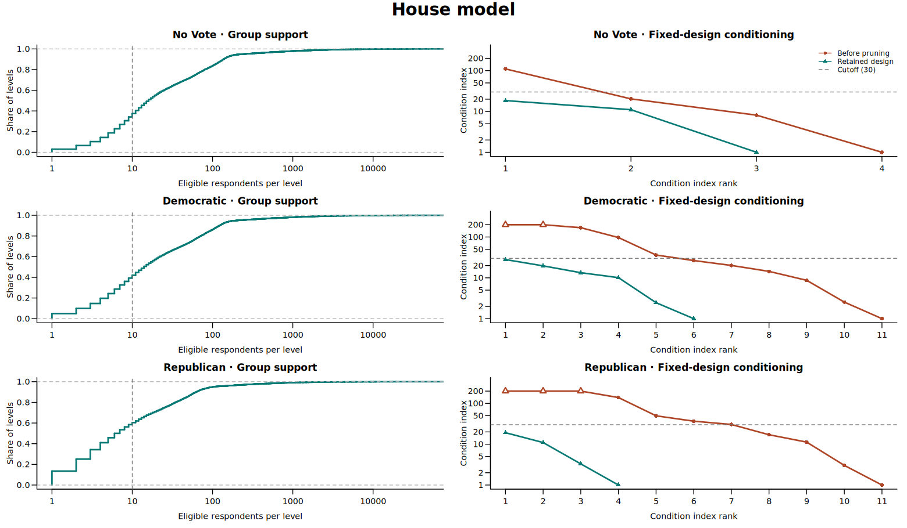
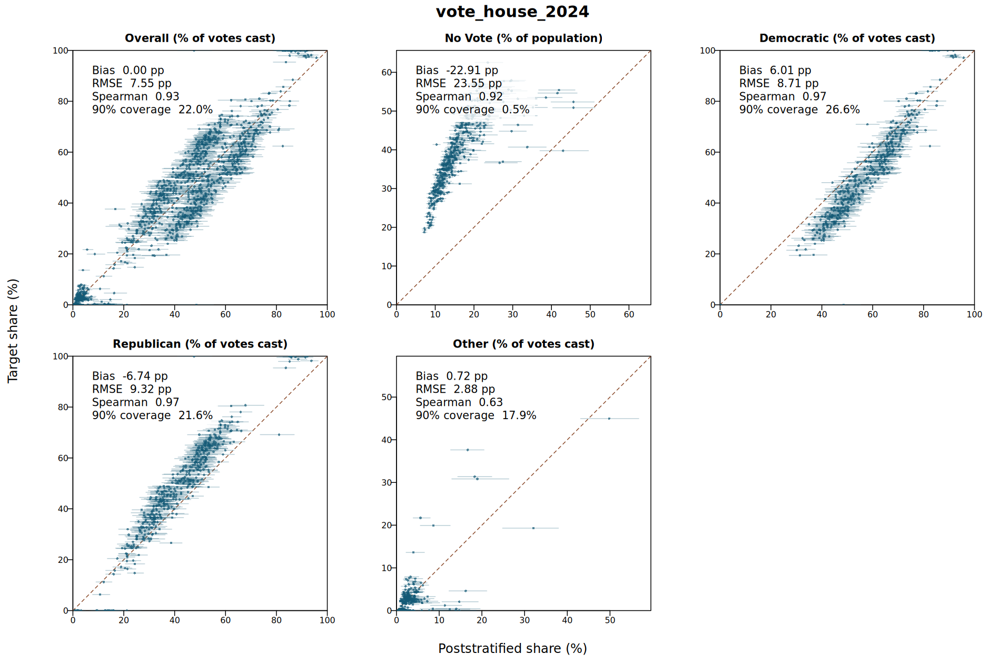
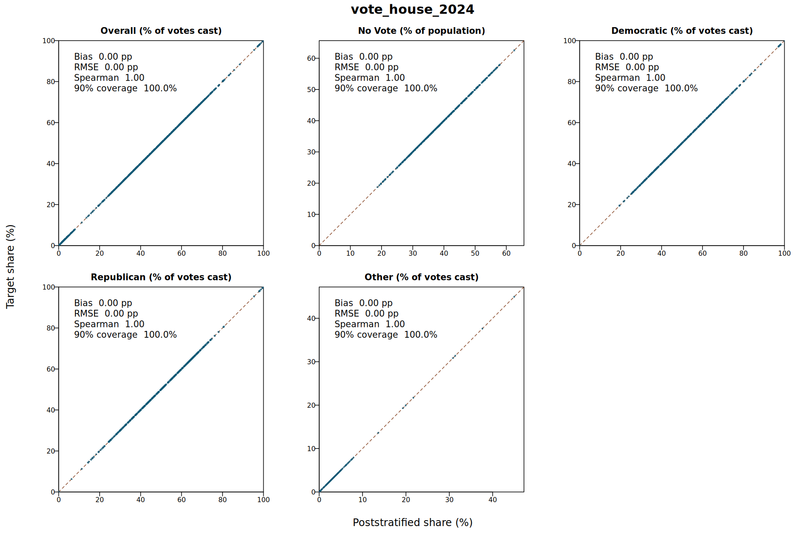

# Extending the US 2026 congressional district frame

This vignette prepares, audits, and fits two models. The goal is a
population frame for predicting the 2026 House vote. We first
estimate 2024 presidential vote in each demographic cell, then estimate
2024 House vote conditional on that presidential choice. Presidential vote
may help explain House voting among people with the same demographics.
Whether it improves predictions is an empirical question. The joint frame
carries both historical outcomes forward for a later 2026 model.

| Frame | Rows |
| --- | ---: |
| Original PUMS demographic cells | 497,550 |
| After adding the four presidential choices | 1,990,200 |
| After adding the four House choices within each presidential choice | 7,960,800 |

*Table 1. Expected frame size at each step. Each extension creates one row
per choice for each incoming cell. Raking adjusts counts, so rows with
zero calibrated counts are still included.*

All three inputs use the 2026 district map (CD120), including DC. The
[US input guide](../data/input/us%202026/README.md) records the upstream
commit, checksums, and the rules for observed and modeled House returns.
Run the chunks from the repository root with `vglmer` 1.0.8, `gKRLS`, and
`SQUAREM` installed. VoteFrame screens fixed columns and random-effect levels before
calling `vglmer`.

## 1. Read the survey, district data, and population frame

The CES auxiliary survey records both 2024 choices. The ACS PUMS mother
frame supplies citizen-adult population weights. The district-by-choice CSV
supplies area-level predictors and calibration targets. Its presidential
shares repeat within each state and choice, while House shares belong to
individual districts. Some House shares on the 2026 map come from upstream
modeled scenarios. Agreement with these benchmarks is a calibration check.


``` r
# Load VoteFrame from this checkout so the audit uses the same functions as the fit.
for (file in list.files("R", pattern = "[.]R$", full.names = TRUE)) source(file)

country <- file.path("data", "input", "us 2026")
fips <- c("state_fips", "district_fips")
demographics <- c("age_cat", "gender_cat", "race_cat", "hispanic_cat", "educ_cat")
pres <- "vote_pres_2024"
house <- "vote_house_2024"
parent_area <- Sys.getenv("VOTEFRAME_PARENT_AREA", "state_fips")
areas_per_batch <- vignette_areas_per_batch()
# The files use choices as their category order. The model uses vote_order
# to define its three regressions. The final choice receives the remainder.
choices <- c("Democratic", "Republican", "Other", "No Vote")
vote_order <- c("No Vote", "Democratic", "Republican", "Other")

# The survey supplies observed choices. The population frame supplies cell
# sizes. Read FIPS IDs as text to preserve their leading zeros in joins.
survey <- readRDS(file.path(country, "ces_2024_harmonized.rds"))
frame <- readRDS(file.path(country, "pums_cd_cells.rds"))
election <- read.csv(file.path(country, "district_election_inputs_cd120.csv"),
                     colClasses = setNames(rep("character", length(fips)), fips),
                     na.strings = "")

# VoteFrame uses one area ID. A district number alone can repeat across states.
district_id <- function(data) {
  id <- paste(data$state_fips, data$district_fips, sep = "-")
  # Preserve missing geography so the survey complete-case check can catch it.
  id[!complete.cases(data[fips])] <- NA_character_
  id
}
survey$district_id <- district_id(survey)
frame$district_id <- district_id(frame)
election$district_id <- district_id(election)

predictors <- c("state_fips", "district_id", demographics)
# Keep the demographic keys and population count N for each cell. State FIPS
# also lets us partition prediction and match statewide totals later.
frame <- frame[order(frame$state_fips), c(predictors, "N")]

# Check that the inputs use the same map and outcome labels. Require one
# election row per district and choice, including the DC district.
stopifnot(
  nrow(election) == 1744L, length(unique(election$district_id)) == 436L,
  !anyNA(election$district_id), !anyDuplicated(election[c("district_id", "vote_choice")]),
  all(grepl("^[0-9]{2}-[0-9]{2}$", election$district_id)),
  setequal(election$vote_choice, choices), "11-98" %in% election$district_id,
  setequal(frame$district_id, election$district_id),
  all(survey$district_id[!is.na(survey$district_id)] %in% election$district_id),
  all(vapply(survey[c(pres, house)], function(x) identical(levels(x), choices), logical(1))),
  all(is.na(election$incumbent[election$vote_choice == "No Vote"]))
)
```


| District × choice records| Population cells| Survey respondents| Citizen adults represented|
|-------------------------:|----------------:|------------------:|--------------------------:|
|                     1,744|          497,550|             58,627|                240,960,972|

*Table 2. Input sizes before screening. A population cell is one district
and demographic combination. The citizen-adult total sums the population
counts across those cells.*

## 2. Specify stage predictors and election benchmarks

Each entry in a fit's area-covariate list corresponds to a choice. Each
entry is a matrix or data frame with district IDs as row names and
predictors as columns. Splitting the CSV by choice directly produces these
tables. In both fits, each party stage uses that choice's district House
share and statewide presidential share, the district's categorical
House lineup, the choice's incumbency, and its ballot indicator. Preserve
both shares on their original citizen-adult scale. Both fits start with
No Vote, using the district House and statewide presidential nonvoting
shares and the lineup. Democratic and Republican follow among voters.
Other receives the remaining probability. Covariates that are blank in
every district for a stage are omitted from that stage. For No Vote,
this applies to incumbency and ballot presence.

Include `on_ballot` in the party-stage candidate designs so the support,
collinearity, and hierarchy rules decide whether its main effect and
interactions enter each fitted stage.


``` r
# Each stage looks up district predictors for the outcome it models.
# District IDs become row names so the survey joins can use them as keys.
choice_rows <- split(election, election$vote_choice)
area_covariates <- lapply(choice_rows, function(rows) {
  covariates <- data.frame(house_share = rows[[house]], pres_share = rows[[pres]],
                           lineup = factor(rows$lineup),
                           incumbent = rows$incumbent, on_ballot = rows$on_ballot,
                           row.names = rows$district_id)
  # No Vote has no candidate, so its incumbency and ballot fields are blank.
  # Omit fields blank across an entire stage.
  covariates[!vapply(covariates, function(x) all(is.na(x)), logical(1))]
})

# Statewide presidential shares repeat on every district row in a state.
# Collapse those copies to one share per state and choice for later raking.
pres_targets <- unique(data.frame(state_fips = election$state_fips,
                                 vote_pres_2024 = election$vote_choice,
                                 target = election[[pres]]))
# House shares are district-specific. Keep one share per district and choice.
house_targets <- data.frame(district_id = election$district_id,
                            vote_house_2024 = election$vote_choice,
                            target = election[[house]])
rake_targets <- setNames(list(pres_targets, house_targets), c(pres, house))
rake_by <- setNames(list("state_fips", "district_id"), c(pres, house))

# Start later comparison plots with the same benchmarks as raking. The
# separate list lets a plot use another comparison table without changing the rake.
plot_targets <- setNames(list(
  list(data = pres_targets, by = "state_fips"),
  list(data = house_targets, by = "district_id")
), c(pres, house))

# Check one presidential share per state and choice. All four shares must
# be between zero and one and sum to one within each state or district.
stopifnot(
  nrow(pres_targets) == 51L * length(choices),
  !anyDuplicated(pres_targets[c("state_fips", pres)]),
  all(is.finite(pres_targets$target) & pres_targets$target >= 0 & pres_targets$target <= 1),
  all(is.finite(house_targets$target) & house_targets$target >= 0 & house_targets$target <= 1),
  all(abs(rowsum(pres_targets$target, pres_targets$state_fips) - 1) < 0.00000001),
  all(abs(rowsum(house_targets$target, house_targets$district_id) - 1) < 0.00000001)
)
```

Each benchmark is a **vote share for one choice in one geography**. For
example, California's Democratic presidential share is one benchmark, and
its presidential No Vote share is another. There are four shares per
geography, including No Vote, because the denominator is the full
citizen-adult population. These are the shares a later calibration run
would match.


|Election          |Geography               | Geographies| Choices per geography| Benchmark shares|
|:-----------------|:-----------------------|-----------:|---------------------:|----------------:|
|2024 presidential |States and DC           |          51|                     4|              204|
|2024 House        |Congressional districts |         436|                     4|            1,744|

*Table 3. Benchmark shares available for later calibration. Each count is
the number of geographies multiplied by the four choices, including
No Vote.*

## 3. Build the survey designs

Both models start at requested depth 2, with interactions and splines.
The presidential model uses state, district, five demographics, and the
area predictors above. The House model adds each CES respondent's
presidential choice. Each model uses its own complete survey cases.
Identical predictor rows are grouped into binomial successes and failures.
At each stage, respondents who chose an earlier outcome leave the risk set.
The counts below refer to eligible respondents at that stage.


``` r
# Try two-way interactions. Count support in respondents, not aggregated cells.
requested_depth <- 2L
minimum_support <- 10L
# Draw count for the later prediction run. The pre-fit audit draws nothing.
n_draws <- 125L
# The House model additionally conditions on each respondent’s presidential choice.
model_specs <- list(
  Presidential = list(outcome = pres, predictors = predictors),
  House = list(outcome = house, predictors = c(predictors, pres))
)

prepare_model <- function(spec) {
  # Combine identical predictor rows and count respondents by vote choice.
  # The audit reports incomplete cases separately for each model below.
  aggregated <- suppressWarnings(aggregate_extension_survey(
    survey, spec$outcome, spec$predictors, "No Vote", outcome_order = vote_order
  ))
  # Other receives the probability left over from the three fitted stages.
  stages <- head(vote_order, -1L)
  setNames(lapply(seq_along(stages), function(i) {
    # At this stage, the current choice is a success. Current and later
    # choices form the trial count because earlier choices already exited.
    success <- aggregated$counts[, i]
    trials <- rowSums(aggregated$counts[, i:length(vote_order), drop = FALSE])
    eligible <- trials > 0
    # Join only eligible cells to the district covariates for this choice.
    stage <- join_stage_covariates(aggregated$cells[eligible, , drop = FALSE],
                                  "district_id", area_covariates[[stages[i]]])
    # Use the same design selector as fitting. It screens the candidate and
    # checks the retained coefficient budget without running the solver.
    selected <- select_sequential_stage_design(
      stage, "district_id", requested_depth, splines = TRUE,
      area_predictors = setdiff(names(stage), spec$predictors),
      observations = sum(trials), trials = trials[eligible],
      minimum_support = minimum_support, successes = success[eligible]
    )
    selected$excluded_respondents <- aggregated$omitted
    selected
  }), stages)
}
preflight <- lapply(model_specs, prepare_model)
```

## 4. Screen support, conditioning, and hierarchy

1. **Build the requested design.** Set aside predictors with only one
   observed value in the stage. A one-level factor has no contrast to
   construct, and a constant numeric predictor supplies no main-effect
   variation beyond the intercept. Build all eligible interactions at
   the requested depth. The starting counts below describe this design.
2. **Screen support.** Fixed columns need at least 10 respondents with
   nonzero entries. A random group level needs at least 10 respondents
   for the whole intercept-and-slopes vector to enter the likelihood.
   A varying slope also needs, on average, at least 10 informative
   respondents per retained group. Within a group, this counts respondents
   whose slope value differs from its most common value.
3. **Screen the fixed design for collinearity.** Weight each row by the
   square root of its trial count and scale each column to unit length.
   The condition indices are `largest singular value / each singular
   value`. Start with the full supported fixed design and prune until its
   maximum is below 30. At each step find the weakest singular direction.
   Among the columns involved, consider the highest-order interactions
   first and keep the intercept. Choose the deletion that yields the
   lowest condition number after enforcing hierarchy. Belsley, Kuh,
   and Welsch use 30 as an inspection flag in
   linear regression, alongside variance-decomposition proportions.
   VoteFrame uses it as an automatic cutoff for its pre-fit logistic
   design. The plots below show condition indices. [SAS guide to the
   Belsley diagnostic](https://support.sas.com/documentation/cdl/en/sgug/59902/HTML/default/fit_sect29.htm)
4. **Enforce hierarchy and check grouping redundancy.** Drop descendants
   whenever a main effect or interaction is removed. Drop a crossed
   random intercept if it gives the same grouping of survey rows as one
   of its parents. For example, district by state duplicates district
   because each district belongs to one state. The general slope rule
   handles numeric predictors that are constant within district.
   Fit a grouped spline deviation only where the
   corresponding linear random block survives. Survey rows from screened
   groups still inform the overall curve and other retained effects.
5. **Check depth after screening.** Compare the estimated retained
   coefficients with eligible respondents. Reduce depth only if the
   screened candidate still exceeds that budget.


## 5. Account for every removed coefficient

The presidential model excluded 1,024
incomplete survey records. The House model excluded
3,214.
The counts below are estimates of **model coefficients**, one per fixed
effect column, random intercept or slope column, and spline basis column.
They exclude variance and covariance parameters. The solver may use a
smaller kernel spline basis after its rank checks.


|Model        |Stage      | Respondents| Survey cells| Depth| Candidate coefficients| Dropped coefficients| Spline coefficients added back†| Coefficients to fit|
|:------------|:----------|-----------:|------------:|-----:|----------------------:|--------------------:|-------------------------------:|-------------------:|
|Presidential |No Vote    |      57,603|       42,019|     2|                 41,860|               28,371|                               0|              13,489|
|Presidential |Democratic |      52,767|       39,007|     2|                 43,535|               30,258|                               0|              13,277|
|Presidential |Republican |      23,922|       19,496|     2|                 42,537|               33,087|                               0|               9,450|
|House        |No Vote    |      55,413|       46,863|     2|                 44,164|               29,221|                               0|              14,943|
|House        |Democratic |      48,330|       40,477|     2|                 45,571|               31,385|                               0|              14,186|
|House        |Republican |      21,552|       18,045|     2|                 43,896|               33,905|                               0|               9,991|

*Table 4. One row per model and stage. The coefficients to fit equal the
candidate columns minus the dropped columns plus any spline columns added
back. Survey cells counts distinct eligible predictor rows after
aggregation. Respondents counts the people represented by those rows.*

† *Spline coefficients added back.* After all fixed and random terms have
been screened for a candidate depth, VoteFrame checks which eligible
overall curves are still supplied by a grouped spline. If no retained
grouped spline supplies an eligible overall curve, it fits that curve on
its own. This check runs once per candidate depth, after pruning. No
spline columns were added back in this audit.

The biggest cut came from dropping district-specific curves for vote
shares. Everyone in a district is assigned the same district vote share,
so the survey offers no way to estimate how that district's curve changes
as the share changes. We can still estimate an overall curve by comparing
districts. The same logic rules out a separate slope for presidential
vote share within each state.

The next biggest cut came from groups with fewer than 10 respondents.
For example, a district and age category can each have plenty of survey
respondents, while the particular district–age pair has too few to
estimate its own effect. The table counts the coefficients we dropped
for each reason. One dropped curve can account for many coefficients.


|Model        |Stage      | Fixed support| Random level support| Within-group slope support| Fixed collinearity| Redundant group intercepts| Linear hierarchy| Whole smooths| Spline level support|
|:------------|:----------|-------------:|--------------------:|--------------------------:|------------------:|--------------------------:|----------------:|-------------:|--------------------:|
|Presidential |No Vote    |             0|                5,237|                        923|                  1|                        872|                0|        21,338|                    0|
|Presidential |Democratic |             0|                5,737|                      1,801|                  5|                        872|                0|        21,843|                    0|
|Presidential |Republican |             0|                8,519|                      1,852|                  6|                        872|                0|        21,838|                    0|
|House        |No Vote    |             0|                6,077|                        923|                  1|                        872|                0|        21,348|                    0|
|House        |Democratic |             0|                6,844|                      1,801|                  5|                        872|                0|        21,863|                    0|
|House        |Republican |             0|                9,375|                      1,323|                  7|                        848|              514|        21,838|                    0|

*Table 5. Why coefficients were dropped.* Each row identifies the **model**
(presidential or House) and the **stage** (the choice being modeled).
The other columns count coefficients dropped for the reasons below.
Their sum matches the dropped-coefficient count in Table 4.

- **Fixed support.** Fewer than 10 respondents had a nonzero entry in
  that fixed-effect column.
- **Random level support.** A group, such as a district–age pair, had
  fewer than 10 respondents. Its random intercept and any slopes were
  left out of the fit together.
- **Within-group slope support.** A varying slope averaged fewer than
  10 informative respondents per retained group, so the slope was
  dropped across all groups. A respondent counts as informative if
  their slope value differs from the group's most common value.
- **Fixed collinearity.** A fixed coefficient was removed to bring the
  maximum condition index below 30.
- **Redundant group intercepts.** A crossed grouping repeated one of
  its parent groupings. For example, district × state makes the same
  groups as district alone.
- **Linear hierarchy.** An interaction was dropped because a main
  effect or lower-order interaction it depended on was removed.
- **Whole smooths.** Estimated spline coefficients dropped when the
  entire curve term was removed.
- **Spline level support.** Estimated spline coefficients left out for
  a particular group whose linear random effects were screened. The
  curve still has fitted deviations for the groups that qualified.


|Model        |Stage      |Redundant crossed groups                   |Fixed interactions removed by hierarchy |Sparse slopes (mean respondents)                                                                                                                                                            |Whole smooths removed                                                                                                                                                                                                                                                                                                                   |
|:------------|:----------|:------------------------------------------|:---------------------------------------|:-------------------------------------------------------------------------------------------------------------------------------------------------------------------------------------------|:---------------------------------------------------------------------------------------------------------------------------------------------------------------------------------------------------------------------------------------------------------------------------------------------------------------------------------------|
|Presidential |No Vote    |district_id:state_fips, district_id:lineup |—                                       |pres_share:state_fips (0), district_id:house_share (0), district_id:pres_share (0)                                                                                                          |v_s(pres_share, by = state_fips), v_s(house_share, by = district_id), v_s(pres_share, by = district_id), v_s(house_share, pres_share, type = "gKRLS")                                                                                                                                                                                   |
|Presidential |Democratic |district_id:state_fips, district_id:lineup |—                                       |pres_share:state_fips (0), district_id:house_share (0), district_id:pres_share (0), district_id:incumbent (0), district_id:on_ballot (0), lineup:on_ballot (0)                              |v_s(pres_share, by = state_fips), v_s(house_share, by = district_id), v_s(pres_share, by = district_id), v_s(house_share, pres_share, type = "gKRLS"), v_s(house_share, on_ballot, type = "gKRLS"), v_s(pres_share, incumbent, type = "gKRLS"), v_s(pres_share, on_ballot, type = "gKRLS")                                              |
|Presidential |Republican |district_id:state_fips, district_id:lineup |—                                       |pres_share:state_fips (0), on_ballot:state_fips (8.47), district_id:house_share (0), district_id:pres_share (0), district_id:incumbent (0), district_id:on_ballot (0), lineup:on_ballot (0) |v_s(pres_share, by = state_fips), v_s(house_share, by = district_id), v_s(pres_share, by = district_id), v_s(house_share, pres_share, type = "gKRLS"), v_s(house_share, incumbent, type = "gKRLS"), v_s(house_share, on_ballot, type = "gKRLS"), v_s(pres_share, incumbent, type = "gKRLS"), v_s(pres_share, on_ballot, type = "gKRLS") |
|House        |No Vote    |district_id:state_fips, district_id:lineup |—                                       |pres_share:state_fips (0), district_id:house_share (0), district_id:pres_share (0)                                                                                                          |v_s(pres_share, by = state_fips), v_s(house_share, by = district_id), v_s(pres_share, by = district_id), v_s(house_share, pres_share, type = "gKRLS")                                                                                                                                                                                   |
|House        |Democratic |district_id:state_fips, district_id:lineup |—                                       |pres_share:state_fips (0), district_id:house_share (0), district_id:pres_share (0), district_id:incumbent (0), district_id:on_ballot (0), lineup:on_ballot (0)                              |v_s(pres_share, by = state_fips), v_s(house_share, by = district_id), v_s(pres_share, by = district_id), v_s(house_share, pres_share, type = "gKRLS"), v_s(house_share, on_ballot, type = "gKRLS"), v_s(pres_share, incumbent, type = "gKRLS"), v_s(pres_share, on_ballot, type = "gKRLS")                                              |
|House        |Republican |district_id:state_fips, district_id:lineup |—                                       |pres_share:state_fips (0), district_id:house_share (0), district_id:pres_share (0), district_id:incumbent (0)                                                                               |v_s(pres_share, by = state_fips), v_s(house_share, by = district_id), v_s(pres_share, by = district_id), v_s(house_share, pres_share, type = "gKRLS"), v_s(house_share, incumbent, type = "gKRLS"), v_s(house_share, on_ballot, type = "gKRLS"), v_s(pres_share, incumbent, type = "gKRLS"), v_s(pres_share, on_ballot, type = "gKRLS") |

*Table 6. Names of the affected terms. One term can account for many
coefficient columns in Table 5. For a sparse slope, the parenthesized
number is its mean number of informative respondents per retained group.*

## 6. Inspect support and conditioning before fitting

The tables report the condition indices before and after pruning and show
which coefficients are involved. The figures below show how far pruning
moves each stage away from the cutoff of 30.


|Model        |Stage      |Before pruning         |After pruning |Fixed columns before → after |Fixed columns rejected                                                                                                                           |
|:------------|:----------|:----------------------|:-------------|:----------------------------|:------------------------------------------------------------------------------------------------------------------------------------------------|
|Presidential |No Vote    |110.40                 |18.46         |4 → 3                        |house_share:pres_share                                                                                                                           |
|Presidential |Democratic |140,868,925,592,265    |26.92         |11 → 6                       |incumbent:on_ballot, house_share:on_ballot, pres_share:on_ballot, house_share:pres_share, pres_share:incumbent                                   |
|Presidential |Republican |1,144,378,722,009,732  |24.64         |11 → 5                       |house_share:on_ballot, incumbent:on_ballot, pres_share:on_ballot, house_share:pres_share, pres_share:incumbent, house_share:incumbent            |
|House        |No Vote    |110.14                 |18.47         |4 → 3                        |house_share:pres_share                                                                                                                           |
|House        |Democratic |17,815,865,119,032,030 |28.03         |11 → 6                       |incumbent:on_ballot, house_share:on_ballot, pres_share:on_ballot, house_share:pres_share, pres_share:incumbent                                   |
|House        |Republican |893,841,368,873,835    |19.13         |11 → 4                       |incumbent:on_ballot, house_share:on_ballot, pres_share:on_ballot, house_share:pres_share, pres_share:incumbent, house_share:incumbent, on_ballot |

*Table 7. Maximum condition index for each stage’s weighted fixed design
before and after backward pruning. The column counts describe that fixed
design alone. Random effects and spline bases are outside this check.*

Each row in Table 8 describes a weak direction in the weighted, scaled
fixed design before pruning. The singular value decomposition gives a
singular value for each direction. The condition index is the largest
singular value divided by the singular value for that direction. A
larger index means a weaker direction.


|Model        |Stage      |Condition index        |Affected coefficients and their individual variance shares                                                     |
|:------------|:----------|:----------------------|:--------------------------------------------------------------------------------------------------------------|
|Presidential |No Vote    |110.40                 |(Intercept) (98%), house_share (94%), pres_share (93%), house_share:pres_share (99%)                           |
|Presidential |Democratic |36.07                  |house_share:incumbent (42%), pres_share:incumbent (49%)                                                        |
|Presidential |Democratic |94.18                  |(Intercept) (21%), pres_share (22%), house_share:pres_share (73%), pres_share:incumbent (38%)                  |
|Presidential |Democratic |155.25                 |(Intercept) (60%), pres_share (63%), on_ballot (87%), house_share:pres_share (26%), pres_share:on_ballot (89%) |
|Presidential |Democratic |20,453,431             |(Intercept) (15%), house_share (100%), pres_share (11%), house_share:on_ballot (100%)                          |
|Presidential |Democratic |140,868,925,592,265    |incumbent (100%), incumbent:on_ballot (100%)                                                                   |
|Presidential |Republican |33.78                  |house_share:incumbent (89%)                                                                                    |
|Presidential |Republican |47.43                  |pres_share:incumbent (50%)                                                                                     |
|Presidential |Republican |132.54                 |(Intercept) (15%), pres_share (16%), house_share:pres_share (83%), pres_share:incumbent (43%)                  |
|Presidential |Republican |239.09                 |(Intercept) (81%), pres_share (82%), on_ballot (95%), house_share:pres_share (16%), pres_share:on_ballot (98%) |
|Presidential |Republican |387,072,888,929,741    |incumbent (100%), incumbent:on_ballot (100%)                                                                   |
|Presidential |Republican |1,144,378,722,009,732  |house_share (100%), house_share:on_ballot (100%)                                                               |
|House        |No Vote    |110.14                 |(Intercept) (98%), house_share (94%), pres_share (93%), house_share:pres_share (99%)                           |
|House        |Democratic |36.19                  |house_share:incumbent (42%), pres_share:incumbent (49%)                                                        |
|House        |Democratic |97.05                  |(Intercept) (16%), pres_share (17%), house_share:pres_share (80%), pres_share:incumbent (40%)                  |
|House        |Democratic |169.10                 |(Intercept) (68%), pres_share (71%), on_ballot (87%), house_share:pres_share (19%), pres_share:on_ballot (89%) |
|House        |Democratic |25,243,827             |(Intercept) (13%), house_share (100%), house_share:on_ballot (100%)                                            |
|House        |Democratic |17,815,865,119,032,030 |incumbent (100%), incumbent:on_ballot (100%)                                                                   |
|House        |Republican |30.41                  |house_share:incumbent (30%)                                                                                    |
|House        |Republican |36.62                  |house_share:incumbent (62%)                                                                                    |
|House        |Republican |49.63                  |pres_share:incumbent (50%)                                                                                     |
|House        |Republican |139.03                 |house_share:pres_share (92%), pres_share:incumbent (46%)                                                       |
|House        |Republican |303.19                 |(Intercept) (89%), pres_share (91%), on_ballot (95%), pres_share:on_ballot (97%)                               |
|House        |Republican |558,850,570,096,225    |house_share (100%), house_share:on_ballot (100%)                                                               |
|House        |Republican |893,841,368,873,835    |incumbent (100%), incumbent:on_ballot (100%)                                                                   |

*Table 8. Share of each coefficient's estimation variance accounted for
by a weak direction. In the first row (Presidential, No Vote), the
weakest direction has a condition index of 110.40. It accounts for 94%
of the House-share coefficient's estimation variance and 99% of the
interaction coefficient's estimation variance. Each percentage is a
share of that coefficient's own variance. The design is held fixed
while outcome noise varies in a hypothetical linear regression. The
table shows directions with a condition index of at least 30. The
**table display cutoff** is **10% of a coefficient's estimation
variance**. A dash means no coefficient reached 10%. The **pruning
candidate cutoff** is **1% of the largest absolute entry** in the
right singular vector for the weakest direction. The intercept is
always kept.*

Let $X$ be the supported fixed design with each row weighted by the
square root of its trial count and each column scaled to unit length.
For Table 8, $X$ is the design before pruning. At each pruning step, $X$
contains the columns still retained after enforcing hierarchy. The
program computes $X=U\cdot\mathrm{diag}(s_1,\ldots,s_p)\cdot V^\top$, with the singular
values ordered largest to smallest.

**The loading of design column $j$ on direction $k$ is $V_{jk}$.**
This is the entry in row $j$ and column $k$ of $V$. For pruning, the
program uses the last column of $V$, which describes the weakest
direction. A non-intercept column $j$ enters the candidate set when

$$
|V_{jp}| \;\ge\; 0.01\cdot\max_i |V_{ip}|.
$$

The rule asks, “Is this column’s absolute loading at least 1/100 as
large as the biggest absolute loading in this direction?”
Using the largest loading as the reference lets the cutoff adapt to how
concentrated or spread out the loadings are in that direction.

The intercept participates in this calculation and is always kept. If
the cutoff yields an empty candidate set, all remaining non-intercept
columns enter the candidate set.

The **110.40** in the first row comes from $s_1/s_p$. To calculate
the **94%**, pick the House-share coefficient. For each singular
direction, square the House-share loading and multiply it by that
direction's squared condition index. The product is that direction's
contribution to the House-share coefficient's estimation variance, on
a common scale. The squared condition index measures how much the
direction amplifies noise variance, and the squared loading measures
how strongly that amplified noise carries into the House-share
estimate. Add those contributions across all directions, then divide
the weakest direction's contribution by that total.

In general, with condition index $\kappa_k=s_1/s_k$, the share of
coefficient $j$'s estimation variance attributable to direction $k$ is

$$
\frac{V_{jk}^2\cdot\kappa_k^2}{\sum_\ell \left(V_{j\ell}^2\cdot\kappa_\ell^2\right)}.
$$

The code uses $V_{jk}^2/s_k^2$ for each contribution. Since
$\kappa_k^2=s_1^2/s_k^2$, the common factor $s_1^2$ cancels in the ratio.

### How to read the figures

Start with the top-right panel of Figure 1, for presidential No Vote.
We want to know whether the survey can tell the intercept, the two vote
shares, and their interaction apart. A high condition index means there
is a way to change several coefficients together while barely changing
the predictions. That makes it hard to tell how much of the prediction
belongs to each coefficient.

The orange dots list those indices before pruning. The largest goes at
position 1, the second-largest at position 2, and so on. The first orange
dot is **110.40**, well above the dashed line at 30. After dropping the
interaction between the two vote shares, we calculate a fresh list and
sort it again. The first green dot is **18.46**. Since even the largest
green value is below 30, all the other green values are below 30 too.
The horizontal positions are places in a sorted list. They do not track
a particular predictor or show the order in which we removed terms.


*Figure 1. Pre-fit checks for the presidential model.* Each row shows one vote choice being modeled. **Left.** Pick a respondent count on the horizontal axis. The curve tells you what fraction of the groups has that many respondents or fewer. A group might be a district or a district–age pair. Groups with fewer than 10 respondents are screened. **Right.** Orange shows the indices before pruning, and green shows them after pruning. Each color puts its largest value first. Read the first green dot in each row to check that the retained design clears the cutoff. Open triangles mark values above 200. Table 8 gives those values in full. The largest green value in each row ranges from 18.46 to 26.92.




*Figure 2. Pre-fit checks for the house model.* Each row shows one vote choice being modeled. **Left.** Pick a respondent count on the horizontal axis. The curve tells you what fraction of the groups has that many respondents or fewer. A group might be a district or a district–age pair. Groups with fewer than 10 respondents are screened. **Right.** Orange shows the indices before pruning, and green shows them after pruning. Each color puts its largest value first. Read the first green dot in each row to check that the retained design clears the cutoff. Open triangles mark values above 200. Table 8 gives those values in full. The largest green value in each row ranges from 18.47 to 28.03.

## 7. Run the national models

The national run uses 125 posterior draws. Set
`VOTEFRAME_US_FIT=true` to include the model results and predictions.
To reuse fitted models from the same inputs and settings, set
`VOTEFRAME_US_REUSE_FITS=true` and point `VOTEFRAME_US_OUTPUT_DIR` to the
directory containing `pres_fit.rds` and `house_fit.rds`.


## 8. Fit and extend with 2024 presidential vote

### Scaling to more posterior draws

The number of frame rows is independent of the draw count. Each additional
draw adds a count column and another calibration solve per state. At 125
draws, the final joint frame has 995,100,000 draw-specific counts. Stored as
eight-byte numbers, those counts alone take about 8 GB uncompressed,
before cell keys, the mean column, intermediate arrays, or temporary copies.
CSV exports also take disk space and time to write and read. Here,
manageable means keeping peak RAM and scratch storage within the machine's
limits and fitting the prediction, raking, and export into the time
available for the run.

The vignette already partitions both predictions and raking by state
and keeps intermediate predictions in memory only for the current state.
To scale further, run both predictions and the joint rake in small batches
of draws within each state. Keep draw IDs paired across the two extensions
and reuse the same sampled coefficients across all applicable states for a
given draw. Accumulate the unraked joint mean across batches and rake it
once if you want the same mean-column definition used here. Store completed
partitions in a compressed format if the analysis needs the full draws.
For the diagnostic plots, keep only the state presidential and district
House totals per draw and calculate intervals from those totals.


``` r
out <- Sys.getenv("VOTEFRAME_US_OUTPUT_DIR",
                  unset = file.path("data", "output", basename(country)))
dir.create(out, recursive = TRUE, showWarnings = FALSE)
requested_depth <- 2L
max_iterations <- 100L
minimum_support <- 10L
depth_support_dir <- file.path(out, "depth_support")
stage_columns <- c("outcome", "observations", "fitted_depth", "estimated_parameters",
                   "dropped_fixed", "dropped_scalar_random", "dropped_correlated_random",
                   "dropped_smooth", "estimated_retained_parameters", "fixed_condition_after",
                   "iterations_used", "max_parameter_change")
control <- vglmer::vglmer_control(quiet = FALSE, quiet_rho = FALSE, print_prog = 1L)
# Stream diagnostics to the console while knitr also records them in the vignette.
fit_us_model <- function(...) {
  if (!isTRUE(getOption("knitr.in.progress"))) return(fit_sequential_logit(...))
  withCallingHandlers(
    fit_sequential_logit(...),
    message = function(m) cat(conditionMessage(m), file = stderr()),
    warning = function(w) cat("Warning: ", conditionMessage(w), "\n", sep = "", file = stderr())
  )
}
load_or_fit_us_model <- function(filename, extension, ...) {
  if (!identical(Sys.getenv("VOTEFRAME_US_REUSE_FITS"), "true")) {
    return(fit_us_model(...))
  }
  loadNamespace("gKRLS")
  fit <- readRDS(file.path(out, filename))
  stopifnot(inherits(fit, "voteframe_sequential_logit"),
            identical(fit$extension_variable, extension),
            identical(fit$outcome_order, vote_order),
            identical(names(fit$stages), head(vote_order, -1L)))
  fit
}
set.seed(2026)

pres_fit <- load_or_fit_us_model(
  "pres_fit.rds", pres,
  survey, pres, "district_id", area_covariates, no_vote = "No Vote", outcome_order = vote_order,
  predictors = predictors, depth = requested_depth, splines = TRUE, control = control,
  tolerance_parameters = 0.01, tolerance_elbo = 0, max_iterations = max_iterations,
  minimum_support = minimum_support, depth_support_dir = depth_support_dir,
  interaction_support_log = file.path(out, "presidential_interaction_support.csv"),
  log_file = file.path(out, "presidential_fit_log.csv")
)
knitr::kable(pres_fit$fit_log[stage_columns])
```


|outcome    | observations| fitted_depth| estimated_parameters| dropped_fixed| dropped_scalar_random| dropped_correlated_random| dropped_smooth| estimated_retained_parameters| fixed_condition_after| iterations_used| max_parameter_change|
|:----------|------------:|------------:|--------------------:|-------------:|---------------------:|-------------------------:|--------------:|-----------------------------:|---------------------:|---------------:|--------------------:|
|No Vote    |        57603|            2|                41860|             0|                  6109|                       923|          21338|                         13489|              18.46013|              27|            0.0069440|
|Democratic |        52767|            2|                43534|             0|                  6609|                      1801|          21843|                         13277|              26.91919|              47|            0.0069129|
|Republican |        23922|            2|                42535|             0|                  9391|                      1852|          21838|                          9450|              24.63738|              80|            0.0046068|

``` r
knitr::include_graphics(list.files(depth_support_dir, "^vote_pres_2024-stage-.*[.]png$",
                                  full.names = TRUE))
```

``` r
for (stage in names(pres_fit$stages)) {
  cat(stage, "\n")
  cat(trimws(deparse(pres_fit$stages[[stage]]$formula), which = "right"), sep = "\n")
  cat("\n")
}
```

```
## No Vote
## cbind(.success, .failure) ~ 1 + house_share + pres_share + (1 +
##     house_share + pres_share | district_id) + (1 + house_share +
##     pres_share | state_fips) + (1 + house_share + pres_share |
##     age_cat) + (1 + house_share + pres_share | gender_cat) +
##     (1 + house_share + pres_share | race_cat) + (1 + house_share +
##     pres_share | hispanic_cat) + (1 + house_share + pres_share |
##     educ_cat) + (1 + house_share + pres_share | lineup) + (1 |
##     .group_1_2) + (1 | .group_1_3) + (1 | .group_1_4) + (1 |
##     .group_1_5) + (1 | .group_1_6) + (1 | .group_1_7) + (1 |
##     .group_1_8) + (1 | .group_2_3) + (1 | .group_2_4) + (1 |
##     .group_2_5) + (1 | .group_2_6) + (1 | .group_2_7) + (1 |
##     .group_2_8) + (1 | .group_3_4) + (1 | .group_3_5) + (1 |
##     .group_3_6) + (1 | .group_3_7) + (1 | .group_3_8) + (1 |
##     .group_4_5) + (1 | .group_4_6) + (1 | .group_4_7) + (1 |
##     .group_4_8) + (1 | .group_5_6) + (1 | .group_5_7) + (1 |
##     .group_5_8) + (1 | .group_6_7) + (1 | .group_6_8) + (1 |
##     .group_7_8) + v_s(house_share, by = district_id) + v_s(pres_share,
##     by = district_id) + v_s(house_share, by = state_fips) + v_s(pres_share,
##     by = state_fips) + v_s(house_share, by = age_cat) + v_s(pres_share,
##     by = age_cat) + v_s(house_share, by = gender_cat) + v_s(pres_share,
##     by = gender_cat) + v_s(house_share, by = race_cat) + v_s(pres_share,
##     by = race_cat) + v_s(house_share, by = hispanic_cat) + v_s(pres_share,
##     by = hispanic_cat) + v_s(house_share, by = educ_cat) + v_s(pres_share,
##     by = educ_cat) + v_s(house_share, by = lineup) + v_s(pres_share,
##     by = lineup) + v_s(house_share, pres_share, type = "gKRLS")
##
## Democratic
## cbind(.success, .failure) ~ 1 + house_share + pres_share + incumbent +
##     on_ballot + house_share:incumbent + (1 + house_share + pres_share +
##     incumbent + on_ballot | district_id) + (1 + house_share +
##     pres_share + incumbent + on_ballot | state_fips) + (1 + house_share +
##     pres_share + incumbent + on_ballot | age_cat) + (1 + house_share +
##     pres_share + incumbent + on_ballot | gender_cat) + (1 + house_share +
##     pres_share + incumbent + on_ballot | race_cat) + (1 + house_share +
##     pres_share + incumbent + on_ballot | hispanic_cat) + (1 +
##     house_share + pres_share + incumbent + on_ballot | educ_cat) +
##     (1 + house_share + pres_share + incumbent + on_ballot | lineup) +
##     (1 | .group_1_2) + (1 | .group_1_3) + (1 | .group_1_4) +
##     (1 | .group_1_5) + (1 | .group_1_6) + (1 | .group_1_7) +
##     (1 | .group_1_8) + (1 | .group_2_3) + (1 | .group_2_4) +
##     (1 | .group_2_5) + (1 | .group_2_6) + (1 | .group_2_7) +
##     (1 | .group_2_8) + (1 | .group_3_4) + (1 | .group_3_5) +
##     (1 | .group_3_6) + (1 | .group_3_7) + (1 | .group_3_8) +
##     (1 | .group_4_5) + (1 | .group_4_6) + (1 | .group_4_7) +
##     (1 | .group_4_8) + (1 | .group_5_6) + (1 | .group_5_7) +
##     (1 | .group_5_8) + (1 | .group_6_7) + (1 | .group_6_8) +
##     (1 | .group_7_8) + v_s(house_share, by = district_id) + v_s(pres_share,
##     by = district_id) + v_s(house_share, by = state_fips) + v_s(pres_share,
##     by = state_fips) + v_s(house_share, by = age_cat) + v_s(pres_share,
##     by = age_cat) + v_s(house_share, by = gender_cat) + v_s(pres_share,
##     by = gender_cat) + v_s(house_share, by = race_cat) + v_s(pres_share,
##     by = race_cat) + v_s(house_share, by = hispanic_cat) + v_s(pres_share,
##     by = hispanic_cat) + v_s(house_share, by = educ_cat) + v_s(pres_share,
##     by = educ_cat) + v_s(house_share, by = lineup) + v_s(pres_share,
##     by = lineup) + v_s(house_share, pres_share, type = "gKRLS") +
##     v_s(house_share, incumbent, type = "gKRLS") + v_s(house_share,
##     on_ballot, type = "gKRLS") + v_s(pres_share, incumbent, type = "gKRLS") +
##     v_s(pres_share, on_ballot, type = "gKRLS")
##
## Republican
## cbind(.success, .failure) ~ 1 + house_share + pres_share + incumbent +
##     on_ballot + (1 + house_share + pres_share + incumbent + on_ballot |
##     district_id) + (1 + house_share + pres_share + incumbent +
##     on_ballot | state_fips) + (1 + house_share + pres_share +
##     incumbent + on_ballot | age_cat) + (1 + house_share + pres_share +
##     incumbent + on_ballot | gender_cat) + (1 + house_share +
##     pres_share + incumbent + on_ballot | race_cat) + (1 + house_share +
##     pres_share + incumbent + on_ballot | hispanic_cat) + (1 +
##     house_share + pres_share + incumbent + on_ballot | educ_cat) +
##     (1 + house_share + pres_share + incumbent + on_ballot | lineup) +
##     (1 | .group_1_2) + (1 | .group_1_3) + (1 | .group_1_4) +
##     (1 | .group_1_5) + (1 | .group_1_6) + (1 | .group_1_7) +
##     (1 | .group_1_8) + (1 | .group_2_3) + (1 | .group_2_4) +
##     (1 | .group_2_5) + (1 | .group_2_6) + (1 | .group_2_7) +
##     (1 | .group_2_8) + (1 | .group_3_4) + (1 | .group_3_5) +
##     (1 | .group_3_6) + (1 | .group_3_7) + (1 | .group_3_8) +
##     (1 | .group_4_5) + (1 | .group_4_6) + (1 | .group_4_7) +
##     (1 | .group_4_8) + (1 | .group_5_6) + (1 | .group_5_7) +
##     (1 | .group_5_8) + (1 | .group_6_7) + (1 | .group_6_8) +
##     (1 | .group_7_8) + v_s(house_share, by = district_id) + v_s(pres_share,
##     by = district_id) + v_s(house_share, by = state_fips) + v_s(pres_share,
##     by = state_fips) + v_s(house_share, by = age_cat) + v_s(pres_share,
##     by = age_cat) + v_s(house_share, by = gender_cat) + v_s(pres_share,
##     by = gender_cat) + v_s(house_share, by = race_cat) + v_s(pres_share,
##     by = race_cat) + v_s(house_share, by = hispanic_cat) + v_s(pres_share,
##     by = hispanic_cat) + v_s(house_share, by = educ_cat) + v_s(pres_share,
##     by = educ_cat) + v_s(house_share, by = lineup) + v_s(pres_share,
##     by = lineup) + v_s(house_share, pres_share, type = "gKRLS") +
##     v_s(house_share, incumbent, type = "gKRLS") + v_s(house_share,
##     on_ballot, type = "gKRLS") + v_s(pres_share, incumbent, type = "gKRLS") +
##     v_s(pres_share, on_ballot, type = "gKRLS")
```

The three presidential stages met the maximum parameter-change tolerance
of 0.01 in the saved national fit.


``` r
pres_draw_state <- new.env(parent = emptyenv())
predict_presidential_state <- function(original) {
  prediction <- predict_sequential_logit(
    pres_fit, frame = original, n_draws = n_draws, write_files = FALSE,
    draw_state = pres_draw_state, batch_size = 4000L
  )
  aggregate_extended_frame(original, prediction, by = names(prediction$cells))
}
```

## 9. Fit and extend with 2024 House vote

The House model adds the reported presidential choice to the CES predictors.
In the population frame it uses the presidential categories created in the
first extension. Each conditional House probability multiplies the expected
population in its presidential category in the same draw. This produces
16 joint vote combinations per original cell. Fit on the national CES and
predict both outcomes one state at a time to limit memory use. Each model
reuses the national coefficient draws in every prediction batch. For
interaction levels found only in the population frame, prediction draws
from the fitted variance distribution and reuses the sampled effect
whenever that level appears again.


``` r
set.seed(2027)
house_fit <- load_or_fit_us_model(
  "house_fit.rds", house,
  survey, house, "district_id", area_covariates, no_vote = "No Vote", outcome_order = vote_order,
  predictors = c(predictors, pres), depth = requested_depth, splines = TRUE, control = control,
  tolerance_parameters = 0.01, tolerance_elbo = 0, max_iterations = max_iterations,
  minimum_support = minimum_support, depth_support_dir = depth_support_dir,
  interaction_support_log = file.path(out, "house_interaction_support.csv"),
  log_file = file.path(out, "house_fit_log.csv")
)
knitr::kable(house_fit$fit_log[stage_columns])
```


|outcome    | observations| fitted_depth| estimated_parameters| dropped_fixed| dropped_scalar_random| dropped_correlated_random| dropped_smooth| estimated_retained_parameters| fixed_condition_after| iterations_used| max_parameter_change|
|:----------|------------:|------------:|--------------------:|-------------:|---------------------:|-------------------------:|--------------:|-----------------------------:|---------------------:|---------------:|--------------------:|
|No Vote    |        55413|            2|                44164|             0|                  6949|                       923|          21348|                         14943|              18.46600|             100|            0.4310780|
|Democratic |        48330|            2|                45570|             0|                  7716|                      1801|          21863|                         14186|              28.02934|             100|            0.3070906|
|Republican |        21552|            2|                43894|             0|                 10163|                      1897|          21838|                          9991|              19.13335|              95|            0.0074460|

``` r
knitr::include_graphics(list.files(depth_support_dir, "^vote_house_2024-stage-.*[.]png$",
                                  full.names = TRUE))
```

``` r
for (stage in names(house_fit$stages)) {
  cat(stage, "\n")
  cat(trimws(deparse(house_fit$stages[[stage]]$formula), which = "right"), sep = "\n")
  cat("\n")
}
```

```
## No Vote
## cbind(.success, .failure) ~ 1 + house_share + pres_share + (1 +
##     house_share + pres_share | district_id) + (1 + house_share +
##     pres_share | state_fips) + (1 + house_share + pres_share |
##     age_cat) + (1 + house_share + pres_share | gender_cat) +
##     (1 + house_share + pres_share | race_cat) + (1 + house_share +
##     pres_share | hispanic_cat) + (1 + house_share + pres_share |
##     educ_cat) + (1 + house_share + pres_share | vote_pres_2024) +
##     (1 + house_share + pres_share | lineup) + (1 | .group_1_2) +
##     (1 | .group_1_3) + (1 | .group_1_4) + (1 | .group_1_5) +
##     (1 | .group_1_6) + (1 | .group_1_7) + (1 | .group_1_8) +
##     (1 | .group_1_9) + (1 | .group_2_3) + (1 | .group_2_4) +
##     (1 | .group_2_5) + (1 | .group_2_6) + (1 | .group_2_7) +
##     (1 | .group_2_8) + (1 | .group_2_9) + (1 | .group_3_4) +
##     (1 | .group_3_5) + (1 | .group_3_6) + (1 | .group_3_7) +
##     (1 | .group_3_8) + (1 | .group_3_9) + (1 | .group_4_5) +
##     (1 | .group_4_6) + (1 | .group_4_7) + (1 | .group_4_8) +
##     (1 | .group_4_9) + (1 | .group_5_6) + (1 | .group_5_7) +
##     (1 | .group_5_8) + (1 | .group_5_9) + (1 | .group_6_7) +
##     (1 | .group_6_8) + (1 | .group_6_9) + (1 | .group_7_8) +
##     (1 | .group_7_9) + (1 | .group_8_9) + v_s(house_share, by = district_id) +
##     v_s(pres_share, by = district_id) + v_s(house_share, by = state_fips) +
##     v_s(pres_share, by = state_fips) + v_s(house_share, by = age_cat) +
##     v_s(pres_share, by = age_cat) + v_s(house_share, by = gender_cat) +
##     v_s(pres_share, by = gender_cat) + v_s(house_share, by = race_cat) +
##     v_s(pres_share, by = race_cat) + v_s(house_share, by = hispanic_cat) +
##     v_s(pres_share, by = hispanic_cat) + v_s(house_share, by = educ_cat) +
##     v_s(pres_share, by = educ_cat) + v_s(house_share, by = vote_pres_2024) +
##     v_s(pres_share, by = vote_pres_2024) + v_s(house_share, by = lineup) +
##     v_s(pres_share, by = lineup) + v_s(house_share, pres_share,
##     type = "gKRLS")
##
## Democratic
## cbind(.success, .failure) ~ 1 + house_share + pres_share + incumbent +
##     on_ballot + house_share:incumbent + (1 + house_share + pres_share +
##     incumbent + on_ballot | district_id) + (1 + house_share +
##     pres_share + incumbent + on_ballot | state_fips) + (1 + house_share +
##     pres_share + incumbent + on_ballot | age_cat) + (1 + house_share +
##     pres_share + incumbent + on_ballot | gender_cat) + (1 + house_share +
##     pres_share + incumbent + on_ballot | race_cat) + (1 + house_share +
##     pres_share + incumbent + on_ballot | hispanic_cat) + (1 +
##     house_share + pres_share + incumbent + on_ballot | educ_cat) +
##     (1 + house_share + pres_share + incumbent + on_ballot | vote_pres_2024) +
##     (1 + house_share + pres_share + incumbent + on_ballot | lineup) +
##     (1 | .group_1_2) + (1 | .group_1_3) + (1 | .group_1_4) +
##     (1 | .group_1_5) + (1 | .group_1_6) + (1 | .group_1_7) +
##     (1 | .group_1_8) + (1 | .group_1_9) + (1 | .group_2_3) +
##     (1 | .group_2_4) + (1 | .group_2_5) + (1 | .group_2_6) +
##     (1 | .group_2_7) + (1 | .group_2_8) + (1 | .group_2_9) +
##     (1 | .group_3_4) + (1 | .group_3_5) + (1 | .group_3_6) +
##     (1 | .group_3_7) + (1 | .group_3_8) + (1 | .group_3_9) +
##     (1 | .group_4_5) + (1 | .group_4_6) + (1 | .group_4_7) +
##     (1 | .group_4_8) + (1 | .group_4_9) + (1 | .group_5_6) +
##     (1 | .group_5_7) + (1 | .group_5_8) + (1 | .group_5_9) +
##     (1 | .group_6_7) + (1 | .group_6_8) + (1 | .group_6_9) +
##     (1 | .group_7_8) + (1 | .group_7_9) + (1 | .group_8_9) +
##     v_s(house_share, by = district_id) + v_s(pres_share, by = district_id) +
##     v_s(house_share, by = state_fips) + v_s(pres_share, by = state_fips) +
##     v_s(house_share, by = age_cat) + v_s(pres_share, by = age_cat) +
##     v_s(house_share, by = gender_cat) + v_s(pres_share, by = gender_cat) +
##     v_s(house_share, by = race_cat) + v_s(pres_share, by = race_cat) +
##     v_s(house_share, by = hispanic_cat) + v_s(pres_share, by = hispanic_cat) +
##     v_s(house_share, by = educ_cat) + v_s(pres_share, by = educ_cat) +
##     v_s(house_share, by = vote_pres_2024) + v_s(pres_share, by = vote_pres_2024) +
##     v_s(house_share, by = lineup) + v_s(pres_share, by = lineup) +
##     v_s(house_share, pres_share, type = "gKRLS") + v_s(house_share,
##     incumbent, type = "gKRLS") + v_s(house_share, on_ballot,
##     type = "gKRLS") + v_s(pres_share, incumbent, type = "gKRLS") +
##     v_s(pres_share, on_ballot, type = "gKRLS")
##
## Republican
## cbind(.success, .failure) ~ 1 + house_share + pres_share + incumbent +
##     (1 + house_share + pres_share + incumbent + on_ballot | district_id) +
##     (1 + house_share + pres_share + incumbent + on_ballot | state_fips) +
##     (1 + house_share + pres_share + incumbent + on_ballot | age_cat) +
##     (1 + house_share + pres_share + incumbent + on_ballot | gender_cat) +
##     (1 + house_share + pres_share + incumbent + on_ballot | race_cat) +
##     (1 + house_share + pres_share + incumbent + on_ballot | hispanic_cat) +
##     (1 + house_share + pres_share + incumbent + on_ballot | educ_cat) +
##     (1 + house_share + pres_share + incumbent + on_ballot | vote_pres_2024) +
##     (1 + house_share + pres_share + incumbent + on_ballot | lineup) +
##     (1 | .group_1_2) + (1 | .group_1_3) + (1 | .group_1_4) +
##     (1 | .group_1_5) + (1 | .group_1_6) + (1 | .group_1_7) +
##     (1 | .group_1_8) + (1 | .group_1_9) + (1 | .group_2_3) +
##     (1 | .group_2_4) + (1 | .group_2_5) + (1 | .group_2_6) +
##     (1 | .group_2_7) + (1 | .group_2_8) + (1 | .group_2_9) +
##     (1 | .group_3_4) + (1 | .group_3_5) + (1 | .group_3_6) +
##     (1 | .group_3_7) + (1 | .group_3_8) + (1 | .group_3_9) +
##     (1 | .group_4_5) + (1 | .group_4_6) + (1 | .group_4_7) +
##     (1 | .group_4_8) + (1 | .group_4_9) + (1 | .group_5_6) +
##     (1 | .group_5_7) + (1 | .group_5_8) + (1 | .group_5_9) +
##     (1 | .group_6_7) + (1 | .group_6_8) + (1 | .group_6_9) +
##     (1 | .group_7_8) + (1 | .group_7_9) + (1 | .group_8_9) +
##     v_s(house_share, by = district_id) + v_s(pres_share, by = district_id) +
##     v_s(house_share, by = state_fips) + v_s(pres_share, by = state_fips) +
##     v_s(house_share, by = age_cat) + v_s(pres_share, by = age_cat) +
##     v_s(house_share, by = gender_cat) + v_s(pres_share, by = gender_cat) +
##     v_s(house_share, by = race_cat) + v_s(pres_share, by = race_cat) +
##     v_s(house_share, by = hispanic_cat) + v_s(pres_share, by = hispanic_cat) +
##     v_s(house_share, by = educ_cat) + v_s(pres_share, by = educ_cat) +
##     v_s(house_share, by = vote_pres_2024) + v_s(pres_share, by = vote_pres_2024) +
##     v_s(house_share, by = lineup) + v_s(pres_share, by = lineup) +
##     v_s(house_share, pres_share, type = "gKRLS") + v_s(house_share,
##     incumbent, type = "gKRLS") + v_s(house_share, on_ballot,
##     type = "gKRLS") + v_s(pres_share, incumbent, type = "gKRLS") +
##     v_s(pres_share, on_ballot, type = "gKRLS")
```

In the saved national House fit, No Vote and Democratic reached the
100-iteration cap with maximum parameter changes of 0.43108 and 0.30709.
Republican met the 0.01 tolerance after 95 iterations.

### Coefficients by predictor combination

Each row counts the fixed, random, and spline coefficients attributed to a
single predictor or interaction. A categorical combination contributes one
random intercept per observed combination of levels. A categorical predictor
interacted with a numeric predictor contributes a slope per observed level
plus any spline-basis coefficients. Fixed columns are counted after
screening, so the listed totals can be smaller than the nominal
coefficient counts used to select depth. Zero means the combination
contributes no coefficients in that stage.


|Combination                   | Pres. No Vote| Pres. Democratic| Pres. Republican| House No Vote| House Democratic| House Republican|
|:-----------------------------|-------------:|----------------:|----------------:|-------------:|----------------:|----------------:|
|district_id × house_share     |        15,731|           15,731|           15,731|        15,731|           15,731|           15,731|
|district_id × age_cat         |         6,025|            6,016|            5,587|         6,017|            5,991|            5,282|
|district_id × pres_share      |         5,680|            5,680|            5,680|         5,680|            5,680|            5,680|
|district_id × educ_cat        |         2,595|            2,583|            2,496|         2,587|            2,550|            2,385|
|state_fips × house_share      |         1,871|            1,871|            1,871|         1,871|            1,871|            1,871|
|district_id × race_cat        |         1,944|            1,914|            1,650|         1,929|            1,880|            1,551|
|district_id × gender_cat      |           872|              872|              872|           872|              872|              868|
|district_id × hispanic_cat    |           870|              870|              850|           870|              870|              835|
|district_id × vote_pres_2024  |             0|                0|                0|         1,735|            1,510|            1,322|
|state_fips × age_cat          |           712|              712|              701|           711|              711|              697|
|state_fips × pres_share       |           675|              675|              675|           675|              675|              675|
|age_cat × house_share         |           539|              539|              539|           539|              539|              539|
|district_id                   |           436|              436|              436|           436|              436|              436|
|district_id × lineup          |           436|              436|              436|           436|              436|              436|
|district_id × state_fips      |           436|              436|              436|           436|              436|              436|
|state_fips × educ_cat         |           306|              306|              306|           306|              305|              300|
|district_id × incumbent       |             0|              436|              436|             0|              436|              436|
|district_id × on_ballot       |             0|              436|              436|             0|              436|              436|
|educ_cat × house_share        |           251|              251|              251|           251|              251|              251|
|house_share × lineup          |           251|              251|              251|           251|              251|              251|
|state_fips × race_cat         |           250|              250|              239|           250|              250|              235|
|race_cat × house_share        |           215|              215|              215|           215|              215|              215|
|age_cat × pres_share          |           194|              194|              194|           194|              194|              194|
|house_share × pres_share      |           175|              170|              135|           185|              175|              135|
|gender_cat × house_share      |           107|              107|              107|           107|              107|              107|
|hispanic_cat × house_share    |           107|              107|              107|           107|              107|              107|
|house_share × incumbent       |             0|              171|              135|             0|              176|              135|
|house_share × on_ballot       |             0|              170|              135|             0|              175|              135|
|pres_share × incumbent        |             0|              170|              135|             0|              175|              135|
|pres_share × on_ballot        |             0|              170|              135|             0|              175|              135|
|state_fips × gender_cat       |           102|              102|              102|           102|              102|              102|
|state_fips × hispanic_cat     |           102|              102|              101|           102|              102|              101|
|state_fips × vote_pres_2024   |             0|                0|                0|           204|              200|              195|
|state_fips × lineup           |            93|               93|               93|            93|               93|               93|
|educ_cat × pres_share         |            90|               90|               90|            90|               90|               90|
|pres_share × lineup           |            90|               90|               90|            90|               90|               90|
|vote_pres_2024 × house_share  |             0|                0|                0|           179|              179|              179|
|age_cat × educ_cat            |            84|               84|               84|            84|               84|               84|
|age_cat × lineup              |            84|               84|               84|            84|               84|               83|
|race_cat × pres_share         |            77|               77|               77|            77|               77|               77|
|age_cat × race_cat            |            70|               70|               70|            70|               70|               70|
|state_fips                    |            51|               51|               51|            51|               51|               51|
|gender_cat × pres_share       |            38|               38|               38|            38|               38|               38|
|hispanic_cat × pres_share     |            38|               38|               38|            38|               38|               38|
|educ_cat × lineup             |            36|               36|               36|            36|               36|               35|
|state_fips × incumbent        |             0|               51|               51|             0|               51|               51|
|state_fips × on_ballot        |             0|               51|               51|             0|               51|               51|
|vote_pres_2024 × pres_share   |             0|                0|                0|            64|               64|               64|
|race_cat × educ_cat           |            30|               30|               30|            30|               30|               30|
|race_cat × lineup             |            30|               30|               30|            30|               30|               28|
|age_cat × gender_cat          |            28|               28|               28|            28|               28|               28|
|age_cat × hispanic_cat        |            28|               28|               28|            28|               28|               28|
|age_cat × vote_pres_2024      |             0|                0|                0|            56|               56|               56|
|age_cat                       |            14|               14|               14|            14|               14|               14|
|educ_cat × vote_pres_2024     |             0|                0|                0|            24|               24|               24|
|gender_cat × educ_cat         |            12|               12|               12|            12|               12|               12|
|gender_cat × lineup           |            12|               12|               12|            12|               12|               12|
|hispanic_cat × educ_cat       |            12|               12|               12|            12|               12|               12|
|hispanic_cat × lineup         |            12|               12|               12|            12|               12|               12|
|vote_pres_2024 × lineup       |             0|                0|                0|            24|               24|               23|
|gender_cat × race_cat         |            10|               10|               10|            10|               10|               10|
|race_cat × hispanic_cat       |            10|               10|               10|            10|               10|               10|
|race_cat × vote_pres_2024     |             0|                0|                0|            20|               20|               20|
|age_cat × incumbent           |             0|               14|               14|             0|               14|               14|
|age_cat × on_ballot           |             0|               14|               14|             0|               14|               14|
|educ_cat                      |             6|                6|                6|             6|                6|                6|
|lineup                        |             6|                6|                6|             6|                6|                6|
|race_cat                      |             5|                5|                5|             5|                5|                5|
|educ_cat × incumbent          |             0|                6|                6|             0|                6|                6|
|educ_cat × on_ballot          |             0|                6|                6|             0|                6|                6|
|gender_cat × hispanic_cat     |             4|                4|                4|             4|                4|                4|
|gender_cat × vote_pres_2024   |             0|                0|                0|             8|                8|                8|
|hispanic_cat × vote_pres_2024 |             0|                0|                0|             8|                8|                8|
|lineup × incumbent            |             0|                6|                6|             0|                6|                6|
|lineup × on_ballot            |             0|                6|                6|             0|                6|                6|
|race_cat × incumbent          |             0|                5|                5|             0|                5|                5|
|race_cat × on_ballot          |             0|                5|                5|             0|                5|                5|
|gender_cat                    |             2|                2|                2|             2|                2|                2|
|hispanic_cat                  |             2|                2|                2|             2|                2|                2|
|vote_pres_2024                |             0|                0|                0|             4|                4|                4|
|gender_cat × incumbent        |             0|                2|                2|             0|                2|                2|
|gender_cat × on_ballot        |             0|                2|                2|             0|                2|                2|
|hispanic_cat × incumbent      |             0|                2|                2|             0|                2|                2|
|hispanic_cat × on_ballot      |             0|                2|                2|             0|                2|                2|
|vote_pres_2024 × incumbent    |             0|                0|                0|             0|                4|                4|
|vote_pres_2024 × on_ballot    |             0|                0|                0|             0|                4|                4|
|(Intercept)                   |             1|                1|                1|             1|                1|                1|
|house_share                   |             1|                1|                1|             1|                1|                1|
|pres_share                    |             1|                1|                1|             1|                1|                1|
|incumbent                     |             0|                1|                1|             0|                1|                1|
|on_ballot                     |             0|                1|                1|             0|                1|                0|
|**Total**                     |        41,859|           43,530|           42,531|        44,163|           45,566|           43,889|


``` r
house_draw_state <- new.env(parent = emptyenv())
predict_house_state <- function(incoming) {
  prediction <- predict_sequential_logit(
    house_fit, frame = incoming, write_files = FALSE,
    draw_state = house_draw_state, batch_size = 4000L
  )
  aggregate_extended_frame(incoming, prediction, by = names(prediction$cells))
}
```

## 10. Predict the joint frame by state

The full run scores the pre-rake predictions, calibrates the state
presidential and district House targets, and saves the joint stratification
frame under `raked_frame/` in the run's output directory. Set
`VOTEFRAME_US_RAKE=false` for a pre-rake benchmark-only run. Prediction
and calibration use state or DC batches by default. Statewide
presidential targets keep every district in a state together, even when
an override requests smaller batches.
The current state's pre-rake frame uses memory or temporary disk
according to available memory. Set `VOTEFRAME_PRE_RAKE_STORAGE=keep`
to save all joint pre-rake partitions.
Set `VOTEFRAME_US_RAKED_DIR` to use a different partition directory
when the fit output directory has limited free space.


``` r
rake_tolerance <- 0.00000001
run_rake <- identical(Sys.getenv("VOTEFRAME_US_RAKE", unset = "true"), "true")
raked_dir <- Sys.getenv("VOTEFRAME_US_RAKED_DIR", unset = file.path(out, "raked_frame"))
if (run_rake) dir.create(raked_dir, showWarnings = FALSE)
states <- geographic_batches(frame, "district_id", parent_area, areas_per_batch, rake_by)
count_columns <- c("N", paste0("N_draw_", seq_len(n_draws)))
state_bytes <- pre_rake_frame_bytes(lengths(states) * length(choices)^2,
                                    n_draws, ncol(frame) + 1L)
pre_rake_mode <- Sys.getenv("VOTEFRAME_PRE_RAKE_STORAGE", "auto")
storage <- vignette_pre_rake_storage(
  out, if (pre_rake_mode == "keep") sum(state_bytes) else max(state_bytes),
  final_directory = if (run_rake) raked_dir else out,
  final_bytes = if (run_rake) sum(state_bytes) else 0
)

# Reduce each block to group-outcome draw totals for the comparison plots.
plot_totals <- function(block, extension) {
  columns <- c(plot_targets[[extension]]$by, extension)
  keys <- block[columns]
  group <- frame_cell_keys(keys, keys)
  cbind(keys[!duplicated(group), , drop = FALSE],
        rowsum(block[count_columns], group, reorder = FALSE))
}

summarize_states <- function() {
  lapply(names(states), function(state) {
    if (isTRUE(getOption("knitr.in.progress"))) {
      cat("Processing partition ", state, "\n", sep = "", file = stderr())
    }
    original <- frame[states[[state]], , drop = FALSE]
    incoming <- predict_presidential_state(original)
    joint <- predict_house_state(incoming)
    stopifnot(nrow(joint) == nrow(original) * length(choices)^2L)
    joint_part <- storage$put(joint, paste0("state_", state))
    if (storage$mode == "temporary") on.exit(unlink(joint_part))
    before <- setNames(lapply(names(plot_targets), function(x) plot_totals(joint, x)),
                       names(plot_targets))
    extended_path <- if (storage$mode == "keep") joint_part
    if (!run_rake) return(list(before = before, extended_path = extended_path))
    rm(joint)
    # Use the same named configuration for the rake in every block.
    targets <- lapply(names(rake_targets), function(outcome) {
      by <- rake_by[[outcome]]
      table <- rake_targets[[outcome]]
      key <- frame_cell_keys(table[by], original[by])
      keep <- key %in% frame_cell_keys(unique(original[by]), original[by])
      table[keep, , drop = FALSE]
    }) |> setNames(names(rake_targets))

    raked <- rake_joint_extended_frame(storage$get(joint_part), original, targets, by = rake_by,
                                       tolerance = rake_tolerance)
    keys <- setdiff(names(original), "N")
    cell <- match(frame_cell_keys(raked[keys], original[keys]),
                  frame_cell_keys(original[keys], original[keys]))
    counts <- rowsum(raked[count_columns], cell)
    error <- max(abs(as.matrix(counts) - original$N))
    stopifnot(error <= rake_tolerance)
    path <- file.path(raked_dir, paste0("state_", state, ".rds"))
    saveRDS(raked, paste0(path, ".tmp"))
    stopifnot(file.rename(paste0(path, ".tmp"), path))

    list(before = before, extended_path = extended_path,
         after = setNames(lapply(names(plot_targets), function(x) plot_totals(raked, x)),
                          names(plot_targets)),
         cell_error = error)
  })
}

set.seed(2028)
summaries <- summarize_states()
if (storage$mode == "keep") {
  paths <- vapply(summaries, function(x) x$extended_path, character(1))
  prune_geographic_partitions(dirname(paths[1L]), paths, "^state_([0-9]+|batch-[0-9]+)[.]rds$")
}
storage$cleanup()
if (run_rake) max(vapply(summaries, function(x) x$cell_error, numeric(1)))
```

```
## [1] 1.455192e-11
```

## 11. Compare predictions with election benchmarks

The panels compare the pre-rake predictions to the selected benchmarks,
with posterior intervals from the draw counts. When raking is enabled they
also show the post-rake comparison. The fit output directory contains a
metrics CSV for each comparison. Presidential
shares are marginalized over House vote. House shares are marginalized over
presidential vote. For party panels, divide both the predictions and targets
by turnout at their own comparison geography. Draw intervals divide each
draw's party count by its own turnout before taking quantiles. Overall pools
those turnout-conditional party comparisons. The No Vote panel keeps the
population denominator. The rake still uses population-share targets.
The default benchmarks also enter model fitting as area predictors, so
agreement with them measures calibration.


``` r
figure_dir <- file.path("vignettes", "assets", "us-2026")
dir.create(figure_dir, recursive = TRUE, showWarnings = FALSE)
fits <- setNames(list(pres_fit, house_fit), c(pres, house))
figures <- character()
for (phase in c("before", if (run_rake) "after")) {
  for (outcome in names(plot_targets)) {
    specification <- plot_targets[[outcome]]
    totals <- do.call(rbind, lapply(summaries, function(x) x[[phase]][[outcome]]))
    figure <- file.path(figure_dir, paste0(outcome, "_", phase, "_rake.png"))
    check <- check_extended_frame(
      totals, specification$data, by = specification$by,
      extension_variable = outcome, outcome_order = fits[[outcome]]$outcome_order,
      no_vote = fits[[outcome]]$no_vote,
      plot_file = figure, coverage_tolerance = if (phase == "after") rake_tolerance else 0
    )
    cat(outcome, phase, "rake\n")
    print(check$metrics)
    utils::write.csv(check$metrics, file.path(out, paste0(outcome, "_", phase, "_rake_metrics.csv")))
    figures <- c(figures, sub("^vignettes/", "", figure))
  }
}
```

```
## vote_pres_2024 before rake
##                  bias_pp   RMSE_pp  spearman coverage_90_pct
## Overall    -1.011683e-15  6.819554 0.8897880       11.764706
## No Vote    -2.555208e+01 25.878180 0.9619005        0.000000
## Democratic  6.390972e+00  7.245576 0.9637104       17.647059
## Republican -8.399158e+00  9.080388 0.9678733        5.882353
## Other       2.008186e+00  2.137081 0.6830769       11.764706
```

```
## vote_house_2024 before rake
##                  bias_pp   RMSE_pp  spearman coverage_90_pct
## Overall    -3.559762e-16  7.549046 0.9340115      22.0183486
## No Vote    -2.291095e+01 23.549801 0.9237887       0.4587156
## Democratic  6.013019e+00  8.710310 0.9661041      26.6055046
## Republican -6.737396e+00  9.317651 0.9658836      21.5596330
## Other       7.243763e-01  2.876831 0.6327862      17.8899083
```

```
## vote_pres_2024 after rake
##                  bias_pp      RMSE_pp spearman coverage_90_pct
## Overall    -1.027228e-15 1.351630e-08        1             100
## No Vote     1.743387e-09 9.799187e-09        1             100
## Democratic  2.196171e-10 1.652576e-08        1             100
## Republican -3.096324e-10 1.657980e-08        1             100
## Other       9.001217e-11 2.832738e-10        1             100
```

```
## vote_house_2024 after rake
##                  bias_pp      RMSE_pp  spearman coverage_90_pct
## Overall    -3.641262e-16 4.855958e-10 0.9999997             100
## No Vote    -7.926541e-11 1.353295e-09 1.0000000             100
## Democratic  3.637376e-11 5.915701e-10 0.9999961             100
## Republican -3.763284e-11 5.954933e-10 0.9999999             100
## Other       1.257984e-12 5.331505e-11 1.0000000             100
```

``` r
knitr::include_graphics(figures, error = FALSE)
```







## 12. Inspect the final frame

Each compressed state RDS includes both outcome columns, `N`, and all
draw-specific counts. The original state and district keys are carried by
`state_fips` and `district_id`. Read the partitions with `readRDS()` to use
the national joint frame in a later analysis. The table shows 100 rows
sampled across the state and DC partitions, with both vote outcomes and
three draw counts.


``` r
if (run_rake) {
  set.seed(2029)
  raked_paths <- file.path(raked_dir, paste0("state_", names(states), ".rds"))
  stopifnot(all(file.exists(raked_paths)))
  partition_sizes <- lengths(states) * length(choices)^2L
  preview_columns <- c(predictors, pres, house, "N",
                       paste0("N_draw_", c(1L, ceiling(n_draws / 2), n_draws)))
  preview <- sample_extended_frame(raked_paths, preview_columns, partition_sizes)
  prune_geographic_partitions(raked_dir, raked_paths, "^state_([0-9]+|batch-[0-9]+)[.]rds$")
  writeLines(normalizePath(raked_dir, mustWork = TRUE), file.path(out, "raked-directory.txt"))
  knitr::kable(preview, digits = 3, row.names = FALSE)
}
```


|state_fips |district_id |age_cat |gender_cat |race_cat        |hispanic_cat |educ_cat     |vote_pres_2024 |vote_house_2024 |       N| N_draw_1| N_draw_63| N_draw_125|
|:----------|:-----------|:-------|:----------|:---------------|:------------|:------------|:--------------|:---------------|-------:|--------:|---------:|----------:|
|06         |06-34       |23-27   |Male       |Other/Multi     |Not Hispanic |Some college |Other          |Democratic      |   6.678|    6.855|     7.262|      6.720|
|17         |17-05       |23-27   |Female     |Native American |Hispanic     |2-year       |No Vote        |Democratic      |   0.124|    0.105|     0.207|      0.142|
|29         |29-05       |38-42   |Male       |Native American |Hispanic     |Some college |No Vote        |No Vote         |  22.933|   25.412|    23.093|     20.544|
|44         |44-01       |43-47   |Female     |White           |Hispanic     |HS grad      |Republican     |Republican      |   4.446|    3.595|     4.408|      5.270|
|12         |12-22       |73-77   |Female     |Black           |Hispanic     |Post-grad    |No Vote        |Republican      |   0.001|    0.002|     0.001|      0.001|
|18         |18-03       |33-37   |Female     |Black           |Not Hispanic |HS grad      |No Vote        |Democratic      |   2.951|    2.699|     2.879|      3.263|
|48         |48-25       |53-57   |Female     |White           |Not Hispanic |4-year       |Democratic     |No Vote         |  23.511|   19.583|    21.192|     19.225|
|48         |48-33       |53-57   |Female     |Asian           |Not Hispanic |Post-grad    |Democratic     |Other           |   0.000|    0.000|     0.000|      0.000|
|18         |18-09       |68-72   |Female     |Other/Multi     |Hispanic     |Some college |No Vote        |Other           |   0.117|    0.144|     0.112|      0.081|
|30         |30-02       |58-62   |Male       |White           |Not Hispanic |2-year       |Republican     |No Vote         |  25.193|   22.587|    27.915|     24.224|
|12         |12-25       |18-22   |Male       |Native American |Hispanic     |No HS        |Other          |Other           |   0.002|    0.003|     0.002|      0.003|
|12         |12-01       |43-47   |Female     |Other/Multi     |Hispanic     |No HS        |Other          |No Vote         |   0.180|    0.159|     0.175|      0.136|
|56         |56-00       |38-42   |Male       |Other/Multi     |Hispanic     |2-year       |Other          |Other           |   1.832|    2.418|     1.518|      1.986|
|36         |36-26       |73-77   |Female     |White           |Not Hispanic |Post-grad    |Democratic     |Republican      |  30.220|   34.873|    31.799|     29.479|
|48         |48-10       |28-32   |Male       |Other/Multi     |Hispanic     |Some college |Republican     |Republican      | 132.205|  133.808|   143.896|    153.854|
|40         |40-01       |58-62   |Male       |Other/Multi     |Not Hispanic |2-year       |Republican     |Republican      |  35.666|   36.030|    37.794|     38.404|
|04         |04-01       |83+     |Female     |Asian           |Not Hispanic |4-year       |No Vote        |Republican      |   0.141|    0.089|     0.103|      0.187|
|46         |46-00       |28-32   |Male       |White           |Not Hispanic |Some college |No Vote        |Republican      |  94.007|  118.208|    65.176|    103.145|
|06         |06-49       |38-42   |Female     |Native American |Hispanic     |4-year       |Other          |Other           |   0.000|    0.000|     0.000|      0.000|
|45         |45-04       |18-22   |Male       |Asian           |Hispanic     |No HS        |Other          |Democratic      |   0.008|    0.005|     0.014|      0.005|
|48         |48-20       |18-22   |Female     |Native American |Hispanic     |2-year       |No Vote        |No Vote         |  26.667|   29.446|    24.441|     26.164|
|12         |12-12       |53-57   |Male       |Black           |Hispanic     |HS grad      |No Vote        |No Vote         |   0.655|    0.630|     0.564|      0.650|
|49         |49-01       |33-37   |Female     |White           |Not Hispanic |Post-grad    |Democratic     |Other           |  81.695|   78.783|   106.267|     70.616|
|06         |06-43       |78-82   |Male       |White           |Hispanic     |Some college |Republican     |Other           |   0.000|    0.000|     0.000|      0.000|
|24         |24-05       |78-82   |Male       |Asian           |Not Hispanic |Some college |Republican     |Republican      |   3.089|    3.432|     2.991|      3.406|
|34         |34-09       |23-27   |Female     |Other/Multi     |Hispanic     |Some college |No Vote        |Republican      |   5.164|    5.920|     7.380|      5.002|
|04         |04-02       |83+     |Female     |White           |Hispanic     |No HS        |Democratic     |Democratic      |  21.944|   26.554|    18.566|     24.067|
|21         |21-05       |18-22   |Male       |Black           |Hispanic     |2-year       |No Vote        |No Vote         |   0.161|    0.151|     0.161|      0.168|
|06         |06-51       |78-82   |Male       |Other/Multi     |Not Hispanic |Post-grad    |Other          |Other           |   0.000|    0.000|     0.000|      0.000|
|08         |08-07       |58-62   |Female     |Native American |Not Hispanic |Some college |Democratic     |Other           |   0.197|    0.192|     0.154|      0.177|
|30         |30-01       |28-32   |Female     |Other/Multi     |Not Hispanic |4-year       |Republican     |Other           |   6.001|    4.793|     7.309|      2.943|
|08         |08-05       |28-32   |Female     |White           |Not Hispanic |HS grad      |Democratic     |Democratic      | 296.194|  275.063|   304.716|    296.783|
|06         |06-05       |28-32   |Male       |Native American |Hispanic     |4-year       |Republican     |Other           |   0.000|    0.000|     0.000|      0.000|
|04         |04-04       |33-37   |Female     |Other/Multi     |Hispanic     |No HS        |Democratic     |Democratic      |  28.793|   29.829|    30.592|     30.467|
|47         |47-08       |33-37   |Female     |Asian           |Not Hispanic |4-year       |Republican     |Democratic      |   2.086|    1.628|     2.477|      1.438|
|25         |25-04       |48-52   |Male       |Other/Multi     |Hispanic     |4-year       |Republican     |Other           |   1.980|    2.030|     1.477|      1.636|
|34         |34-12       |48-52   |Female     |Black           |Hispanic     |4-year       |Democratic     |Other           |   0.096|    0.082|     0.106|      0.085|
|26         |26-09       |28-32   |Female     |White           |Not Hispanic |4-year       |Other          |Republican      |  37.482|   57.871|    31.608|     30.798|
|48         |48-30       |78-82   |Female     |White           |Hispanic     |No HS        |No Vote        |Republican      |   0.182|    0.219|     0.184|      0.129|
|09         |09-03       |83+     |Male       |White           |Hispanic     |No HS        |Democratic     |Republican      |   0.134|    0.171|     0.096|      0.129|
|25         |25-07       |53-57   |Female     |White           |Not Hispanic |Post-grad    |Republican     |No Vote         | 268.130|  239.178|   291.488|    312.142|
|55         |55-07       |43-47   |Male       |White           |Not Hispanic |4-year       |Democratic     |Other           |   1.135|    1.293|     1.143|      1.148|
|20         |20-03       |48-52   |Male       |White           |Hispanic     |2-year       |Republican     |Democratic      |   0.520|    0.417|     0.398|      0.652|
|06         |06-06       |28-32   |Male       |Other/Multi     |Hispanic     |4-year       |Democratic     |Republican      |   0.000|    0.000|     0.000|      0.000|
|26         |26-09       |23-27   |Male       |White           |Hispanic     |Some college |No Vote        |No Vote         |  41.362|   42.856|    40.761|     41.927|
|51         |51-02       |73-77   |Female     |Other/Multi     |Hispanic     |No HS        |Republican     |Other           |   0.163|    0.234|     0.092|      0.221|
|19         |19-03       |43-47   |Male       |Other/Multi     |Hispanic     |2-year       |No Vote        |No Vote         |   7.648|    8.498|     8.102|      7.182|
|18         |18-03       |63-67   |Male       |Other/Multi     |Not Hispanic |HS grad      |Other          |Republican      |   0.379|    0.292|     0.419|      0.291|
|17         |17-15       |38-42   |Female     |Native American |Not Hispanic |Post-grad    |Other          |Democratic      |   0.000|    0.000|     0.000|      0.000|
|06         |06-43       |53-57   |Male       |White           |Not Hispanic |Post-grad    |Democratic     |Other           |   0.000|    0.000|     0.000|      0.000|
|25         |25-02       |58-62   |Male       |Other/Multi     |Hispanic     |4-year       |Other          |No Vote         |   0.051|    0.067|     0.053|      0.017|
|22         |22-04       |23-27   |Female     |Asian           |Not Hispanic |Post-grad    |Democratic     |No Vote         |   1.771|    1.510|     1.582|      1.677|
|23         |23-01       |28-32   |Female     |Other/Multi     |Hispanic     |Some college |Democratic     |Republican      |   0.201|    0.216|     0.229|      0.200|
|06         |06-07       |33-37   |Male       |White           |Hispanic     |2-year       |Republican     |No Vote         |  10.773|    8.113|    14.605|     10.096|
|36         |36-16       |53-57   |Male       |Other/Multi     |Hispanic     |4-year       |No Vote        |Republican      |   3.594|    3.251|     2.389|      3.984|
|12         |12-27       |63-67   |Female     |Other/Multi     |Hispanic     |4-year       |No Vote        |Republican      |  21.561|   25.094|    22.883|     29.786|
|53         |53-03       |18-22   |Male       |Asian           |Hispanic     |2-year       |Democratic     |Republican      |   0.350|    0.376|     0.312|      0.307|
|42         |42-13       |63-67   |Female     |Black           |Not Hispanic |Some college |Republican     |Democratic      |   0.028|    0.037|     0.023|      0.026|
|34         |34-11       |78-82   |Female     |Other/Multi     |Hispanic     |Post-grad    |No Vote        |Other           |   0.001|    0.000|     0.000|      0.000|
|26         |26-08       |68-72   |Female     |Other/Multi     |Not Hispanic |4-year       |Republican     |Republican      |  10.216|   10.450|     8.481|      8.927|
|45         |45-03       |83+     |Female     |White           |Not Hispanic |Post-grad    |No Vote        |No Vote         |  18.610|   19.292|    21.987|     18.442|
|19         |19-02       |38-42   |Male       |Native American |Not Hispanic |No HS        |No Vote        |Other           |   0.003|    0.002|     0.003|      0.002|
|24         |24-04       |73-77   |Male       |White           |Hispanic     |Post-grad    |Democratic     |Republican      |   0.011|    0.013|     0.012|      0.013|
|48         |48-01       |48-52   |Female     |Black           |Not Hispanic |4-year       |Democratic     |Republican      |  11.332|   12.269|    10.024|      9.205|
|48         |48-34       |58-62   |Female     |Native American |Not Hispanic |2-year       |No Vote        |No Vote         |   3.108|    2.759|     2.863|      3.387|
|08         |08-02       |58-62   |Female     |Other/Multi     |Not Hispanic |2-year       |Republican     |Democratic      |   0.967|    1.281|     1.162|      1.129|
|06         |06-08       |73-77   |Male       |White           |Hispanic     |HS grad      |Republican     |Other           |   0.000|    0.000|     0.000|      0.000|
|12         |12-21       |78-82   |Male       |White           |Hispanic     |Post-grad    |Republican     |No Vote         |   0.067|    0.064|     0.099|      0.074|
|12         |12-04       |33-37   |Female     |Other/Multi     |Hispanic     |Post-grad    |No Vote        |Democratic      |   1.478|    1.860|     1.837|      1.520|
|12         |12-25       |48-52   |Female     |Asian           |Hispanic     |Some college |Republican     |No Vote         |   0.221|    0.216|     0.291|      0.228|
|25         |25-09       |68-72   |Female     |Other/Multi     |Not Hispanic |HS grad      |Republican     |Democratic      |   8.471|    8.056|     7.437|     10.196|
|51         |51-02       |48-52   |Female     |Native American |Hispanic     |4-year       |Republican     |No Vote         |   0.325|    0.355|     0.244|      0.255|
|53         |53-08       |43-47   |Male       |Black           |Not Hispanic |Some college |Other          |Republican      |   1.093|    1.232|     1.602|      0.927|
|12         |12-06       |23-27   |Female     |Other/Multi     |Not Hispanic |Post-grad    |No Vote        |Other           |   0.000|    0.000|     0.000|      0.000|
|42         |42-14       |43-47   |Male       |Other/Multi     |Hispanic     |No HS        |Democratic     |No Vote         |   1.355|    1.142|     1.780|      1.468|
|29         |29-05       |83+     |Male       |Other/Multi     |Hispanic     |No HS        |Republican     |No Vote         |   3.930|    4.329|     4.737|      4.795|
|13         |13-14       |58-62   |Male       |Black           |Hispanic     |HS grad      |No Vote        |Democratic      |   0.097|    0.077|     0.092|      0.096|
|17         |17-06       |18-22   |Male       |Black           |Not Hispanic |Some college |No Vote        |Democratic      |  10.869|    7.803|    10.277|     11.492|
|06         |06-47       |73-77   |Female     |Native American |Hispanic     |HS grad      |No Vote        |Republican      |   0.058|    0.051|     0.045|      0.053|
|28         |28-04       |38-42   |Female     |Black           |Not Hispanic |HS grad      |No Vote        |Democratic      |  25.469|   22.807|    26.219|     28.034|
|12         |12-08       |38-42   |Male       |White           |Not Hispanic |Some college |Other          |Democratic      |  12.174|    8.137|    13.476|     15.097|
|01         |01-06       |68-72   |Female     |Other/Multi     |Not Hispanic |4-year       |Other          |Democratic      |   1.941|    2.093|     1.289|      1.578|
|39         |39-15       |33-37   |Female     |White           |Not Hispanic |Some college |Other          |Republican      |   6.869|    5.531|     7.440|      4.995|
|32         |32-03       |63-67   |Female     |White           |Hispanic     |Post-grad    |Democratic     |No Vote         |   0.000|    0.000|     0.000|      0.000|
|06         |06-39       |83+     |Male       |Other/Multi     |Hispanic     |Post-grad    |Republican     |Other           |   0.000|    0.000|     0.000|      0.000|
|25         |25-09       |83+     |Female     |White           |Not Hispanic |Post-grad    |Republican     |Democratic      |  56.581|   51.947|    49.124|     56.967|
|04         |04-03       |38-42   |Female     |Asian           |Not Hispanic |2-year       |Republican     |No Vote         |   0.868|    0.683|     0.730|      0.769|
|06         |06-27       |83+     |Female     |Other/Multi     |Not Hispanic |HS grad      |Other          |Democratic      |   0.496|    0.493|     0.503|      0.461|
|34         |34-11       |23-27   |Male       |Black           |Hispanic     |No HS        |Democratic     |No Vote         |   0.449|    0.428|     0.548|      0.541|
|38         |38-00       |78-82   |Female     |White           |Hispanic     |Some college |No Vote        |Other           |   0.000|    0.001|     0.000|      0.000|
|48         |48-28       |53-57   |Female     |Black           |Not Hispanic |HS grad      |Democratic     |Other           |   0.005|    0.004|     0.006|      0.004|
|37         |37-07       |63-67   |Male       |Black           |Hispanic     |HS grad      |Democratic     |No Vote         |   0.537|    0.559|     0.765|      0.515|
|55         |55-02       |68-72   |Female     |Native American |Not Hispanic |Some college |Republican     |Democratic      |   0.031|    0.034|     0.028|      0.030|
|17         |17-07       |83+     |Female     |Native American |Hispanic     |No HS        |Republican     |Democratic      |   0.141|    0.100|     0.126|      0.154|
|26         |26-02       |23-27   |Female     |Native American |Not Hispanic |Some college |Democratic     |Republican      |   1.090|    1.149|     0.995|      1.138|
|17         |17-11       |23-27   |Female     |Other/Multi     |Not Hispanic |No HS        |Democratic     |Democratic      |   3.928|    4.327|     2.903|      3.664|
|06         |06-15       |53-57   |Female     |Native American |Hispanic     |2-year       |Republican     |Democratic      |   0.314|    0.374|     0.347|      0.458|
|34         |34-07       |43-47   |Female     |Black           |Not Hispanic |Post-grad    |Other          |Republican      |   1.043|    0.857|     0.846|      0.661|
|28         |28-03       |43-47   |Male       |Asian           |Not Hispanic |No HS        |Republican     |Other           |   0.000|    0.000|     0.000|      0.000|
|19         |19-02       |23-27   |Male       |Other/Multi     |Hispanic     |HS grad      |No Vote        |Other           |   0.191|    0.188|     0.197|      0.134|
